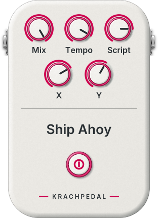
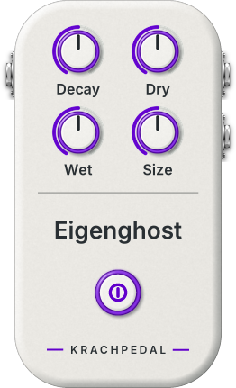
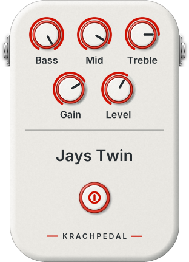
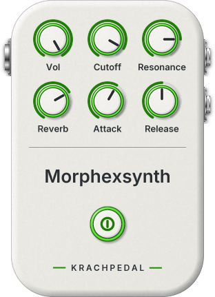
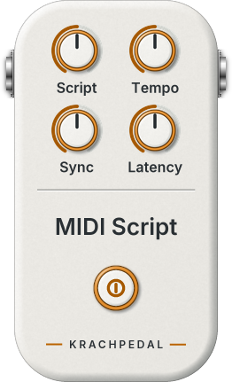

# jaypacks-dwarf-dsp

LV2 audio plugins for the [MOD Dwarf](https://mod.audio/dwarf/), developed on
a Mac: DSP with unit tests, a JSON description per plugin, one LV2 adapter,
builds for the Mac (listening in Reaper) and for the Dwarf (cross-compiled in
docker), and automated tests on the device.

## Goals

- **Organic design for highly creative use.** The plugins are instruments for
  playing, not replicas of gear: sounds that move and breathe (random walks,
  glides, resonances that sing), controls that stay expressive on stage and
  smooth under the foot and the knob, and room for happy accidents. As in
  AbacDsp, the author's DSP library from which this project borrows its
  algorithms, realistic simulation of specific pedals, amps or rooms is not the
  point; the point is to go beyond what a physical device can do, using what
  digital audio makes possible.
- **Working with an LLM.** How this way of working is set up, and why, is
  described in the [AbacDsp](https://github.com/scjurgen/AbacDsp) library, where
  the method lives. Here it is applied: the repository states current facts, a
  roadmap and measured results so that a session can continue the work
  (`docs/genai-development.md`, `docs/working-with-claude-code.md`).
- **Trust through measurement.** Every claim about the sound is checked against
  theory and measured, on the Mac and on the Dwarf itself, so creative freedom
  rests on plugins that behave: no clicks, no NaNs, no xruns.

## Plugins

The pedal faces are shown as mod-ui renders them (half size). Steps and outlook:
`docs/roadmap.md`.

### Ship Ahoy

<a href="docs/plugins/shipahoy.md"></a>

A resonant pole-mixing filter named after Frank Zappa's "Ship Ahoy", steered by a Lua
script. The default script hops the frequency to a random value on every step of a tempo
clock (about 7 per second) and glides there, with strong resonance; others play sequences
or follow what is played into it. Five knobs: Mix, Tempo, Script, and X and Y, whose
meaning each script decides.

Page: `docs/plugins/shipahoy.md`

**Status:** Mac tests pass, device test passes (`tools/jp.py test-device shipahoy`).

<br clear="left">

### Eigenghost

<a href="docs/plugins/eigenghost.md"></a>

A diffused FDN reverb with two pitch-shifting lines, mono in, stereo out.

Page: `docs/plugins/eigenghost.md`, charts: `documentation/Eigenghost/`

**Status:** Mac tests pass, device test passes (`tools/jp.py test-device eigenghost`).

<br clear="left">

### Jays Twin

<a href="docs/plugins/jaystwin.md"></a>

A simple Fender Twin Reverb amp and 2x12 cabinet from biquads, for guitar: the real AB763
tone stack, bright switch, atan drive (the gain goes up to eleven), and a cabinet fitted to
the Jensen C12K datasheet.

Page: `docs/plugins/jaystwin.md`, charts: `documentation/JaysTwin/`

**Status:** Mac tests pass, device test passes (`tools/jp.py test-device jaystwin`).

<br clear="left">

### Morphexsynth

<a href="docs/plugins/morphexsynth.md"></a>

An MPE subtractive synth after AbacDsp's: 12 voices of three wavetable oscillators through
a resonant filter, envelopes, LFO, distortion and a routing matrix for the per-note
controllers, with a phaser, chorus and reverb and ten factory patches.

Page: `docs/plugins/morphexsynth.md`, patches: `docs/plugins/morphexsynth-patches.md`

**Status:** Mac tests pass, device test passes (`tools/jp.py test-device morphexsynth`: level and pitch against the same pedal on the Mac, MIDI from the ALSA sequencer like a USB controller).

<br clear="left">

### MIDI Script

<a href="docs/plugins/midiscript.md"></a>

A MIDI effect whose logic is a Lua script: arpeggiator, chord player, scale quantiser,
octave doubler, CC remap, or your own. Exact-sample clock, no hung notes.

Page: `docs/plugins/midiscript.md`, scripting: `docs/scripting.md`

**Status:** Mac tests pass, device test passes (`tools/jp.py test-device midiscript`: the arpeggio keeps the board's tempo, reload, panic, broken files).

<br clear="left">

### Test plugins

`probe`, `siggen` and `meter` measure inside the device's graph and report through
mod-ui (`docs/test-plugins.md`).

## Performance on the Dwarf

Measured on the device with `tools/jp.py perf` (`docs/device.md`); CPU in percentage points
of mod-ui's DSP load (one period of 128 frames at 48 kHz is 100 %). Details per setting on
each plugin's page. The figures include the host's cost: changing control outputs cost more than
the DSP itself (probe). Memory is what the plugin allocates when it is created (at 48 kHz,
counted on the Mac by its memory probe, `docs/testing.md`): the device cannot show it
(`docs/device.md`, "Performance measurement").

<!-- perf:begin -->
| Plugin | Version | CPU, highest setting | Memory | Binary |
|---|---|---|---|---|
| `eigenghost` | 0.1.1 | 7 % (preset Small room) | 1648 kB | 58 kB |
| `jaystwin` | 0.1.0 | 1 % (defaults) | 0.9 kB | 22 kB |
| `meter` | 0.1.0 | 2 % (defaults) | 3.5 kB | 22 kB |
| `midiscript` | 0.1.0 | 4 % (Arpeggiator, 3 keys held) | 50 kB | 363 kB |
| `morphexsynth` | 0.1.1 | 50 % (12 notes, Section Brass) | 2498 kB | 513 kB |
| `probe` | 0.1.0 | 9 % (idle (no note)) | 0.2 kB | 10 kB |
| `shipahoy` | 0.3.0 | 5 % (preset Slow drift) | 71 kB | 375 kB |
| `siggen` | 0.1.0 | 1 % (defaults) | 0.3 kB | 10 kB |
<!-- perf:end -->

## Quick start

Requirements: CMake 3.21+, Ninja, Apple clang (C++17), Python 3, docker with
the image `dwarf-new` for the Dwarf build (`docker/Dockerfile`, about 15
minutes to build), network access for the first configure (GoogleTest is
fetched; the venv `.venv` with Pillow, numpy and matplotlib is created by
`dev-scripts/dev-venv.sh`, which the scripts below call). Details in
`docs/building.md`.

```
dev-scripts/dev-test.sh           # configure build-tests/, build everything, run all tests
dev-scripts/dev-warnings.sh       # clean rebuild, list warnings
tools/jp.py build-mac --install   # release bundles into ~/Library/Audio/Plug-Ins/LV2
tools/jp.py build-dwarf           # cross-build in docker (image dwarf-new)
tools/jp.py deploy shipahoy       # install on the Dwarf (DWARF_HOST, default 192.168.51.1)
tools/jp.py test-device shipahoy  # device integration test (deploys siggen, meter, shipahoy)
tools/jp.py perf                  # CPU and memory of every plugin on the Dwarf, updates the tables
tools/modui.py status             # read-only: device reachable, pedalboard, jaypacks bundles
dev-scripts/dev-docs-plots.sh     # regenerate the charts in documentation/
```

## The development loop

```
edit dsp/ or plugins/<name>/        unit tests next to the change (tests/unit/)
  -> dev-scripts/dev-test.sh        unit + host tests through the built .so (seconds)
  -> tools/jp.py build-mac --install, listen in Reaper (docs/reaper.md)
  -> tools/jp.py build-dwarf <name> GCC 9.4, binary checks
  -> tools/jp.py test-device <name> deploy and measure on the Dwarf (minutes)
  -> play it
```

## Documentation

| Document | Content |
|---|---|
| `docs/architecture.md` | How JSON, generator, adapter and pedal fit together; naming, versions, builds |
| `docs/building.md` | Prerequisites, Mac and Dwarf builds, deploy |
| `docs/testing.md` | Test layers, generic host tests, thresholds, adding tests |
| `docs/device.md` | The MOD Dwarf: access, mod-ui API and websocket, logs, pedalboards |
| `docs/test-plugins.md` | Measuring on the device: probe, siggen, meter and the measure protocol |
| `docs/caveats-and-limits.md` | Pitfalls: compiler, floating point, real time, mod-ui |
| `docs/plugin-json.md` | The plugin description format and how to add a plugin |
| `docs/plugins/` | One page per plugin: how it works, techniques, performance on the Dwarf |
| `docs/reaper.md` | Listening and testing in REAPER on the Mac |
| `docs/genai-development.md` | How the project is developed with an LLM |
| `docs/working-with-claude-code.md` | How an LLM session continues the work |
| `docs/outlook-lua.md` | Lua scripting on the Dwarf: options, measurements, the decided design |
| `docs/scripting.md`, `docs/scripting-plugins.md` | The scripting core (sandbox, commands, host, reload, logs, the user's loop) and the checklist for adding it to a plugin |
| `docs/roadmap.md`, `docs/references.md` | Steps, status and outlook; AbacDsp sources and provenance |
| `documentation/` | Charts and analysis of the algorithms |

## Layout

| Path | Content |
|---|---|
| `dsp/` | Header-only DSP blocks, C++17, namespace `jp`, in AbacDsp's categories: `Filters/`, `NonLinear/`, `Generators/`, `Numbers/`, `Parameters/`, `Delays/`, `Diffuser/`, `Reverbs/`, `BlockProcessors/`, `Analysis/` (measurement blocks for tests and the meter) |
| `plugins/<name>/` | Plugin description (`<name>.json`) and pedal class (`<Name>Pedal.h`): `shipahoy`, `eigenghost`, `jaystwin`, `morphexsynth`, `midiscript`, and the test plugins `probe`, `siggen`, `meter` |
| `lv2/` | The LV2 adapter, the services it gives a pedal (MIDI output, worker), the plugin entry point, the denormal guard |
| `scripting/` | The scripting core shared by plugins: sandboxed Lua runtime, command bindings, script host with hot reload (`docs/scripting.md`) |
| `generator/` | `jpgen.py`: JSON -> `ports.h`, TTL and modgui files, face layout; `graphics.py` and `style.py`: pedal face, knob filmstrip, footswitch, screenshot, thumbnail; templates, assets (Inter font, OFL), tests |
| `third_party/lv2/` | Vendored LV2 headers (ISC) |
| `third_party/lua/` | Lua 5.4.8 as released (MIT) |
| `tests/unit/` | GoogleTest unit tests (one `unit_tests` executable), in the folders of `dsp/` plus `Plugins/` (pedals), `Lv2/` and `Scripting/` |
| `tests/host/` | Minimal LV2 host, generic tests for every built bundle and integration tests per plugin (`host_tests`), modgui check, `shipahoy_expected`, `eigenghost_expected` |
| `tools/` | `jp.py`: generate, build on the Mac and the Dwarf, install, deploy, test-device; `modui.py`: device client; `device_tests/`: tests on the Dwarf |
| `docker/` | Dockerfile of the cross build image (moddwarf-new, GCC 9.4) |
| `dev-scripts/` | One-step wrappers for configure, build, test, warnings, explore, venv, charts |
| `docs/` | The documentation above |
| `documentation/` | Charts and analysis of the algorithms (`dev-scripts/dev-docs-plots.sh`) |
| `CLAUDE.md` | Rules for development sessions |
| `LICENSE`, `ARTWORK-LICENSE.txt`, `BRANDING.md` | MIT for the code; reserved terms for the pedal artwork; reserved brand names |

## Licence

The code is MIT, see `LICENSE`. The look of the pedals (modgui artwork, generator graphics,
snapshots) and the brand names are not MIT: see `ARTWORK-LICENSE.txt` and `BRANDING.md`.

- Build the plugins and use them on your own devices: allowed, artwork included.
- Fork the code under MIT: allowed; replace the artwork and do not use the brand names
  (`jaypack`, `Krachpedal`, `Krachpedale`).
- Redistribute or sell built bundles that contain the artwork: needs written permission.
- The example scripts of the scripted plugins are freely copyable.

Third-party files (`third_party/`, the Inter font) keep their own licences. This split
applies from the commit that introduced it; earlier copies keep the terms they were
obtained under.
