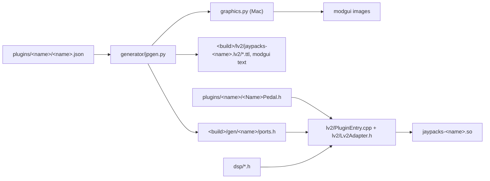

# Architecture

How a plugin goes from a JSON description and a C++ class to an LV2 bundle on the Mac and on
the MOD Dwarf.

## Overview

Three layers, each testable on its own:

1. **DSP blocks** (`dsp/`): header-only, C++17, namespace `jp`, real-time safe. Filters,
   waveshapers, smoothers, random numbers, delays and reverb networks, the analysis blocks of
   the tests (`dsp/Analysis/`).
2. **Pedal** (`plugins/<name>/<Name>Pedal.h`): one class per plugin that combines blocks.
   It knows nothing about LV2: `setSampleRate()`, `reset()`, one setter per control input
   (`set<Symbol>(float)`, port units), one const getter per control output
   (`get<Symbol>()`) and `process()`, for a plugin with a MIDI input also `midi()`, with a MIDI output
   `setMidiOutput()`, with the host's worker thread `setWorkScheduler()`, `work()` and `workResponse()`
   (`lv2/PedalServices.h`, below). Smoothing of
   parameters happens here, per sample.
3. **LV2 adapter** (`lv2/Lv2Adapter.h`): one hand-written template for every plugin,
   driven by the generated port table. The generator writes only data, never C++ logic.

## The generator

`generator/jpgen.py` (standard library only, Python 3.6+) validates the JSON
(`docs/plugin-json.md`) and writes, rewriting a file only when its content changes:

| Output | Content |
|---|---|
| `<build>/gen/<name>/ports.h` | `jp::generated::PluginPorts`: URI, version, audio port counts, `c_controlInputs` (index, symbol, range, default, setter), `c_controlOutputs` (index, symbol, getter), `c_midiInput` and `c_midiIndex`, `c_midiOutput` and `c_midiOutIndex`, `c_worker` |
| `<build>/lv2/jaypacks-<name>.lv2/manifest.ttl` | Plugin URI, binary, presets, `rdfs:seeAlso` of the other files |
| `.../<name>.ttl` | Plugin description and ports |
| `.../presets.ttl` | Presets, if the JSON has any |
| `.../modgui.ttl`, `modgui/jaypacks-<name>.html`, `.css` | With `--modgui` (CMake option `JP_GRAPHICS`): pedal face description, icon template, stylesheet, `modgui:monitoredOutputs` |

`generator/graphics.py` (numpy, Pillow, the Inter font in `generator/assets/fonts/inter/`)
renders the face (milky casing, knob labels, divider, title, brand "Krachpedal"), the knob
filmstrip (101 frames, glowing acrylic rim in the plugin colour, value arc and hand), the
footswitch (top frame bypassed, bottom frame active), the screenshot and the thumbnail;
tokens and parameters are in `generator/style.py`. The face width follows the number of face
controls (190, 230 or 280 px); `jpgen.knob_positions()` and `jpgen.lower_layout()` give the
spots the stylesheet puts knobs and footswitch at (absolute positions) and graphics.py draws
around. The design was worked out with `documentation/Graphics/`.

Generated files live only in the build directory and are never committed, except the
plugin snapshots in `docs/plugins/images/` (`tools/jp.py snapshot`, shown on the plugin
pages). CMake runs the generator through a stamp file whenever the JSON, `jpgen.py` or a
template changes.

## Naming and versions

| Item | Pattern | Example |
|---|---|---|
| Plugin name | lower case letters and digits | `shipahoy` |
| URI | `https://github.com/scjurgen/jaypacks-dwarf-dsp/plugins/<name>` | |
| Bundle | `jaypacks-<name>.lv2` | `jaypacks-shipahoy.lv2` |
| Binary | `jaypacks-<name>.so` (also on the Mac) | |
| Brand | "Krachpedal" (one pedal; the collection is "Krachpedale") | |
| Pedal class | `jp::<Name>Pedal` in `plugins/<name>/<Name>Pedal.h` | `jp::ShipAhoyPedal` |

The JSON's `minor` and `micro` become `lv2:minorVersion` and `lv2:microVersion`; `major` only
appears in `ports.h`. An incompatible change (ports removed or reordered, meaning of values
changed) needs a new URI, i.e. a new plugin name. mod-ui shows `minor.micro` as the version.

Port indices: audio inputs, audio outputs, control inputs, control outputs, each in JSON
order, then the MIDI input and the MIDI output if the plugin has them. The adapter checks this order at compile time.

## The adapter contract

- The pedal is created with `new` in `instantiate()`; `setSampleRate()` is called there.
- `activate()` applies every connected control, calls `reset()` (state cleared, smoothers
  snapped to the host's values) and writes the control outputs.
- `run()` handles any block length, runs under flush-to-zero (`lv2/FlushDenormals.h`),
  applies changed controls (clamped to the port range, NaN ignored by a bit test), calls
  `process()` and writes the control outputs.
- `process()` signature by port count: 1 in / 1 out `process(in, out, n)`; 0 in / 1 out
  `process(out, n)`; 0 in / 0 out (a MIDI processor, which needs `"midi-out"`) `process(n)`; otherwise
  `process(const float* const* in, float* const* out, n)`. Input and output may share a buffer.
- A plugin with a MIDI input (`"midi-in": true`) needs `midi(const uint8_t* msg, uint32_t size)`.
  `run()` walks the atom sequence and cuts the block at the frame of every event: the audio
  before the event is processed, then `midi()` is called, so events act sample accurately and
  the output does not depend on the block size (a generic host test checks this). `msg`
  points at 3 readable bytes (bytes beyond `size` are 0); events of 1 to 3 bytes are
  forwarded, system exclusive is dropped. Controls are applied once per block, before the first
  event.
- A plugin with a MIDI output (`"midi-out": true`) gets a `MidiOutput&` once through `setMidiOutput()`
  (`lv2/PedalServices.h`) and writes messages of 1 to 3 bytes with `send(frame, bytes, size)` from `process()` and
  `midi()`. `frame` counts from the start of the call, so a pedal answering an input event in `midi()` uses 0 and
  keeps the event's position. The adapter empties the output sequence at the start of every `run()`; a frame before
  the last one written is raised to it and a frame past the block lowered to the last sample (the sequence is always
  in order and inside the block); a message that does not fit, has another size or has no connected port is dropped
  and counted (`dropped()`), never blocking.
- A plugin that uses the host's worker thread (`"worker": true`) gets a `WorkScheduler&` once through
  `setWorkScheduler()` and schedules jobs from `process()` and `midi()` (`schedule(data, size)`, false if the host
  refused). The host calls `work(data, size, WorkResponder&)` on its worker thread, concurrently with `run()` (the
  pedal synchronises what both touch; allocation and blocking are allowed there) and `workResponse(data, size)` on the
  audio thread at the start of a later `run()`, never in the one that scheduled the job. The host's rings are small
  (`docs/device.md`, "Worker"): a job or an answer is a wake-up or a short message.
- No allocation, locks, I/O or exceptions in `run()` (and `workResponse()`). The required features are `urid:map`
  for a plugin with a MIDI input or output and `work:schedule` for a plugin with a worker (`instantiate()` fails
  without them); the only extension data is `work:interface` for a worker plugin.

## Builds

| Build | Directory | How | Used for |
|---|---|---|---|
| Tests | `build-tests/` | `dev-scripts/dev-test.sh` (Release, tests on) | Unit tests, host tests, Python tests |
| Sanitizers | `build-mac-asan/` | `cmake --preset mac-asan` | The same tests with ASan and UBSan |
| Mac release | `build-mac-release/` | `tools/jp.py build-mac` | Bundles for Reaper, and the generated files for the device bundle |
| Dwarf | `build-dwarf/` | `tools/jp.py build-dwarf` (docker) | The device `.so` |
| Charts | `build-docs/` | `dev-scripts/dev-docs-plots.sh` | `documentation/` |

The device bundle (`build-dwarf/bundles/`) is the Mac release bundle with the Dwarf `.so`
in place of the Mac one; `ports.h` and the TTL of both builds must be identical, which
`jp.py` checks. Details in `docs/building.md`.

## Tests and device

The test layers are described in `docs/testing.md`; device access and the mod-ui interface
in `docs/device.md`; the test plugins and the measurement protocol in
`docs/test-plugins.md`.

## Directory map

| Path | Content |
|---|---|
| `dsp/` | DSP blocks by category as in AbacDsp: `Filters/` (one-pole lowpass and highpass, pole mixing, biquads, ramped biquads and their cascade, bilinear transform, Fender tone stack, bright cap, Twin cabinet, the pole-mixing filter with band-pass feedback and its fitted corrections, for the synth voice, and the 4-pole phaser), `NonLinear/` (atan drive, distortion tables), `Generators/` (Ornstein-Uhlenbeck, LFO, brown noise, envelopes), `Numbers/` (random numbers, pan law, primes, bulge curve, interpolation, note conversions), `Parameters/` (smoothing, fixed-step ramps), `Synthesizer/` (MPE curves, routing slots, zone, voice allocator, modulation targets, the synth voice, its effects bus), `SynthHandling/` (sustain pedal), `Wavetables/` (band-limited tables, oscillator), `Delays/` (parallel block delay, granular pitch shifter, modulated delay of the chorus), `Diffuser/` (Schroeder allpass chain), `Reverbs/` (FDN tank, Walsh-Hadamard), `BlockProcessors/` (block callbacks for delay lines), `Analysis/` (measurement blocks) |
| `plugins/<name>/` | JSON and pedal class per plugin (`shipahoy`, `eigenghost`; test plugins `probe`, `siggen`, `meter`) |
| `lv2/` | Adapter, port table types, entry point, denormal guard |
| `generator/` | `jpgen.py`, `graphics.py`, `style.py`, templates, assets (jack images, Inter font), their tests |
| `third_party/lv2/` | LV2 core, urid, atom, midi and worker headers (ISC) |
| `third_party/lua/` | Lua 5.4.8 as released (MIT), built as `jp_lua` |
| `scripting/` | Scripting core shared by plugins (`docs/scripting.md`) |
| `tests/unit/`, `tests/host/` | GoogleTest unit tests (folders as in `dsp/`, plus `Plugins/`, `Lv2/` and `Scripting/`); minimal LV2 host, generic and per-plugin host tests, modgui check, `shipahoy_expected` |
| `tools/` | `jp.py` (generate, build, deploy, test-device), `modui.py` (device client), `device_tests/` |
| `docker/` | Dockerfile of the cross build image |
| `dev-scripts/` | One-step wrappers for configure, build, test, warnings, explore, venv, charts |
| `documentation/` | Charts and analysis per algorithm |
| `docs/` | This documentation, roadmap, references |
