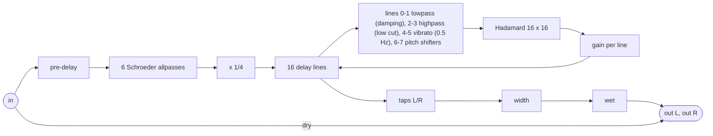

# eigenghost: diffused FDN reverb with two pitch-shifting lines

`plugins/eigenghost/` (`jp::EigenghostPedal`), bundle `jaypacks-eigenghost.lv2`, URI
`https://github.com/scjurgen/jaypacks-dwarf-dsp/plugins/eigenghost`. Mono in, stereo out. A
16-line feedback delay network reverb after AbacDsp's `examples/minireverb`: after a
pre-delay six allpass diffusers smear the input, the delay lines are mixed by a Hadamard
matrix, two of the lines shift the pitch on every pass, so the tail can climb or fall in
intervals (shimmer), and two others are slowly modulated.

## How it works

- **Pre-delay.** A whole-sample delay of 0 to 200 ms before the diffuser (default 20 ms);
  the dry signal is not delayed. A change crossfades in 50 ms, as the size does; a change
  during a fade waits for its end (the newest wins).
- **Diffuser.** Six Schroeder allpasses in series, the shortest stage the diffuser size in
  metres (333.3 m/s), the longest 3 times as long, spread along a bulge of 0.4 (prime numbers
  of samples), gain up to 0.75 (Diffusion 100 %). The chain is flat in magnitude (within
  1e-6 dB) and makes the onset dense: the echo density reaches 90 % of noise after 140 ms
  at the default 60 %, after 308 ms without diffusion (both including the pre-delay). At
  diffusion 0 the stages are pure delays that add their sum to the pre-delay (42 ms at the
  default 1.3 m).
- **Tank.** 16 delay lines with distinct prime lengths between Size and Size x spread
  (metres at 333.3 m/s, at most 0.5 s), spread by the bulge curve (default 0.6: crowded
  towards the short end, early reflections first, median line 53 ms at 12 m). Every line gets the same
  input; the line outputs are mixed by the 16 x 16 Hadamard matrix scaled by 1/4
  (orthogonal, lossless) and fed back with a per-line gain 0.001^(length / (fs T60)), so
  every line falls by 60 dB in the decay time whatever its length. The tank processes blocks
  of 16 samples; the feedback path supplies two blocks of each loop, so the loop is exactly
  the line length.
- **Processing in six lines.** A one-pole lowpass (Damping) in lines 0 and 1, a one-pole
  highpass (Low cut) in lines 2 and 3, the vibrato in lines 4 and 5, the pitch shifters in
  lines 6 and 7. The matrix spreads every line into all others within a few passes, so a few
  lines colour the whole tail. The damping can add at most about 0.6 dB of loss per pass (an
  eighth of the energy passes the damped lines): at decay 3 s the high bands bottom out near
  2.0 s however low the cutoff (`documentation/Eigenghost/`).
- **Modulation.** Lines 4 and 5 swing their delay sinusoidally at 0.5 Hz, 90 degrees apart;
  Mod depth is the peak pitch deviation (default 4 cents, at most 20, measured within 1 %).
  The swing sits around a nominal delay that the tank takes off the line, so the loop and
  its decay gain keep their length; the fractional delay is a first-order allpass (magnitude
  1), so a lossless tank loses only 0.18 dB over 10 s at 4 cents. The depth moves slowly
  (500 ms) because a fast change would sweep the read position and bend the pitch. Measured
  on the late tail of a noise burst, the modulation lowers some of the strongest mode peaks
  by 3 to 5 dB but not the strongest bin against the mean (`documentation/Eigenghost/`);
  how much it helps against ringing is for the ear.
- **Pitch shifters.** Granular: two crossfaded read heads over a 100 ms buffer, Hermite
  interpolation, grains of up to about 100 ms with a random offset, a 12 kHz lowpass on the
  shifted signal; Pitch amount mixes shifted and plain signal in the line. Measured interval
  error +0.9 to +6.0 cents (spectral centroid, 237 Hz, -12 to +12 semitones).
- **Stereo.** Every line has a left and a right tap, one of them up to 0.33 ms earlier (a
  random offset per line). Left/right correlation of a noise tail 0.09 at Width 100 %;
  Width 0 gives two identical outputs, 150 % widens by mid/side.
- **Size changes** crossfade from the old to the new line lengths in 50 ms, with the line
  gains ramped along; a change that arrives during a fade waits for its end. A hard change
  would click on every pass (`documentation/Eigenghost/eg_size_wave.png`).
- **Level.** The input enters the lines at 1/4 (1 / sqrt(16)), so the first pass carries the
  input's energy; the reverberant part adds with the decay: wet level for noise +1.2, +5.5
  and +8.3 dB at decay 0.5, 3 and 10 s (Wet 0 dB, default size).
- **Latency.** The wet signal is 16 samples (0.33 ms) late plus the pre-delay; the dry signal
  is not delayed.
- **Memory.** 1648 kB per instance at 48 kHz (memory probe; the 16 lines of 0.5 s are
  1501 kB of it, the rest the pre-delay of 200 ms, 6 diffuser stages of up to 50 ms, two
  pitch buffers of 4800 samples and two vibrato buffers of 512 samples), allocated when the
  plugin is created or the sample rate changes; it scales with the sample rate.

The charts in `documentation/Eigenghost/` show the impulse response and echo density, the
energy decay per decay setting, the decay time per octave band for several damping settings,
the partials of a shimmer tail, a size change by fade against a hard change, the line
lengths per bulge, and the modulation (pitch deviation, late tail spectrum per depth).

## Techniques

| Technique | Where | Charts and theory |
|---|---|---|
| Feedback delay network: 16 lines, orthogonal Hadamard feedback, per-line gain from the decay time, block processing with a 2-block feedback path | `dsp/Reverbs/FdnTank.h` | `documentation/Eigenghost/`, https://ccrma.stanford.edu/~jos/pasp/FDN_Reverberation.html |
| Fast Walsh-Hadamard transform, row-wise over a block (vectorises, bit-identical to the per-sample form) | `dsp/Reverbs/WalshHadamard.h` | https://en.wikipedia.org/wiki/Fast_Walsh%E2%80%93Hadamard_transform |
| Prime line lengths spread by a bulge curve | `dsp/Numbers/PrimeDispatcher.h`, `dsp/Numbers/BulgeControl.h` | `documentation/Eigenghost/` (line lengths) |
| Size changes by crossfading old and new read heads, gain changes ramped per sample | `dsp/Delays/ParallelPlainDelay.h`, `dsp/Reverbs/FdnTank.h` | `documentation/Eigenghost/` (size change) |
| Block delay with prefetching of the next block (lines larger than the cache) | `dsp/Delays/ParallelPlainDelay.h` | |
| Interaural time offsets per line for the stereo taps (seeded) | `dsp/Reverbs/FdnTank.h`, `dsp/Numbers/Random.h` | |
| Schroeder allpass chain with crossfaded length changes | `dsp/Diffuser/SchroederAllpass.h`, `dsp/Diffuser/SchroederDiffuser.h` | `documentation/Eigenghost/` (echo density), https://ccrma.stanford.edu/~jos/pasp/Schroeder_Allpass_Sections.html |
| Granular pitch shifting with two crossfaded heads and Hermite interpolation | `dsp/Delays/PitchFadeWindowDelay.h`, `dsp/BlockProcessors/BlockProcPitch.h`, `dsp/Numbers/Interpolation.h` | `documentation/Eigenghost/` (shimmer) |
| Vibrato in two lines: sine-modulated delay with first-order allpass interpolation, its nominal delay subtracted from the line (exact loop length) | `dsp/BlockProcessors/BlockProcVibrato.h`, `dsp/Reverbs/FdnTank.h` | `documentation/Eigenghost/` (modulation), https://ccrma.stanford.edu/~jos/pasp/First_Order_Allpass_Interpolation.html |
| Pre-delay as a one-channel block delay with crossfaded changes | `dsp/Delays/ParallelPlainDelay.h` | |
| One-pole lowpass and one-pole, one-zero highpass in the lines | `dsp/Filters/OnePoleLowpass.h`, `dsp/Filters/OnePoleHighpass.h`, `dsp/BlockProcessors/BlockProcOnePole.h` | `documentation/Eigenghost/` (damping) |
| Smoothing: dry, wet, width per sample; decay (log time), pitch amount, diffusion, damping and low cut (log frequency) per block; mod depth per block over 500 ms | `dsp/Parameters/ParameterSmoothing.h`, `plugins/eigenghost/EigenghostPedal.h` | |
| 16-sample core behind a FIFO: output independent of the host's block size | `plugins/eigenghost/EigenghostPedal.h` | |

Common to every plugin (the LV2 adapter, `lv2/Lv2Adapter.h`): any host block size,
flush-to-zero for denormal floats while `run()` executes (`lv2/FlushDenormals.h`), NaN
control values ignored (bit-pattern test, safe under `-ffast-math`), no allocation, locks or
I/O in `run()`.

## Controls

| Control | Range | Default | Notes |
|---|---|---|---|
| Decay | 0.2 to 30 s | 3 | On the pedal face; time to fall by 60 dB |
| Dry | -60 to +6 dB | 0 | On the pedal face; -60 mutes |
| Wet | -60 to +6 dB | -6 | On the pedal face; -60 mutes |
| Size | 1 to 40 m | 12 | On the pedal face; the shortest line |
| Pre-delay | 0 to 200 ms | 20 | Delay of the reverb against the dry signal |
| Pitch 1, Pitch 2 | -24 to +24 semitones | +12, -12 | Intervals of the two pitch lines; fractional (0.1 semitone = 10 cents, e.g. 0.05 for a slow chorus-like drift) |
| Pitch amount | 0 to 100 % | 50 | Shifted share in the pitch lines; 0: no pitch shifting |
| Reverse | off, on | off | Grains played backwards |
| Diffusion | 0 to 100 % | 60 | Allpass gain up to 0.75 |
| Diffuser size | 0.3 to 5 m | 1.3 | Shortest diffuser stage; the longest is 3 times as long |
| Size spread | 1 to 4 | 3 | Longest line as a multiple of Size (at most 0.5 s) |
| Bulge | -1 to 1 | 0.6 | Positive: lines crowd towards the short end (early reflections first), negative: towards the long end |
| Damping | 200 to 20000 Hz | 3000 | Lowpass in two lines |
| Low cut | 10 to 500 Hz | 20 | Highpass in two lines |
| Mod depth | 0 to 20 cents | 4 | Peak pitch deviation of the two modulated lines (0.5 Hz) |
| Width | 0 to 150 % | 100 | 0: mono wet signal |

Presets: "Hall" (decay 3 s, no pitch shifting, damping 6 kHz), "Shimmer" (decay 8 s,
size 16 m, pitch +12 and +19 at 60 %, damping 8 kHz), "Dark octave down" (decay 6 s,
size 20 m, both lines -12 at 50 %, damping 1.5 kHz), "Plate" and "Small room". The first
three set only the controls named; "Plate" and "Small room" set every control but Dry, so
nothing is left over from the preset before.

- **Plate:** dense from the start and bright, thin in the bass: diffusion 100 %, diffuser
  0.5 m, size 3.5 m (spread 2.5, bulge 0.2), pre-delay 8 ms, decay 3 s, damping 16 kHz, low
  cut 120 Hz, mod depth 6 cents, width 120 %, wet -8 dB. Measured on an impulse: the echo
  density reaches 0.9 after 30 ms (defaults: 140 ms), the broadband decay fits 2.56 s and
  the band above 4 kHz 2.08 s (the short lines, 17 ms on average, pass the damping lines 57 times a
  second, so even 16 kHz takes some treble).
- **Small room:** a short, close ambience: decay 0.8 s, size 4 m (spread 2.5, bulge 0.6),
  pre-delay 4 ms, diffusion 70 %, diffuser 0.8 m, damping 5 kHz, low cut 40 Hz, mod depth
  3 cents, wet -10 dB. Measured: first wet sample after 12.7 ms, dense after 40 ms, decay
  0.66 s broadband and 0.57 s above 4 kHz.

## Using it

Suggestions, not measurements:

- Pitch amount is the strongest control: a few percent adds a halo, 50 % and more makes the
  intervals ring on their own. With both lines going up, the tail keeps climbing (every pass
  shifts again) and the damping decides how high it gets; one line up and one down keeps
  the tail around the played pitch.
- Long decays with shimmer build up: keep Wet lower than without shimmer (with both lines an
  octave up at 100 %, decay 30 s and continuous noise, the tail settled about 10 dB above
  the input level in the tests; it stays bounded).
- For a plain room, set Pitch amount to 0 and choose Size for the room (5 to 10 m small,
  15 to 30 m large), then Damping for the material.
- At Diffusion 0 the echoes of the single lines are audible (and the diffuser adds to the
  pre-delay): useful for slapback-like or metallic effects.
- Pre-delay separates the dry note from the reverb: 20 to 40 ms keeps a voice or a guitar
  clear in a large space; 0 puts the reverb right on the note.

## Performance on the Dwarf

<!-- perf:begin -->
| Settings | CPU (points of mod-ui's DSP load) | Range over the cycles |
|---|---|---|
| defaults | 6.0 | 5.8 to 6.1 |
| preset Hall | 5.9 | 5.5 to 6.0 |
| preset Shimmer | 5.9 | 5.7 to 6.5 |
| preset Dark octave down | 5.8 | 5.7 to 6.0 |
| preset Plate | 6.0 | 5.4 to 6.2 |
| preset Small room | 6.1 | 5.5 to 6.4 |

Memory: the plugin allocates 1648 kB when it is created (at 48 kHz, peak 1648 kB, nothing while it runs; counted by its memory probe on 2026-10-16); the binary is 58 kB. Xruns while processing: 0.

Measured 2026-10-16 with tools/jp.py perf: plugin 0.1.1, commit 0f21fec+changes, MOD OS v1.13.5.3315, jackd 48000 Hz, 128 frames; input siggen white noise at -12 dBFS; median of 3 cycles of 6 s with and without the plugin.
<!-- perf:end -->

The two modulated lines cost about 17 us per 128 frames on the Dwarf (timed by a cross-built
benchmark: the whole pedal about 185 to 195 us); with `std::sin` per sample the vibratos
took 49 us and the plugin 7.2 points, now the sine is computed once per 16-sample block and
rotated in between. On the Mac: 7.4 us per 128 frames on an Apple M-series core (0.3 % of
real time).

## Tests

`tests/unit/Plugins/EigenghostPedal_test.cpp` (pedal: geometry, exact dry and wet, levels,
width, shimmer stability, block size independence, reset, sample rates, size fades,
pre-delay timing and held changes, slow mod depth), the DSP blocks' unit tests
(`tests/unit/Reverbs/`, `Diffuser/`, `Delays/`, `BlockProcessors/`, the vibrato among
them), `tests/host/Eigenghost_test.cpp` (through the binary: TTL against the pedal, decay
times, pitch lines in the tail, dry/wet jumps, decay jumps, size and pre-delay sweeps without
clicks, pre-delay onset, mod depth reaching the tail) and on
the device `tools/jp.py test-device eigenghost` (37 checks: exact outputs, wet levels
against the Mac within 0.02 dB, pitch lines, modulation, zipper, extremes, addressing,
xruns).

## Sources

1. J. O. Smith, "Feedback Delay Networks (FDN)", Physical Audio Signal Processing,
   https://ccrma.stanford.edu/~jos/pasp/FDN_Reverberation.html.
2. J. O. Smith, "Schroeder Allpass Sections",
   https://ccrma.stanford.edu/~jos/pasp/Schroeder_Allpass_Sections.html.
3. J. S. Abel and P. Huang, "A Simple, Robust Measure of Reverberation Echo Density", AES
   121st Convention, 2006 (the normalised echo density of the charts).
4. AbacDsp, `examples/minireverb` and the ported DSP blocks, https://github.com/scjurgen/AbacDsp
   (provenance in `docs/references.md`).
