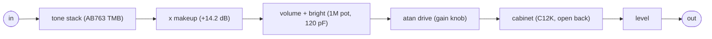

# jaystwin: a simple Fender Twin Reverb amp and cabinet

`plugins/jaystwin/` (`jp::JaysTwinPedal`), bundle `jaypacks-jaystwin.lv2`, URI
`https://github.com/scjurgen/jaypacks-dwarf-dsp/plugins/jaystwin`, display name "Jays Twin".
Mono in, mono out. A simple model of the Fender Twin Reverb (AB763 blackface) for guitar,
built from biquad filters: the amp's tone stack with its real component values, the bright
switch, a soft atan drive and a 2x12 open-back cabinet fitted to the measured response of the
Jensen C12K speaker. No reverb, no tremolo. The gain goes up to eleven.

## How it works

- **Tone stack.** The passive treble/mid/bass network of the AB763 Twin (treble 250k with
  250 pF, bass 250k with 0.1 uF, mid 10k with 0.047 uF, slope 100k; all log pots) as Yeh and
  Smith's closed-form third-order transfer function, checked against a nodal analysis of the
  circuit. It runs as a first-order section and a biquad (the cubic denominator is factored
  in double before the bilinear transform). The knobs interact and the middle is always
  scooped: with all three at 5 the stack gives -14.7 dB at 80 Hz, -25.0 dB at 500 Hz and
  -20.6 dB at 4 kHz; treble 0 to 10 lifts 3 kHz by 31 dB, bass 0 to 10 lifts 80 Hz by 14.5 dB,
  mid 0 to 10 fills 500 Hz by 7.7 dB. A fixed makeup of +14.2 dB puts the stack's maximum at
  5/5/5 at 0 dB.
- **Bright.** The 120 pF cap across the upper part of the 1M volume pot, driven by the tone
  stack's output impedance (25k, fixed): a first-order treble shelf from about 1.3 kHz whose
  lift depends on the volume, here the gain knob: about +7.6 dB at 3 kHz up to gain 4,
  +6.2 dB at 6, +3.3 dB at 8, nothing at 10 (the volume pot ends there; 11 only drives harder). Bright is a toggle in the settings (no face
  control); switching crossfades its lift.
- **Drive.** y = atan(d x) / atan(d) with d = 10^(36 / 20 x gain / 10), from 1 at gain 0 to
  63 at gain 10 and, because the knob goes up to eleven (Spinal Tap,
  https://en.wikipedia.org/wiki/Up_to_eleven), 95 at 11: one more step of 3.6 dB. Small
  signals gain d / atan(d), so turning the gain up is louder and more compressed, as on the
  amp: a guitar chord peaking at -12 dBFS comes out 21 dB louder at gain 10 than at 0, and
  0.85 dB louder still at 11 (the drive is nearly saturated there). Odd harmonics only;
  memoryless, no oversampling (aliasing below).
- **Cabinet.** Seven cookbook biquads fitted by least squares to the Jensen C12K 8 ohm curve
  of the Jensen specification sheet (0.68 dB rms from 30 Hz to 8 kHz): resonance near 125 Hz,
  a dip at 410 Hz, the narrow presence peak at 2.3 kHz, the steep fall above 4 kHz. The open
  back is an assumed first-order low cut at 80 Hz. The curve is the speaker on axis on a
  baffle, not a miked cabinet in a room.
- **Level.** In dB after the cabinet, with a fixed trim of -4 dB: at the defaults (gain 3,
  level 0) the output is as loud as the input (a chord peaking at -12 dBFS: 0.2 dB apart in
  RMS), so switching the plugin in does not jump. At high gain the output reaches full scale;
  turn Level down there. The presets are levelled to the defaults (within 0.3 dB).
- **Smoothing.** Every knob per sample (20 ms). The tone stack and the bright cap are
  redesigned every 16 samples while their knobs move, and their coefficients ramp linearly to
  each new design (applied at once, a fast treble move clicked: steps 13 times the steady
  ones in the tone stack); ramped, the steps equal those of a redesign on every sample.
- **Not modelled.** The second triode, the phase inverter and the power amp (no sag, no
  power-amp clipping, no output transformer), the reverb and the tremolo. The Twin's famous
  clean headroom is in the gain mapping only.
- **Latency.** None. **Memory.** No buffers; the pedal object is 840 bytes.

The charts in `documentation/JaysTwin/` show the tone stack per knob, the bright lift per
volume, the cabinet against the datasheet curve, the drive curves and the linear chain at the
defaults, with the method of the datasheet tracing and the cabinet fit.

## Techniques

| Technique | Where | Charts and theory |
|---|---|---|
| Closed-form tone stack (Yeh and Smith), verified by nodal analysis of the circuit | `dsp/Filters/FenderToneStack.h` | `documentation/JaysTwin/` (tone stack), https://ccrma.stanford.edu/~dtyeh/tonestack/ |
| Third-order filter split into a first-order section and a biquad: smallest pole by Newton's method, deflation from the constant end, poles mapped to z one by one and kept inside the unit circle | `dsp/Filters/FenderToneStack.h`, `dsp/Filters/BilinearTransform.h` | https://ccrma.stanford.edu/~jos/filters/Bilinear_Transformation.html |
| Bright cap as a first-order shelf from the divider of the volume pot | `dsp/Filters/VolumeBright.h` | `documentation/JaysTwin/` (bright) |
| Speaker response as a cascade of cookbook biquads fitted by bounded least squares to a traced datasheet curve | `dsp/Filters/TwinCabinet.h`, `dsp/Filters/BiquadCascade.h`, `documentation/JaysTwin/fit_cabinet.py`, `trace_chart.py` | `documentation/JaysTwin/` (cabinet), https://webaudio.github.io/Audio-EQ-Cookbook/audio-eq-cookbook.html |
| Biquads in transposed Direct Form II with per-type steps | `dsp/Filters/Biquad.h` | https://ccrma.stanford.edu/~jos/filters/Transposed_Direct_Forms.html |
| Coefficient ramps between control-rate designs (stable by convexity of the stability region) | `dsp/Filters/RampedBiquad.h` | |
| atan soft clipping with unity at full scale | `dsp/NonLinear/AtanDrive.h` | `documentation/JaysTwin/` (drive), https://ccrma.stanford.edu/~jos/pasp/Soft_Clipping.html |
| Audio (log) pot taper | `dsp/Filters/FenderToneStack.h` (`audioTaper()`) | |
| Per-sample smoothing, design countdown per sample: output independent of the host's block size | `dsp/Parameters/ParameterSmoothing.h`, `plugins/jaystwin/JaysTwinPedal.h` | |

## Controls

| Control | Range | Default | Notes |
|---|---|---|---|
| Bass | 0 to 10 | 5 | On the pedal face (upper row); bass pot of the tone stack |
| Mid | 0 to 10 | 5 | On the pedal face (upper row); mid pot |
| Treble | 0 to 10 | 5 | On the pedal face (upper row); treble pot (it also moves the mid dip: about 300 Hz at 10, 2 kHz at 2.5) |
| Gain | 0 to 11 | 3 | On the pedal face (lower row); drive and, up to 10, the volume position of the bright cap |
| Level | -30 to +12 dB | 0 | On the pedal face (lower row) |
| Bright | off, on | off | Settings only |

Presets: "Clean" (the defaults), "Bright clean" (bass 4, mid 5, treble 6, gain 2, bright on,
level +4 dB), "Edge" (mid 6, gain 7, level -10 dB) and "Scooped" (bass 7, mid 2, treble 7,
level -1 dB); all equally loud within 0.3 dB for a chord.

## Using it

Suggestions, not measurements:

- Start with the tone knobs at 5 and set the gain for the amount of grit, then Level for the
  loudness. Above gain 7 the drive compresses noticeably; the Twin's clean character lives
  below 5.
- Treble is the strongest tone knob and also sets where the mid dip sits; adjust Mid after
  Treble. Mid at 10 with bass and treble low gives the flattest response.
- Bright makes low-gain settings sparkle and does almost nothing above gain 8, like the
  switch on the amp.
- The cabinet already rolls off above 5 kHz: put the plugin last before the output, or turn
  off the cabinet simulation of any following plugin or amp.

## Aliasing

The drive has no oversampling. Measured at the output (after the cabinet), relative to the
fundamental of a -12 dBFS sine: at gain 7 the aliases stay at -100 dB (1.3 kHz) and -84 dB
(3.1 kHz); at gain 10 at -98 dB (1.3 kHz) and -42 dB (3.1 kHz, where the harmonics are at
-37 dB); at gain 11 at -83 dB (1.3 kHz) and -36 dB (3.1 kHz), as strong as the harmonics
there. High notes at full gain are the case where oversampling would help; the author's
listening test in Reaper found the plugin ok without it (2026-10-16), so it stays a later option.

## Performance on the Dwarf

<!-- perf:begin -->
| Settings | CPU (points of mod-ui's DSP load) | Range over the cycles |
|---|---|---|
| defaults | 0.6 | 0.3 to 0.7 |
| preset Bright clean | 0.6 | 0.2 to 0.7 |
| preset Edge | 0.5 | 0.4 to 0.6 |
| preset Scooped | 0.6 | 0.4 to 0.7 |

Memory: the plugin allocates 0.9 kB when it is created (at 48 kHz, peak 0.9 kB, nothing while it runs; counted by its memory probe on 2026-10-16); the binary is 22 kB. Xruns while processing: 0.

Measured 2026-10-16 with tools/jp.py perf: plugin 0.1.0, commit 2fe778e+changes, MOD OS v1.13.5.3315, jackd 48000 Hz, 128 frames; input siggen white noise at -12 dBFS; median of 3 cycles of 6 s with and without the plugin.
<!-- perf:end -->

On the Mac: 1.9 us per 128 frames on an Apple M-series core (0.07 % of real time).

## Tests

`tests/unit/Plugins/JaysTwinPedal_test.cpp` (pedal: small signals follow the designed chain
within 0.02 dB, makeup, exact level, bright, drive mapping, block split while knobs move,
reset), the DSP blocks' unit tests (`tests/unit/Filters/Biquad_test.cpp`,
`FenderToneStack_test.cpp`, `VolumeBright_test.cpp`, `BiquadCascade_test.cpp`,
`TwinCabinet_test.cpp`, `RampedBiquad_test.cpp`, `tests/unit/NonLinear/AtanDrive_test.cpp`)
and `tests/host/JaysTwin_test.cpp` (through the binary: TTL against the pedal, knob sweeps
and jumps without clicks, level against gain and the presets, aliasing, no subnormals in a
decaying tail), and on the device `tools/jp.py test-device jaystwin` (47 checks with
`jaystwin_expected`: bypass exact; band gains of white noise at -80 dBFS for five settings
within 0.054 dB of the Mac from 250 Hz up and within 0.27 dB at 125 Hz, 63 Hz reported only
(the meter cannot resolve the cabinet's steep low cut there: coherence 0.88 to 0.99, the gain
scatters by +-0.4 dB between windows on the device and on the Mac); the drive level of a
237 Hz sine at gain 0, 5, 10 and 11 within 0.001 dB of the Mac; treble and gain jumps within
1.3 times the steady step; extremes, silence, addressing, xruns).

## Sources

1. D. T. Yeh and J. O. Smith, "Discretization of the '59 Fender Bassman Tone Stack", DAFx-06,
   https://ccrma.stanford.edu/~dtyeh/tonestack/ (the closed form; the same formulas in Faust's
   `tonestacks.lib`, https://github.com/grame-cncm/faustlibraries/blob/master/tonestacks.lib).
2. R. Robinette, AB763 model differences and the Twin Reverb layout,
   https://robrobinette.com/AB763_Model_Differences.htm,
   https://robrobinette.com/images/Guitar/AB763_Models/AB763_Twin_Reverb_Layout_DIYLC.pdf
   (component values, bright cap, mid pot).
3. Jensen Loudspeakers, C12K specification sheet, https://www.jensentone.com/vintage-ceramic/c12k
   (the speaker response the cabinet is fitted to).
4. R. Bristow-Johnson, Audio EQ Cookbook,
   https://webaudio.github.io/Audio-EQ-Cookbook/audio-eq-cookbook.html.
5. Cabinet simulation using biquad filters (the idea: a few biquads after a measured curve),
   http://www.redfelineninja.org.uk/daniel/2012/08/cabinet-simulation-using-biquads-filters/.
6. AbacDsp, `src/includes/Filters/Biquad.h` (ported), https://github.com/scjurgen/AbacDsp
   (provenance in `docs/references.md`).
