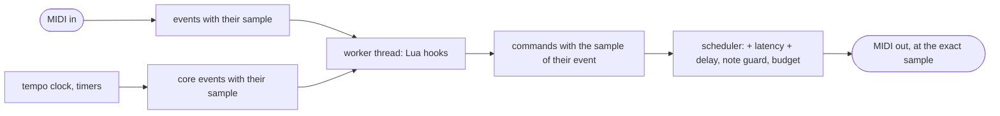

# midiscript: a MIDI effect written in Lua

`plugins/midiscript/` (`jp::MidiScriptPedal`), bundle `jaypacks-midiscript.lv2`, URI
`https://github.com/scjurgen/jaypacks-dwarf-dsp/plugins/midiscript`, display name "MIDI Script". MIDI in, MIDI out, no
audio. What happens to the notes is decided by a Lua script: the plugin comes with six (passthrough, arpeggiator, chord
player, scale quantiser, octave doubler, CC remap) and runs up to eight of your own, which it reloads when the file
changes. It is the second user of the scripting core (`docs/scripting.md`).

## How it works

- **The script runs in the host's worker thread**, one to two blocks behind the audio. The audio thread stamps every
  incoming message with its sample and the script's answers come back with the sample of the event they answer; each
  leaves at that sample plus the command's own delay plus the plugin's **latency**. The latency (control, default 12 ms)
  is the time the worker gets: it must be at least two blocks and a little (6.6 ms at 128 frames, the Dwarf's block). With
  enough latency the output does not depend on the block size or on the worker's timing (tested for blocks of 1 to 1024
  frames). A message that still comes too late goes out at the start of its block and is counted (Late, a control output).
- **Clock.** `OnTick(tick)` is called 24 times per quarter note at the Tempo control (the host fills it with the board's
  tempo through the designation `time:beatsPerMinute`); the ticks are announced a latency ahead, so a script's notes land
  on the grid. Sync = Free run: the clock runs from activation; Sync = Transport: only while the board's transport rolls
  (the port with the designation `time:speed`). Tick 0 comes one latency after the start; `OnTransportStart` and
  `OnTransportStop` mark the start and the stop. `SetTimer` / `StopTimer` give a script eight timers in ms or ticks.
- **No hung notes.** Every note on that leaves is remembered until its note off has left. A new script, a script that
  fails, the Panic control, a script's own `Panic()` and a reactivation end every sounding note (note offs, never refused),
  drop what was waiting and (for Panic) send All Notes Off on all 16 channels. A script that runs in a loop is cut by a
  budget of 128 messages per 2.7 ms (counted in Dropped); a hook that fails (an error, over the budget, out of memory) ends the notes, drops what was queued, including what that call had asked for, and the script goes on with the next event; a file that does not load changes nothing: the previous script keeps playing and Script status says why.
- **Channels count from 1** in hooks and commands (Morphexsynth's hooks count from 0, as in AbacDsp).

## Controls

| Control | Range | Default | Notes |
|---|---|---|---|
| Script | Passthrough, Arpeggiator, Chord Player, Scale Quantiser, Octave Doubler, CC Remap, User 1 to User 8 | Passthrough | Pedal face; User n runs `user-<n>.lua` from the scripts folder (below) |
| Tempo | 20 to 300 BPM | 120 | Pedal face; designated `time:beatsPerMinute`: the board's tempo |
| Sync | Free run, Transport | Free run | Pedal face; whether the clock needs the transport |
| Latency | 0 to 50 ms | 12 | Pedal face; the time the script gets to answer, added to every message |
| Speed | 0 or 1 | 0 | Settings only; designated `time:speed`: the transport state |
| Panic | 0 or 1 | 0 | Settings only; a change to 1 ends every note and sends All Notes Off |
| Script status (output) | 0 to 6 | | 0 nothing loaded, 1 ok, 2 file missing, 3 compile error, 4 runtime error, 5 over the budget, 6 out of memory |
| Sounding (output) | 0 up | | Notes that are on and not yet off |
| Late (output) | 0 up | | Messages that missed their sample (raise Latency) |
| Dropped (output) | 0 up | | Messages lost to the flood budget, a full buffer or a refused queue |

## Scripts

`API.md` in the bundle's `scripts/` folder (written from the table that checks the calls) lists everything a script can do:
the commands `Note`, `NoteOn`, `NoteOff`, `CC`, `PitchBend`, `ProgramChange`, `Pass`, `Panic`, `SetTimer`, `StopTimer`; the
hooks `OnStart`, `OnNoteOn`, `OnNoteOff`, `OnCC`, `OnPitchBend`, `OnProgramChange`, `OnOther`, `OnTick`, `OnTransportStart`,
`OnTransportStop`, `OnTimer`; the constants `Ticks.Quarter`, `Ticks.Sixteenth` ... (the lengths of notes in ticks). Messages
without a hook (real-time messages such as MIDI clock) are not passed on; `OnOther` gets channel pressure, poly pressure and
the like. `Pass()` sends the message of the hook that runs, unchanged; `Note()` sends a note on and, one length later, its note off.

The factory scripts are short and made to be copied and edited (their settings are the lines at the top):

| Script | What it does | Settings |
|---|---|---|
| `passthrough` | Everything goes through, one latency later | |
| `arpeggiator` | The held notes are played in time with the clock | mode (up, down, updown, random), rate, gate, swing, octaves |
| `chord-player` | Every key sounds a chord | chord shape, strum in ms, inversion |
| `scale-quantiser` | Every note goes to the nearest note of a scale (a tie goes down); the note off follows its note on | root, scale |
| `octave-doubler` | Every note is played with the same note some octaves away | shift, level |
| `cc-remap` | Controllers turned into other controllers (CC 1 to CC 74, CC 11 to CC 7), the rest passes | the table |

The bundle's `scripts/` folder is also what to give an LLM that writes scripts: next to `API.md` and `constants.lua` it
has `AGENTS.md` (a guide for an AI assistant with the loop, the rules, the mistakes seen most and a prompt to paste) and
`examples/`, which are not selectable in the Script setting: copy one to a user slot. In lua-editor, Help > "Copy API
brief for an LLM" puts the guide, the API and the examples on the clipboard as one text.

| Example (`scripts/examples/`) | Shows |
|---|---|
| `01-pass-through` | every message through; a message without `Pass()` is dropped |
| `02-transpose` | a shift in semitones, remembering what each key sent so the note off matches |
| `03-chord-from-one-note` | a strummed chord on every key (`chords`) |
| `04-remap-a-controller` | one controller turned into another (`CC`, `Pass`) |
| `05-quantise-to-a-scale` | every note moved into a scale (`scales`) |
| `06-timed-arpeggio` | the held keys on a repeating timer in a euclidean rhythm (`SetTimer`, `rhythm`) |
| `07-panic-on-stop` | all notes off when the transport stops (`Panic`) |

`scales.lua`, `chords.lua` and `rhythm.lua` are libraries for scripts (`import "scales"` defines `Scales`: shapes and
`Scales.quantise()`; `Chords`: shapes, `Chords.notes()`, `Chords.invert()`; `Rhythm`: `Rhythm.swing()`, `Rhythm.euclid()`).
The random mode of the arpeggiator uses the seeded `math.random` of the core, so a run is reproducible.

Your own: put `user-1.lua` to `user-8.lua` into `/data/jaypacks/scripts/midiscript/` on the Dwarf (`scp -O` over USB, or
`tools/jp.py push-script midiscript user-1 file.lua`; on a Mac `~/Library/Application Support/jaypacks/scripts/midiscript/`
or `$JP_SCRIPT_DIR/midiscript/`) and select User n; the plugin checks the file twice a second. A script that does not
load is rejected (Script status, `user-<n>.log` says why). The sandbox, the limits and the user's loop are described
in `docs/scripting.md`.

## Performance on the Dwarf

<!-- perf:begin -->
| Settings | CPU (points of mod-ui's DSP load) | Range over the cycles |
|---|---|---|
| idle (no note) | 0.6 | 0.5 to 0.7 |
| Arpeggiator, 3 keys held | 3.4 | 3.2 to 3.7 |
| Arpeggiator, 8 keys held | 3.3 | 3.2 to 3.4 |
| Chord Player, 8 keys | 0.9 | 0.5 to 1.1 |
| Scale Quantiser, 8 keys | 0.5 | 0.4 to 0.7 |
| Octave Doubler, 8 keys | 0.9 | 0.8 to 1.2 |

Memory: the plugin allocates 50 kB when it is created (at 48 kHz, peak 51 kB, nothing while it runs; counted by its memory probe on 2026-10-18); the binary is 363 kB. Xruns while processing: 0.

Measured 2026-10-18 with tools/jp.py perf: plugin 0.1.0, commit 2552992+changes, MOD OS v1.13.5.3315, jackd 48000 Hz, 128 frames; input MIDI notes from the ALSA sequencer (see the settings); median of 3 cycles of 6 s with and without the plugin.
<!-- perf:end -->

## On the Dwarf

Measured 2026-10-18 with `tools/jp.py test-device midiscript` (`tools/device_tests/test_midiscript.py`, 72 checks, all pass;
details in `docs/roadmap.md`, Lua scripting step 9). The worker's round trip is short: at 128 frames, messages came late
with a latency of 0 ms (all) and 2 ms (a few), none from 4 ms on, so the default of 12 ms has three times the margin; it
may be lowered to 6 ms for a keyboard that should feel tighter, and raised if Morphexsynth and others load the Dwarf. The
arpeggiator keeps the board's tempo to within 1 % (125.2, 166.2 and 249.9 ms per sixteenth against 125, 166.7 and 250
at 120, 90 and 60 BPM). A script with `OnTick` costs about 3 points of DSP load because the worker is woken for every
tick; scripts that react to notes only cost less than 1.

## Tests

`tests/unit/Plugins/MidiScript_test.cpp` drives the pedal the way the LV2 adapter does (blocks cut at the messages, the
worker run between blocks) and checks every shipped script against an exact list of messages with their samples: the
passthrough byte for byte on all 16 channels for blocks of 16 to 1024 frames, the arpeggiator in every mode, with octaves,
swing and another tempo, the chords, the quantiser for all 128 notes, the doubler, the CC remap; a note on with velocity 0
reaching `OnNoteOff`; no hung notes after a reload, an error, a panic and a reactivation; the flood budget; the
timers and the transport sync; every file of `scripts/examples/` loaded and run with a few messages (script state ok, nothing late or dropped, no hanging note, something sent). `tests/host/MidiScript_test.cpp` does the arpeggio through the built binary with the worker
on a thread of its own. The generic host tests compare the MIDI output across block sizes for every plugin with a MIDI output.
