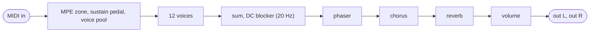

# morphexsynth: an MPE subtractive synth

`plugins/morphexsynth/` (`jp::MorphexsynthPedal`), bundle `jaypacks-morphexsynth.lv2`, URI
`https://github.com/scjurgen/jaypacks-dwarf-dsp/plugins/morphexsynth`, display name "Morphexsynth".
MIDI in, stereo out, no audio input. A port of the Morphexsynth of AbacDsp
(`examples/morphexsynth`): 12 voices of three wavetable oscillators through a resonant filter,
with envelopes, an LFO, distortion and a routing matrix that sends the per-note controllers of an
MPE controller to the sound, followed by a phaser, a chorus and a reverb. The sounds are Lua scripts: the ten factory
patches of AbacDsp, as script files in the bundle, and up to eight of your own that the plugin reloads when you change
the file (see "Scripts" below and `docs/scripting.md`).


## How it works



- **Voice** (`dsp/Synthesizer/MorphexsynthVoice.h`). Three oscillators read band-limited
  wavetables (triangle, shark fin, saw, square, white noise; 16 mipmap levels each, built once and
  shared by the voices) with detune, a frequency factor and pulse width by phase distortion; the sum goes
  through the filter (four one-pole stages with a band-pass feedback tap and a saturator, the
  filter of AbacDsp's voice, with the preset table of shipahoy), the amplitude envelope, an optional
  distortion (31 shaper curves) and the pan law. Everything that is not audio rate runs every 16
  samples: the LFO, the envelopes, the routing and the filter's targets.
- **Routing.** Ten slots, each reads a source (X, Y, Z, velocity, note, filter envelope, amplitude
  envelope), shapes it through a curve and adds it, scaled by a depth, into a target (pitch bend,
  cutoff, resonance, pan, oscillator frequency and level, sustain, times, distortion).
- **MPE.** Per-note controllers arrive on the channel of their note: pitch bend (14 bit) is X, CC 74
  and the mod wheel are Y, channel pressure is Z. Notes are given to voices from a pool of 12
  (a silent voice first, else the one that began longest ago). A bend, CC 74 or pressure value that
  arrives before the note on of its channel is kept and applied to the next note on that channel (an
  MPE controller sends the bend of a touch first; AbacDsp lets the first note ignore it).
- **Bus** (`dsp/Synthesizer/MorphexsynthEffects.h`). A phaser of two four-pole stages per channel
  on one shared sweep (200 to 2000 Hz), a chorus (18 ms, one modulated delay per channel, the right
  channel half a period later) and a reverb on `jp::FdnTank` (16 lines, mono in, the stereo taps of the tank
  out), each off when its mix is 0.
- **Blocks of 16 samples.** The sound is made in blocks of 16 samples (the block of the reverb tank): a MIDI event
  acts at the start of the next block, up to 0.3 ms late, and the output does not depend on how the host
  cuts its blocks.

## Techniques

| Technique | Where | Charts and theory |
|---|---|---|
| Band-limited wavetable oscillator: 16 mipmap levels by inverse FFT, level chosen by the phase increment, pulse width by phase distortion, a morph over three waveforms (two tables read per sample, each at its own level) | `dsp/Wavetables/` | `documentation/Wavetables/` |
| Pole-mixing filter with a band-pass feedback tap, saturated loop, fitted cutoff warp and critical resonance | `dsp/Filters/PoleMixingBandpassFilter.h`, `PoleMixingCorrections.h` | https://electricdruid.net/multimode-filters-part-2-pole-mixing-filters |
| Envelope with curved segments, LFO with eight waveforms, brown noise | `dsp/Generators/` | |
| Waveshaper tables by interpolated control points | `dsp/NonLinear/WaveShaperTables.h` | |
| Routing matrix with curves and one-pole smoothing | `dsp/Synthesizer/ValueConnector.h`, `MpeCurve.h`, `MpeRouting.h` | |
| MPE zone, voice allocation, sustain pedal | `dsp/Synthesizer/MpeZone.h`, `VoiceAllocator.h`, `dsp/SynthHandling/SustainPedalHandler.h` | |
| Four-pole phaser (the Dixon notch mix), modulated delay, FDN reverb | `dsp/Filters/Phaser24.h`, `dsp/Delays/ModulationDelay.h`, `dsp/Reverbs/FdnTank.h` | |

## Controls

| Control | Range | Default | Notes |
|---|---|---|---|
| Vol | -40 to +12 dB | -6 | Pedal face; added to the level of the patch (the factory patches are loud: -6 dB is the default) |
| Cutoff | -48 to +48 semitones | 0 | Pedal face; moves the cutoff of the patch |
| Resonance | -50 to +100 % | 0 | Pedal face; added to the resonance of the patch (percent of the normalised resonance, 100 is the self-oscillation threshold; limited to 0 to 1.3) |
| Attack | -500 to +2000 ms | 0 | Pedal face; added to the attack of the patch's amplitude envelope (at least 1 ms remain; a patch with a 2 ms attack can be given a slow swell, an 800 ms attack shortened) |
| Release | -1000 to +3000 ms | 0 | Pedal face; added to the release of the patch's amplitude envelope (at least 1 ms remain); the filter envelope keeps the patch's times |
| Reverb | -60 to +12 dB | -10 | Pedal face; added to the reverb mix of the patch, the lowest value switches the reverb off |
| Chorus | 0 to 200 % | 100 | Settings only; scales the chorus mix of the patch |
| Phaser | 0 to 200 % | 100 | Settings only; scales the phaser mix of the patch |
| Patch | ten patches | Retro Poly | Settings only; changing it releases all notes and applies the patch completely; ignored while Script is above 0 |
| Script | Patch menu, User 1 to User 8 | Patch menu | Settings only; User n runs `user-<n>.lua` from the scripts folder (below) |
| Script status (output) | 0 to 6 | | 0 nothing loaded, 1 ok, 2 file missing, 3 compile error, 4 runtime error, 5 over the instruction or time budget, 6 out of memory |
| Bend range | 0 to 24 semitones | 12 | Settings only; replaces the depth of the PitchBend slots of the patch (0: as the patch) |
| Glide | 0 to 2000 ms per octave | 0 | Settings only; replaces the glide of the patch (0: as the patch) |
| Pressure | 0 to 400 % | 200 | Settings only; scales the depth of the slots that read Z (channel pressure or poly pressure); the patches use Z for cutoff or resonance, and at 100 % the effect is small |
| MPE master, lower, upper | channels 1 to 16 | 1, 2, 16 | Settings only; the channels that play: the master and the members from lower to upper |

Cutoff, Resonance, Attack, Release, Reverb, Chorus and Phaser are offsets and scales of the patch's own values (the
patches carry their cutoff and times, so an absolute dial would override them). A script that sets the amplitude
envelope later is offset too. Every patch with its settings, its routing and what
the controllers do to it: `docs/plugins/morphexsynth-patches.md`. The patches: 4 Ever Mini, Airy Pad, Crystal
Bells, Cutting Lead, Grand Stage, Harp Pluck, Kick Punch, Retro Poly, Section Brass, Warm Bass; the X
(pitch bend) range is 2 semitones in most, 1 in Harp Pluck and 12 in Warm Bass (the Bend range setting replaces it); every
patch bends, answers pressure (Z) and follows the velocity (12 dB of level from velocity 30 to 127, and a brighter sound
for harder notes); the routing of each patch (X, Y, Z, velocity and the filter envelope to pitch, cutoff or
resonance) is in its script, `plugins/morphexsynth/scripts/<name>.lua`
(in the bundle: `scripts/`).

## Scripts

A sound is a Lua script that calls commands such as `SetOscillator`, `SetFilterEnvelope`, `SetCtrlSlot`, `SetReverb`
and can define hooks (`OnNoteOn`, `OnNoteOff`, `OnCC`, `OnProgramChange`, `OnPitchBend`) that react to the MIDI. The
commands, their ranges and defaults, the hooks and the constants are in `API.md` in the bundle's scripts folder (written
from the same table that checks the calls, so it is always what the plugin does), and in `docs/scripting.md`.

- **Factory patches.** The ten patches are the files `4-ever-mini.lua` ... `warm-bass.lua` in the bundle's `scripts/`
  folder, from AbacDsp's factory patches (`SetVolume` is new: the level of a patch was a field of the file there). They are run
  once when the plugin is created and their settings kept as values, so choosing a patch is instant and does not depend on
  the worker thread. A test makes sure that each file ends in exactly the patch that was compiled into the plugin
  before (`EveryFactoryScriptMakesExactlyTheCompiledPatch`). Copy one to start your own.
- **Examples and the guide.** `examples/` in the same folder has seven small patches that run as they are, and
  `AGENTS.md` is a guide for an AI assistant (see `docs/scripting.md`, "The user's loop"); copy an example to a user slot.

  | Example | Shows |
  |---|---|
  | `01-a-patch-in-onstart` | the smallest useful patch |
  | `02-mod-wheel-to-the-filter` | the Y source on the filter cutoff (`SetCtrlSlot`) |
  | `03-pressure-to-resonance` | pressure and velocity shaping the sound |
  | `04-an-effects-chain` | distortion, chorus, phaser and reverb |
  | `05-vibrato-with-the-lfo` | a slow LFO on the pitch |
  | `06-patches-by-program-change` | `OnProgramChange` switching between patches |
  | `07-wave-morph-on-a-controller` | `SetWaveMorph` moved by a controller while notes sound |

- **Your scripts.** Put `user-1.lua` to `user-8.lua` into the scripts folder of the plugin on the Dwarf,
  `/data/jaypacks/scripts/morphexsynth/` (the plugin creates it when it first writes a log; `scp -O file
  root@192.168.51.1:/data/jaypacks/scripts/morphexsynth/user-1.lua`; on a Mac
  `~/Library/Application Support/jaypacks/scripts/morphexsynth/`, or `$JP_SCRIPT_DIR/morphexsynth/`), and set Script
  to User 1 ... 8. The plugin checks the file twice a second and reloads it when it has changed; there is nothing to
  press. A script that fails to load (a syntax error, an error at the top level or in `OnStart`, a limit
  exceeded) is rejected and the previous sound goes on; Script status shows the state and `user-<n>.log` beside the
  script says why, with the script's own `Log` lines and warnings about calls that were ignored. `import "name"` loads
  `name.lua` from the same folder or the bundle.
- **What happens when a script takes over.** The settings its top-level code and `OnStart` make are collected into one
  patch that starts from a blank one (everything off, no oscillator sounding) and loaded at once with all notes released,
  so the sound is that patch whatever played before: a user script that is a copy of a factory script sounds
  bit for bit like it (tested). What a hook calls later (e.g. a new filter envelope per note from `OnNoteOn`) is applied one
  command at a time.
- **Wavetable morph.** `SetWaveMorph(index, { waveform2 = ..., waveform3 = ..., morph = ... })` lets an oscillator
  crossfade between three waveforms: the one of `SetOscillator`, then `waveform2` and `waveform3` (defaults Square and
  Saw). `morph` runs from 0 (the first) over 0.5 (the second) to 1 (the third); a change of it moves linearly in 10 ms, so
  calling it from a hook (`OnCC` for the mod wheel, say) sweeps without a click. Position 0 sounds exactly as an oscillator
  without a morph (bit for bit, tested), a position that is a slot reads that slot alone, a noise slot adds its noise in
  proportion to its weight. A note starts in the position the patch has, not in the middle of a move made while the
  voice was silent. The crossfade reads two tables per sample, each at the level that is safe for the pitch: the
  inharmonic power of morphs of saw, square and shark fin from 55 Hz to 11 kHz is at most -64.3 dB re total (the plain waves:
  -67.2 dB). On the Dwarf (2026-10-18), 8 notes of 3 oscillators: 41.7 points of mod-ui's DSP load with no morph, 42.2
  with the morph on a slot (one table, as without), 46.3 with all 24 oscillators crossfading (+4.6): the second table read
  costs about a tenth of the voice. An example:

  ```lua
  SetOscillator(0, { waveform = OscWaveform.Saw, level = 0.5 })
  SetWaveMorph(0, { waveform2 = OscWaveform.Square, waveform3 = OscWaveform.Triangle })
  function OnCC(channel, controller, value)
      if controller == 1 then SetWaveMorph(0, { waveform2 = OscWaveform.Square, waveform3 = OscWaveform.Triangle, morph = value / 127 }) end
  end
  ```
- **Hooks run in the host's worker thread**, not in the audio thread: a hook acts one to two blocks (3 to 5 ms) after
  its MIDI event, the sound goes on while a script thinks, and a hook that runs too long is cut at 100000 VM instructions
  (about 7 ms on the Dwarf) or 20 ms. The plugin tells the worker only about events that the loaded script has a hook
  for. A script has 1 MB of memory.

## MIDI

Channel voice messages on the master channel and on the member channels of the zone: note on and off, pitch bend,
channel pressure and poly pressure (both are Z; poly pressure for the one note it names), CC 1 and CC 74 (Y), CC 64
(sustain pedal), CC 123 (all notes off). Program change and the rest are ignored. A keyboard on channel 1 plays like any synth; an MPE controller (the zone defaults are
the MPE lower zone: master 1, members 2 to 16) bends and shapes each note on its own. The plugin face has a MIDI
input jack: connect it to the pedalboard's MIDI input in the web UI.

## Using it

Suggestions, not measurements:

- Start with a patch, then Cutoff and Resonance for the tone and Reverb for the room; the patches are
  already balanced to a similar level.
- Set Bend range to the pitch bend range of your controller (up to 24 semitones).
- With a controller that sends all notes on one channel, the pitch bend wheel bends all notes of the
  channel, as on any synth.
- Cutoff and resonance follow the controllers, the envelopes and the knobs within about 5 ms (AbacDsp's
  voice took 43 ms and more); the chorus and phaser mixes follow their knobs over 10 ms.
- Several slots on one target add: Cutting Lead sends both Y and Z to the cutoff, and the cutoff is the sum of the two
  (AbacDsp set it to whichever message came last, which made the cutoff jump between the two values on a controller that
  sends both, as a LinnStrument does).

## Performance on the Dwarf

<!-- perf:begin -->
| Settings | CPU (points of mod-ui's DSP load) | Range over the cycles |
|---|---|---|
| idle (no note) | 7.2 | 7.2 to 7.3 |
| 1 note, Retro Poly | 11.6 | 11.4 to 12.0 |
| 4 notes, Retro Poly | 19.9 | 19.5 to 20.6 |
| 12 notes, Retro Poly | 47.3 | 47.0 to 48.3 |
| 12 notes, Cutting Lead | 46.5 | 46.1 to 47.2 |
| 12 notes, Airy Pad | 40.6 | 40.5 to 40.9 |
| 12 notes, Section Brass | 49.2 | 48.9 to 50.0 |
| 12 notes, Warm Bass | 43.1 | 43.0 to 43.2 |

Memory: the plugin allocates 2498 kB when it is created (at 48 kHz, peak 2501 kB, nothing while it runs; counted by its memory probe on 2026-10-18); the binary is 513 kB. Xruns while processing: 0.

Measured 2026-10-18 with tools/jp.py perf: plugin 0.1.1, commit 732e9ef+changes, MOD OS v1.13.5.3315, jackd 48000 Hz, 128 frames; input MIDI notes from the ALSA sequencer (see the settings); median of 3 cycles of 6 s with and without the plugin.
<!-- perf:end -->

On the Mac: 12 voices for 10 s of audio take about 0.2 s (host test), on the Dwarf an idle plugin (the bus runs
all the time) costs 7 points, one note about 4 points more and twelve about 34 points more; the voices and the bus
together measured 46 % of the period in the isolated benchmark with the tank of 32 lines, before it was cut to 16
(`docs/roadmap.md`, Morphexsynth steps 5, 6 and 8). Scripts cost nothing measurable: the idle plugin measured
7.1 points with the script host (7.0 before) and twelve notes 39.6 (40.6), a user script that defines no hook sends the worker no event.

## Tests

`tests/unit/Plugins/MorphexsynthPedal_test.cpp` (the pedal: notes, the zone, bend per channel, the value before the note on,
sustain, 12 voices and the steal, blocks cut at 1 to 24000 samples give the same output bit for bit, the ports),
`tests/unit/Plugins/MorphexScript_test.cpp` (the commands with AbacDsp's ranges and defaults, the constants with its
numbers, the filter type names, the hooks, the ten factory scripts against the compiled patches),
`tests/unit/Plugins/MorphexsynthScript_test.cpp` (user scripts in the pedal: every file of `scripts/examples/` sounds and survives its hooks, takeover, reload, a broken file, hooks, the
zone, the Patch port, twelve held notes under a reload), the script part of `tests/host/Morphexsynth_test.cpp` (the bundle
contents; a user script loaded by the host's worker, inline and on a thread, reloaded, broken),
the unit tests of the DSP blocks (`tests/unit/Synthesizer/`, `Wavetables/`, `Generators/`, `NonLinear/`,
`SynthHandling/`, `Filters/`, `Delays/`), `tests/host/Morphexsynth_test.cpp` (through the binary: MIDI,
every patch, the bend of one channel, 12 voices for 10 s, the steal without a click, the zone ports), and on the
device `tools/jp.py test-device morphexsynth` (MIDI from the ALSA sequencer like a USB controller; level of both channels
against the same pedal on the Mac within 0.06 dB, the zero-crossing frequency of single notes and of the bends within
0.2 %, the zone ports, the sustain pedal, every control at its extremes and all patches in turn without a non-finite
or denormal sample, CPU, xruns, journal).

## Sources

1. AbacDsp, `examples/morphexsynth` and `src/includes/Synthesizer`, `Wavetables`, `Generators`, `Filters`,
   `NonLinear` (ported; provenance in `docs/references.md`), https://github.com/scjurgen/AbacDsp
2. MPE specification (MIDI Manufacturers Association): per-note pitch bend, CC 74 and channel pressure on member
   channels.
3. Pole-mixing filters: https://electricdruid.net/multimode-filters-part-2-pole-mixing-filters,
   https://expeditionelectronics.com/Diy/Polemixing
