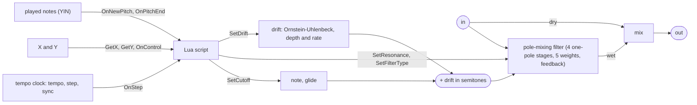

# shipahoy: resonant filter steered by scripts

`plugins/shipahoy/` (plugin `jp::ShipAhoyPedal`, DSP `jp::ShipAhoyEngine`), bundle
`jaypacks-shipahoy.lv2`, URI `https://github.com/scjurgen/jaypacks-dwarf-dsp/plugins/shipahoy`.
Mono in, mono out. A Lua script decides where the filter frequency goes, how resonant it is and which of
15 response types it has, on every step of a tempo clock (the Tempo knob, or the board's tempo) or when something
is played into it. The default script is the classic: a random hop on every step. The face has five knobs: Mix,
Tempo, Script, and X and Y, whose meaning each script decides.


## Background

The plugin is named after Frank Zappa's guitar piece "Ship Ahoy". It is on *Shut Up
'n Play Yer Guitar Some More* (released in May 1981), taken from the coda of a "Zoot
Allures" performance at Kosei Nenkin Kaikan, Japan, on 3 February 1976 [1].

Its sound is a guitar through a voltage-controlled filter in sample-and-hold mode: a clock
samples a random voltage several times per second and holds it, so the filter frequency
jumps to a new value on every tick, and with the resonance turned up every jump is heard as a
new, vowel-like peak. Guitar Player (October 1995, quoted in a forum thread [2]) describes it
as a voltage-controlled filter circuit from an old Oberheim keyboard. Other sources name the
Oberheim VCF-200 or the Maestro FSH-1 Filter Sample/Hold [3, 4]; the exact unit is not
confirmed by a primary source we found, so this page does not name one.

An earlier description of this plugin called the filter an "Oberheim Matrix" sound. That
cannot be the unit of the 1976 recording: the Oberheim Matrix-12 and Matrix-6 came out in
1985 [5]. The connection is a different one: shipahoy's filter types come from pole mixing,
which the Oberheim Xpander and Matrix-12 used for their 15 filter responses [6]; the table
here follows that set, with some additions.

## How it works



- **The script is the engine.** The plugin has no running state in which the filter moves without a script. The
  first factory script (Hop) is the classic Ship Ahoy; the others play sequences, trills or follow what is played.
  What the face's X and Y do is decided by the script (see X and Y below).
- **Steps.** A tempo clock of 96 ticks per quarter note makes a step every `Step` length (see Timing), and a step is
  the hook `OnStep`. The first step comes one lead (two blocks, 5.3 ms at 128 frames and 48 kHz) after activation,
  then every step a lead later.
- **Note to frequency.** A script sends the filter to a MIDI note (69 = 440 Hz, cents as fractions) with
  `SetCutoff`; the glide is linear in semitones, so exponential in frequency, and a command during a glide
  continues from where the frequency is, so nothing jumps. The frequency is clamped to [10 Hz, fs / 6]. Before its
  first `SetCutoff` a script finds the filter at 1 kHz.
- **Drift.** A slow random movement added to the note in semitones (`SetDrift(depth, { rate })`: depth 0 to 12
  semitones, 0 = off; rate 0.05 to 20 Hz). It is an Ornstein-Uhlenbeck process, so it wanders around 0, never runs
  away and its values are Gaussian: the depth is their standard deviation, peaks reach about three times as much. The
  rate is the corner frequency of its spectrum (flat below, 6 dB per octave above). It moves whether or not the
  transport runs, does not depend on the block size and starts the same after every activation; with depth 0 it
  stands still and costs nothing (about 0.5 points of DSP load on the Dwarf while it runs). At a high depth and a
  high resonance the level jumps with the frequency, as with the steps.
- **Tuning.** A note sets the frequency of the resonance peak, not the cutoff of the one-pole stages:
  `poleMixingTuningForPeak()` computes the stage pole that puts the self-oscillation exactly there, at any sample
  rate. Without resonance a lowpass therefore sounds somewhat darker than the note (stage cutoff 939 Hz for 1 kHz).
- **Resonance** (`SetResonance(percent)`) is a fraction of the self-oscillation threshold at the current frequency:
  100 % is the edge of oscillation for every frequency and filter type. At 85 % the peak sits 4 to 5.5 % below the
  frequency, at 95 % 1 to 2 % below.
- **Filter.** Four one-pole lowpass stages with a state clamp at +-1 (part of the sound, it limits the level at high
  resonance); the output is a weighted sum of the input and the four stage outputs, the weights set by the filter
  type (`SetFilterType`, the `FilterType` constants; `dsp/Filters/PoleMixingFilter.h`).
- **Defaults.** A new script starts with resonance 85, type Lp12 and no drift, and calls the commands only for what it
  wants different.
- **Smoothing and mix.** Mix, resonance and the drift depth are smoothed per sample (20 ms one-pole); mix is a
  constant-power crossfade from dry (0 %) to wet (100 %), 50 % mixes both at equal power.

The charts in `documentation/ShipAhoy/` show the classic sound at work, the hop algorithms, glides, the mix law and the
drift; `documentation/Filters/PoleMixing/` the filter types, the tuning and the clamp.

## Timing

One model for the clock:

`steps per second = tempo / 60 x steps per beat x speed ratio`

- **Tempo** (the face's second knob, 20 to 300 BPM): the tempo of the clock in free run. The
  knob has no designation: the host drives a port with the designation `time:beatsPerMinute`
  from the pedalboard's tempo, which would override it. The board's tempo arrives in a second
  port, Board tempo (settings), that only Sync = Transport listens to.
- **Step** (settings): the length of a step as a note value, 8/1 down to 1/64, default 1/16
  (four steps a beat). 60 BPM at 1/8 is 2 steps per second; at the default 1/16 the Tempo in
  BPM divided by 15 is the steps per second (105 BPM = 7 Hz).
- **Sync** (settings): Free run (the clock runs from activation, the Tempo knob is the tempo) or
  Transport (the board's tempo, the clock runs only while the board's transport rolls,
  `time:speed`, and starts with it, so the steps fall on the bar; the knob does not matter).
- **Speed ratio:** a script's `SpeedRatio(r)` multiplies the clock tempo, 0.1 to 10, 1 for every
  new script. At 60 BPM and 1/8 a ratio of 10 gives 20 steps per second, 0.1 gives 0.2.
- Steps from 1/64 at 300 BPM (80 per second) to 8/1 at 20 BPM (one in 96 seconds); with the
  ratio from 800 per second to one in 16 minutes.

## Scripting

Select the script with the Script knob (nine factory scripts, then User 1 to 8); a user script is a file
`user-1.lua` to `user-8.lua` in `/data/jaypacks/scripts/shipahoy/` on the Dwarf (`tools/jp.py push-script shipahoy
user-1 my.lua`, `tools/jp.py script-log shipahoy user-1`), reloaded within a second of every save. The
bundle's `scripts/API.md` lists everything a script can do (and is what to hand an LLM that
writes scripts); `scripts/constants.lua` the constants (`Ticks.Sixteenth`, `FilterType.Lp24` ...). The sandbox,
the budgets and the logs are those of the other scripted plugins (`docs/scripting.md`). The Lua editor
(`lua-editor/`, `apis/shipahoy/api.json`) completes and checks the commands, the getters, the hooks including
`OnNewPitch`, `OnPitchEnd` and `OnControl`, and `import "notes"` with its members; it edits the factory scripts in the
repo, pushes a draft to a user slot of the Dwarf and shows the API as a page in the browser (F1; workflow in
`lua-editor/README.md`); the file is generated from the sources, not written by hand
(`lua-editor/tools/api_from_headers.py`, `--check` fails when it is out of date).

The bundle's `scripts/` folder is also what to give an LLM that writes scripts: next to `API.md` and `constants.lua` it
has `AGENTS.md` (a guide for an AI assistant with the loop, the rules, the mistakes seen most and a prompt to paste) and
`examples/`, which are not selectable in the Script setting: copy one to a user slot. In lua-editor, Help > "Copy API
brief for an LLM" puts the guide, the API and the examples on the clipboard as one text.

| Example (`scripts/examples/`) | Shows |
|---|---|
| `01-smallest` | the smallest script: one note per step |
| `02-note-list-glide` | a list of notes in turn, with a glide |
| `03-random-hold` | a random note of a scale on every step, X and Y as knobs |
| `04-speed-timer` | speed changes on a repeating timer (`SetTimer`, `SpeedRatio`) |
| `05-follow-played` | the filter follows the notes played into the plugin (`OnNewPitch`, `notes`) |
| `06-transport-reset` | the pattern restarts when the transport starts |

```lua
-- an eight-note sequence, one note per step; X is how much of the step is spent gliding to it
local notes = { 57, 60, 64, 67, 64, 60, 62, 59 }

function OnStart()
    SetResonance(GetY())
end

function OnControl(x, y)
    SetResonance(y)
end

function OnStep(step)
    SetCutoff(notes[step % #notes + 1], { glide = GetX() / 100 })
end
```

| Name | What |
|---|---|
| `OnStart()` | Once, after the script is loaded; its commands apply at once |
| `OnStep(step)` | A step of the clock (the Step setting at the tempo and ratio of the moment); `step` counts from 0 at the start of the clock |
| `OnNewPitch(note, hz, pitch, periodicity, level)` | A note was played into the plugin: `note` is the nearest MIDI note, `pitch` the MIDI note with cents, `periodicity` 0 to 1 how clearly periodic it was (1 minus the YIN difference at the period, not a probability), `level` the linear RMS of the last 25 ms |
| `OnPitchEnd(note)` | The note that was playing has ended |
| `OnControl(x, y)` | X or Y was moved (both values, 0 to 100), at most once per block and only on a change |
| `GetX()`, `GetY()` | The values of X and Y (0 to 100) at the moment of the call |
| `OnTick(tick)`, `OnTimer(id)`, `OnTransportStart()`, `OnTransportStop()`, `SetTimer`, `StopTimer` | The clock of the scripting core, 96 ticks per quarter note |
| `SetCutoff(note, { ticks, ms, glide, delayTicks, delayMs })` | Glide the frequency to a MIDI note (69 = 440 Hz, fractions are cents) in `glide` (0 to 1, default 0.05) of the step: `ticks` plus `ms`, or the present step length when both are 0. 0 jumps, 0.5 glides in the first half and holds, 1 arrives as the step ends |
| `SetResonance(percent)` | The resonance, 0 to 100 % of self-oscillation (default 85) |
| `SetFilterType(type)` | One of the `FilterType` constants (`Lp6` ... `Phaser4`; default `Lp12`) |
| `SetDrift(depth, { rate })` | The drift: depth in semitones 0 to 12 (0 = off), rate in Hz 0.05 to 20 (default 1) |
| `SpeedRatio(ratio, { delayTicks, delayMs })` | Multiply the clock tempo, 0.1 to 10 |

- **X and Y.** The two knobs are labelled X and Y only: the label is part of the face picture and of the plugin
  description, and LV2 cannot change it at run time. What they do is decided by the running script and written in
  its header comment, in two lines (`-- X: ...`, `-- Y: ...`, or `-- X, Y: not used`). The table below is generated
  from those lines (`tools/script_headers.py update`, checked by `tools/test_script_headers.py`). A script that
  reads neither ignores them. The defaults X = 5 % and Y = 85 % are the classic sound of Hop (a glide of 5 % of the
  step, resonance 85 %).

<!-- xy:begin -->
| Script | X | Y |
|---|---|---|
| Hop (`hop.lua`) | glide in percent of the step, 1 to 100 (5 = a short glide, 100 = glides all the way to the next step) | resonance in percent, 0 to 100 (85 = the classic, above 95 it rings hard) |
| Sequence (`sequence.lua`) | glide in percent of the step, 1 to 100 (70 reaches each note shortly before the next step) | resonance in percent, 0 to 100 |
| Random hold (`random-hold.lua`) | glide in percent of the step, 1 to 100 | resonance in percent, 0 to 100 |
| Alternating (`alternating.lua`) | glide in percent of the step, 1 to 100 | resonance in percent, 0 to 100 |
| Follow (`follow.lua`) | glide in percent of the step, 1 to 100 (70 is a flowing line) | resonance in percent, 0 to 100 |
| Answer (`answer.lua`) | glide in percent of the step, 1 to 100 (50 = half the step) | resonance in percent, 0 to 100 |
| Echo (`echo.lua`) | glide in percent of the step, 1 to 100 (20 = a fifth of the step) | resonance in percent, 0 to 100 |
| Slow drift (`slow-drift.lua`) | drift depth in percent, 0 to 100 (50 = 1.5 semitones of wobble, 100 = 3) | resonance in percent, 0 to 100 |
| Toggle trill (`toggle-trill.lua`) | glide in percent of the step, 1 to 100 | resonance in percent, 0 to 100 |
<!-- xy:end -->

- **Timing.** The script runs in the host's worker thread, a block or two behind the audio. The clock is a lead ahead
  of the audio and a command of a clock hook (`OnStep`, `OnTick`, `OnTimer`, the transport) lands at the sample of the
  event whose hook called it, plus the delay, plus the lead. The lead is not a setting: it is the round trip of the
  worker, two blocks of the largest block the host has called the plugin with (the first block sets it, a larger one
  raises it, activation starts again). Every event of the clock moves by the same lead, so steps keep their
  distances; only where the first one falls depends on the block size. A command that still comes too late (the
  first larger block of a host that changes its block size, a worker that was not scheduled in time) is applied at
  the start of its block and counted (output Late).
- **Immediate reactions.** What answers something from outside does not wait for the lead: the commands of
  `OnNewPitch`, `OnPitchEnd` and `OnControl` and the commands of a script's load (`OnStart`) are applied at the first
  block boundary after they reach the audio thread (plus their own delay), so a played note or a turn of X is
  followed as fast as the block size allows. Their timing therefore depends on the block size, which is the price of
  the speed.
- **Failures.** A new script takes over where the filter is, with the defaults of resonance, type and drift. A hook
  that fails (an error, over its budget) or a reload holds the frequency, drops what was queued and stops the timers;
  the script goes on with the next event. A file that does not load changes nothing, the previous script keeps
  playing (Script status: 2 missing, 3 compile error, 4 runtime error, 5 over budget, 6 out of memory).
- **Played notes.** While the selected script defines `OnNewPitch` or `OnPitchEnd` the input is read by a
  monophonic pitch detector (YIN, 80 Hz to 1 kHz, a guitar's range, a reading every 20 ms) and a note tracker; with
  neither hook nothing runs. A note arrives about 80 ms after its start (three steady readings, a window of 25 ms),
  the end of a note about 60 ms after the sound has stopped; the same note struck again (a level rise of 6 dB)
  arrives again; noise, a muted chord and silence give none. One voice only: a chord has no single pitch. Details,
  figures and the failure modes (`documentation/YinPitch/README.md`).
- **notes.lua.** `import "notes"` keeps the last five played notes (`Notes.remember`, `Notes.last`), the notes to
  build from (`Notes.window`: the played ones, preceded by the end of `Notes.fallback`, a minor pentatonic, until five
  were played, so a script sounds from the first step), their pitch classes and distances above a root
  (`Notes.pitchClasses`, `Notes.intervals`) and a repeated sequence (`Notes.sequence`).
- Factory scripts: `hop` (the classic: a random note inside three octaves around 1 kHz on every step), `sequence`
  (the one above), `random-hold` (a random note inside two octaves around middle C), `alternating` (a trill between
  the lower and the upper part), `slow-drift` (a random walk around 800 Hz over four octaves with a wobble on top),
  `toggle-trill` (a trill between the lower and the upper 40 % of three octaves, band pass); and three that use what
  is played: `follow` (steps through the last five played notes, oldest to newest), `answer` (a phrase an octave
  above the newest note that climbs through the pitch classes of the last five and comes back) and `echo` (moves the
  filter to the played note and keeps it there).

```lua
-- the filter goes to what was played, at once: the command of the hook is applied at the next block
function OnNewPitch(note, hz, pitch, periodicity, level) SetCutoff(pitch, { glide = 0.1 }) end
```

## Techniques

| Technique | Where | Charts and theory |
|---|---|---|
| Pole-mixing filter: four one-pole lowpass stages, output a weighted sum of input and stage outputs (15 responses from one structure), feedback from stage 4 | `dsp/Filters/PoleMixingFilter.h` | `documentation/Filters/PoleMixing/` |
| One-pole lowpass stage with a state clamp at +-1 (soft limit at high resonance) | `dsp/Filters/OnePoleLowpass.h` | `documentation/Filters/PoleMixing/` (stage response, clamp) |
| Exact self-oscillation threshold and closed-form tuning of the resonance peak (`poleMixingOscillationThreshold()`, `poleMixingTuningForPeak()`) | `dsp/Filters/PoleMixingFilter.h` | `documentation/Filters/PoleMixing/` (threshold, peak tuning) |
| Steps of a tempo clock (96 ticks per quarter, exact samples, a lead ahead of the audio) | `plugins/shipahoy/ShipAhoyPedal.h`, `scripting/TempoClock.h`, `scripting/TimedEventBuffer.h` | `docs/scripting.md`, `tests/unit/Plugins/ShipAhoyPedal_test.cpp` |
| Sample and hold in Lua: uniform, toggle and walk hop targets (the algorithms of `hop.lua`, `toggle-trill.lua`, `slow-drift.lua`; reference implementation with violet and gauss in `tests/unit/ShipAhoyClockedEngine.h`) | `plugins/shipahoy/scripts/`, `lua` `math.random` (xoshiro256**) | `documentation/ShipAhoy/` |
| Linear glide in semitones, restarting from the current value | `dsp/Generators/CutoffTrajectory.h` (used by `plugins/shipahoy/ShipAhoyEngine.h`) | `documentation/ShipAhoy/` (glide) |
| Ornstein-Uhlenbeck random walk with the exact transition (the drift, the walk of `slow-drift.lua`) | `dsp/Generators/OrnsteinUhlenbeck.h` | `documentation/OrnsteinUhlenbeck/` |
| One-pole parameter smoothing per sample (20 ms) for mix, resonance, drift depth | `dsp/Parameters/ParameterSmoothing.h` | |
| Constant-power (sin/cos) dry/wet crossfade | `dsp/Numbers/PanLaw.h` | `documentation/ShipAhoy/` (mix law) |

Common to every plugin (the LV2 adapter, `lv2/Lv2Adapter.h`): any host block size,
flush-to-zero for denormal floats while `run()` executes (`lv2/FlushDenormals.h`), NaN
control values ignored (bit-pattern test, safe under `-ffast-math`), no allocation, locks or
I/O in `run()`.

## Controls

| Control | Range | Default | Notes |
|---|---|---|---|
| Mix | 0 to 100 % | 100 | On the pedal face; 0 dry, 100 wet |
| Tempo | 20 to 300 BPM | 105 | On the pedal face; the clock's tempo in free run |
| Script | Hop, Sequence, Random hold, Alternating, Follow, Answer, Echo, Slow drift, Toggle trill, User 1 to 8 | Hop | On the pedal face |
| X | 0 to 100 % | 5 | On the pedal face; what it does is decided by the script (table above) |
| Y | 0 to 100 % | 85 | On the pedal face; the same |
| Sync | Free run, Transport | Free run | Settings |
| Step | 8/1 to 1/64 | 1/16 | Settings; the length of a step |
| Board tempo | 20 to 300 BPM | 120 | Settings; filled by the host (`time:beatsPerMinute`), used with Sync = Transport |
| Transport | off, on | off | Settings; filled by the host (`time:speed`) |
| Script status, Late, Dropped | outputs | | See Scripting |

Resonance, filter type, glide and drift are not controls any more: a script sets them (or X and Y do). Presets set the
script, Mix, Tempo, X and Y and nothing else: "Ship Ahoy" (Hop, 105 BPM, X 5, Y 85), "Slow drift" (Slow drift, 30 BPM,
X 50 = a wobble of 1.5 semitones, Y 60), "Toggle trill" (Toggle trill, 150 BPM, X 10, Y 70) and "Follows playing"
(Follow, 105 BPM, X 70, Y 80: play a line into it). Pedalboards saved with 0.2.x may load with default values for
the controls that no longer exist.

## Filter types

A script picks the type with `SetFilterType(FilterType.Lp12)`; the constant for each row is `Lp6`, `Lp12`, `Lp18`, `Lp24`,
`Bp6`, `Bp12`, `Hp6`, `Hp12`, `Hp18`, `Hp24`, `Notch`, `NotchOctaves`, `Phaser2`, `Phaser3`, `Phaser4`.

| Type | Character |
|---|---|
| lp 6 / 12 / 18 / 24 dB | Lowpass, 6 dB per octave per order. 12 dB is the default: clear vowels; 24 dB is darker and rounder |
| bp 6 / 12 dB | Bandpass: only the region around the peak, thin and vocal, "wah"-like |
| hp 6 / 12 / 18 / 24 dB | Highpass: removes the body below the frequency; the passband ends about 0.6 dB per order low at 16 kHz |
| notch | One notch at the frequency (-24 dB without resonance) |
| notch octaves | Two notches, about an octave below and an octave above the frequency (501 Hz and 1974 Hz for 1 kHz) |
| 2 / 3 / 4 pole phaser | Notch mixes (not allpasses) whose notches move with the frequency: "2 pole phaser" is the same response as "notch", "3 pole phaser" one notch above the frequency (1.72 kHz for 1 kHz), "4 pole phaser" two (415 Hz and 2.38 kHz) |

Notch positions computed with `poleMixingResponse()` for a frequency of 1 kHz without
resonance (`shipahoy_expected` on a fine grid); resonance adds a peak near the frequency.

## Getting the "Ship Ahoy" sound

Loading the plugin gives the preset. Step by step from scratch:

1. Mix 100, Script Hop.
2. Tempo 105 BPM at 1/16 (7 steps per second): the hops are heard as a rhythm of their own, not as a tremolo.
3. Y (the resonance) high, 80 to 95 %: each hop becomes a distinct vowel. Above about 90 % the peak
   rings and the level rises.
4. X (the glide) short, a few %: the hops step; longer glides turn steps into swoops.
5. The centre (1 kHz) and the range (three octaves) are fixed in `hop.lua`; copy it to a user slot and change the
   two numbers at the top for another instrument.

Variations:

- **Slow sweeps:** the Slow drift script at 30 BPM (the "Slow drift" preset): a drifting, auto-wah-like filter; X is
  the depth of the wobble.
- **Trills:** Toggle trill alternates low and high; at 8 to 12 steps per second with a band pass it trills (the
  "Toggle trill" preset).
- **Rhythm:** with Sync = Transport the steps follow the board's tempo and start with the
  transport; the Step setting picks the note value (1/16 by default).
- **Phaser types** with Mix around 0 % give moving notches instead of moving peaks (`SetFilterType(FilterType.Phaser3)`
  in a script of your own).
- **Playing the frequency:** a script that holds the note `GetX()` says (`OnControl` for the immediate reaction), then
  map X to an expression pedal or MIDI.

Level: resonance changes the loudness, most at high settings. Measured on the Mac with a
decaying 110 Hz sawtooth at the defaults, the output is about +2.5 dB RMS above the input at
85 % and +7 to +8 dB at 100 %, with peaks below 0.9 for an input peak of 0.5 (the stage clamp
limits it). Turn down the following stage, or the Mix, when going above 90 %.

Starting points for instruments (suggestions, not measurements): sustained notes and chords
let the hops be heard; try the pedal before and after distortion, the two placements sound
different; on bass a lower centre (200 to 500 Hz) with a lowpass type keeps the body;
synthesizer pads and drones show the hops clearly because their spectrum stays steady.

## Performance on the Dwarf

<!-- perf:begin -->
| Settings | CPU (points of mod-ui's DSP load) | Range over the cycles |
|---|---|---|
| defaults | 1.7 | 1.7 to 2.0 |
| preset Slow drift | 4.4 | 4.4 to 5.0 |
| preset Toggle trill | 2.0 | 1.9 to 2.5 |
| preset Follows playing | 4.0 | 3.8 to 4.1 |

Memory: the plugin allocates 71 kB when it is created (at 48 kHz, peak 71 kB, nothing while it runs; counted by its memory probe on 2026-10-23); the binary is 375 kB. Xruns while processing: 0.

Measured 2026-10-23 with tools/jp.py perf: plugin 0.3.0, commit 4732074+changes, MOD OS v1.13.5.3315, jackd 48000 Hz, 128 frames; input siggen white noise at -12 dBFS; median of 3 cycles of 6 s with and without the plugin.
<!-- perf:end -->

On the Mac: 18 to 24 ns per sample on an Apple M-series core (0.1 % of real time).

## Tests

`tests/unit/Plugins/ShipAhoyEngine_test.cpp` (the engine: filter, glide, note mode, drift: depth is the
standard deviation, rate the corner frequency, repeatable, independent of the blocks; and the reference hopper of
`tests/unit/ShipAhoyClockedEngine.h`: ranges, glide, distributions of the random types),
`tests/unit/Plugins/ShipAhoyPedal_test.cpp` (the plugin: every file of `scripts/examples/` runs without errors or late commands, the clock and the steps for blocks of
1 to 4096, glide, speed ratio, failures, reload, new scripts start with the defaults; the setters and their
clamping; X and Y through `GetX()`, `GetY()` and `OnControl` once per change; commands of the external hooks applied
at the next block without the lead; every factory script runs without errors, late or dropped commands, each says
what X and Y do; the first script against exact notes; played notes: a phrase of two notes reaches `OnNewPitch` within
60 to 150 ms with its pitch, noise and silence give none, `OnPitchEnd`, the detector runs only while a pitch hook is
defined, the output is the same for blocks of 16, 128 and 512, `notes.lua` checked inside Lua, `follow`, `answer`
and `echo` against what the phrase should make them do; each of these checked by mutation),
`tests/unit/Scripting/Binding_test.cpp` (the getters of the scripting core),
`tests/host/ShipAhoy_test.cpp` (through the binary: filter shapes within 0.077 dB, hop positions
read from the audio: uniform for Hop, an Ornstein-Uhlenbeck walk for Slow drift, tempo and step against the step
rate, a user script against a held filter, an A5 played into the plugin against a filter held at 880 Hz),
`tests/host/TestPlugins_test.cpp` (through the meter), `tools/test_script_headers.py` (X and Y lines and table)
and on the device `tools/jp.py test-device shipahoy` (including user scripts written over ssh, X and Y, and
siggen as the player of an A5 and then an A4 that the filter must follow).

## Sources

1. Wikipedia, "Shut Up 'n Play Yer Guitar" (track listing and release),
   https://en.wikipedia.org/wiki/Shut_Up_%27n_Play_Yer_Guitar (read 2026-10-15).
2. DIY Stompboxes forum, quoting Guitar Player, October 1995, p. 80,
   https://diystompboxes.com/smfforum/index.php?msg=684384 (read 2026-10-15; the magazine
   itself was not checked).
3. Guitar World on the Red Witch Euphemia pedal (Maestro FSH-1, Oberheim VCF-200),
   https://www.guitarworld.com/news/red-witch-euphemia (read 2026-10-15).
4. Pedal of the Day, Lone Wolf Audio Acetylene Nirvana (Oberheim VCF-200),
   https://pedal-of-the-day.com/?p=8539 (read 2026-10-15).
5. Wikipedia, "Oberheim Matrix", https://en.wikipedia.org/wiki/Oberheim_Matrix (read
   2026-10-15).
6. Electric Druid, "Multimode filters, Part 2: Pole-mixing filters",
   https://electricdruid.net/multimode-filters-part-2-pole-mixing-filters (read 2026-10-15).
