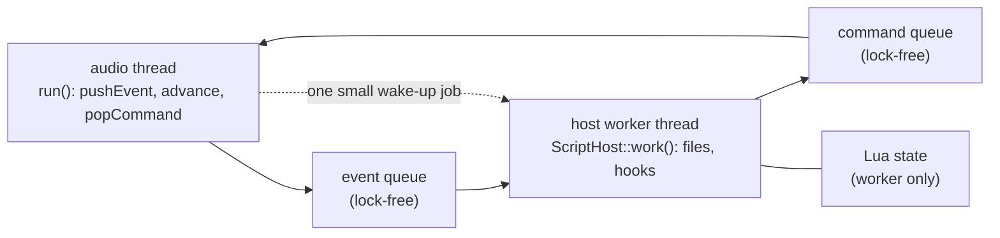

# Scripting: Lua scripts for plugins

The core that lets a plugin run Lua 5.4 scripts that users and LLM sessions write and change on their own machine
without recompiling. It is plugin independent (`scripting/`); a plugin supplies only its bindings. The decisions and
the measurements behind it are in `docs/outlook-lua.md` and `docs/device.md`; the plan and its status in
`docs/roadmap.md` ("Lua scripting"). This page describes what exists (steps 1 to 8); the first plugin that uses it
(Morphexsynth) has its bindings in `plugins/morphexsynth/MorphexScript.h` (step 4); it runs scripts in steps 5 and 6. MIDI Script and Ship Ahoy (`plugins/shipahoy/ShipAhoyScript.h`, an audio filter whose steps come from the tempo clock, 96 ticks per quarter note) use the timed pieces. Besides commands (script to plugin) and hooks (plugin to script) a binding set can declare getters (`GetterSpec`, at most eight): functions without arguments that return a number the plugin keeps for the script (`ScriptHost::setValue`, any thread, never waits), as Ship Ahoy does for the knobs X and Y (`GetX()`, `GetY()`); the generated API description lists them in a section of their own.

## The pieces

| File | What it is |
|---|---|
| `third_party/lua/` | Lua 5.4.8 as released, compiled as C (`jp_lua`). `jp_lua_config.h` is included in front of every source and fixes the string hash seed, so `pairs()` visits keys in the same order in every run |
| `scripting/Binding.h` | The tables a plugin writes: commands (name, positional arguments, table fields with kind, range, default, one-line doc), hooks, tables of constants |
| `scripting/LuaRuntime.h/.cpp` | `Runtime`: one sandboxed Lua state with the commands, hooks and constants of a `BindingSet`; limits; `import`; log |
| `scripting/ApiDescription.h/.cpp` | `apiMarkdown()` and `constantsLua()`: the documents generated from a `BindingSet` |
| `scripting/SpscQueue.h` | Lock-free queue for one producer and one consumer thread |
| `scripting/ScriptHost.h` | `ScriptHost<Event, Command>`: files, hot reload, the worker thread side, the queues, logs |
| `scripting/TimedEventBuffer.h`, `MidiScheduler.h` | Messages that wait for an absolute sample and leave at their exact frame; the stuck-note guard, panic and the flood budget |
| `scripting/TempoClock.h`, `Timers.h` | The tick clock, the timers, the core hooks `OnTick`, `OnTransportStart`, `OnTransportStop`, `OnTimer` and the commands `SetTimer` and `StopTimer` |
| `scripting/ScriptDirectory.h` | `userScriptDirectory(plugin)`: the folder of the user's scripts (`$JP_SCRIPT_DIR/<plugin>`, the Mac's Application Support, `/data/jaypacks/scripts/<plugin>` on the Dwarf) |
| `scripting/BindingCheck.h` | `checkBindings()`: the test of a plugin's binding tables (names, ranges, defaults) |
| `lv2/PedalServices.h` | `WorkScheduler` that the host uses to wake the host's worker thread |

## What a script is

A Lua file. The top-level code runs once when the file is loaded; the plugin then calls the script's hooks
(`OnStart`, and whatever the plugin defines, e.g. `OnNoteOn(channel, note, velocity)`) when events arrive. The script
steers the plugin by calling its commands (`SetGain(-6)`, `SetOscillator(0, { waveform = Saw, level = 0.5 })`); the
samples stay in C++. Commands may be called at the top level and from hooks.

Globals every script has: `Log(...)` (and `print`), `clamp(x, lo, hi)`, `lerp(a, b, t)`, `import "name"`, one table
per group of constants, one function per command, and the standard libraries base, math, table and string with the
changes below.

## The sandbox

| Closed | How |
|---|---|
| os, io, package, debug, coroutine, utf8, require | libraries not opened |
| dofile, loadfile, load, collectgarbage, warn, string.dump | removed |
| precompiled chunks | text only (`luaL_loadbufferx` mode "t") |
| endless loops, also inside pcall | instruction count hook; after the budget is used up the hook raises an error at every instruction, so a pcall in a loop cannot swallow it |
| memory | the allocator refuses past the limit (default 1 MB); the script gets "not enough memory" |
| wall time | checked by the same hook (default 20 ms per hook call, 250 ms per load) |
| `__gc` finalizers | `setmetatable` refuses a metatable with one: Lua switches the hooks off while a finalizer runs, so a loop in it could not be stopped (found by a test that hung) |
| catastrophic string patterns | `string.find`, `match`, `gmatch`, `gsub` take a subject of at most 8192 and a pattern of at most 100 characters: the matcher is C code that no instruction count interrupts |
| `import` | takes a name of letters, digits, `-` and `_` (at most 40), never a path |
| hash order and random numbers | fixed hash seed; `math.random` seeded by the host |

The limits are `Limits` (`handlerInstructions` 100000, `loadInstructions` 2000000, `handlerMillis` 20, `loadMillis`
250, `memoryBytes` 1 MB). On the Dwarf's A35 a Lua VM instruction takes 0.065 us with the hook, so 100000 are 5 to 7
ms and 2000000 are 90 ms (241 ms for a tail-call loop, which the 250 ms wall limit would also stop). These are the
limits for accidents (a typo, a loop), not a defence against a determined attacker: the user installs the script
on their own device, and the worst a script can do is stall its own plugin's worker thread, never the audio.

## Commands and how they are checked

A command is positional arguments followed by an optional table of named fields. The runtime checks every call
against the `CommandSpec` before the plugin sees it:

- a wrong Lua type, too few or too many arguments, or a table that is not a table is an **error** that stops the script
  (the message names the command and the argument, `patch:12: SetGain: 'db' must be a number, not string`);
- a **number** outside its range is clamped; a **whole number** that is outside its range, not whole, a non-finite number or
  a text that is too long **drops the call** with a line in the script log (`patch:12: SetVoice: 'index' = 7 is outside
  0..2, call ignored`), the previous setting stays;
- a table field the command does not know is reported and ignored (a misspelled field would silently keep its default);
- the plugin may reject a call after the checks (`makeCommand()` returns false with a reason): also logged, the script goes on.

The checked call (`CommandCall`: the values in spec order, which of them the script gave, text values) is converted by
the plugin's `ScriptBinder::makeCommand()` into the plugin's own plain command struct.

## The host: threads, queues, files

- The **audio side** never waits and never allocates: `pushEvent()` copies the event into the event queue and wakes the
  worker with one small job (only one is outstanding at a time; a refused job is tried again at the next `advance()`);
  `advance(frames)` counts the time to the next file check; `popCommand()` takes what the script has called;
  `select(origin, name)` asks for a script. A full queue drops and counts.
- The **worker side** (`work()`, called from the pedal's `work()`): picks up a selection, checks the file's
  modification time every `pollSeconds` (stat, 30 to 57 us on the Dwarf) and reloads a changed file, then hands
  every queued event to the binder's `dispatch()`, which calls the hook. The Lua state lives only here.
- Worker answers are not used for data: the host's rings are small (docs/device.md), so commands go through the
  host's own queue and the worker's answer channel stays unused.
- A **reload** builds a new state: the file is compiled, the top-level code and `OnStart` run, and the commands they call
  are held back. If all of it worked, the generation counter goes up, the held commands are queued with the new
  generation and the old state is replaced; otherwise the old state stays, `state()` and the log say what was wrong,
  and the same file is tried again only after it changes. `popCommand()` skips commands of an older generation;
  `generation()` tells the pedal that a new script has taken over (so it can release what the old one set).
- A hook that raises an error, runs over its budget or runs out of memory ends that call only (`hookFailures()` counts them); `state()` shows the
  latest problem, later events still run.
- Files: `<factoryDir>/<name>.lua` (the plugin's own, read only) and `<userDir>/<name>.lua`; `import` finds, in this
  order, the plugin's embedded modules, the user's files and the factory files. A name is letters, digits, `-`, `_`.
- **Logs:** after a load, and after a failing hook or new script output (at most once a second, the file check
  forces the last write), `<userDir>/<name>.log` has the script, the state, the message, the generation, the load
  time, the memory peak, the dropped events and commands, and the script's own `Log` lines.

`ScriptState` is what a control output can show: 0 idle, 1 ok, 2 file missing, 3 compile error, 4 runtime error,
5 over the budget, 6 out of memory.

## Timed MIDI: clock, timers, scheduler

A script runs in the worker thread, a block or two behind the audio. For music that must land on the sample, the
audio thread keeps the time and the script only decides what happens "at event time + offset". The pieces (all on the
audio thread, no allocation, no locks) are used together by a plugin like this, once per block:

1. **Stamps.** `pushEvent(event, time)` and `pushCoreEvent()` carry the absolute sample the event happened at. The
   commands that the hook calls come back with that time (`peekCommand(command, generation, time)`), so a command's
   moment is "the event's sample plus its own delay", never "now". A delay is a field of the plugin's command
   (samples, ms or ticks, converted with `TempoClock::msToSamples()` and `ticksToSamples()`).
2. **Clock.** `TempoClock` counts ticks (24 per quarter note in the tests) from `start(sample)` at the tempo that
   `setTempo()` gives (clamped to 1 to 3000; the plugin reads it from the `time:beatsPerMinute` port, whose own range is the plugin's). Ticks are
   computed from an anchor, so they do not drift. `announce(clock, timers, limit, push)` makes the ticks and the
   timers that are due before `limit` into `CoreEvent`s in the order of their times; the plugin calls it with the end of
   the block plus a lookahead, so the worker has the event before its sample comes.
3. **Timers.** `SetTimer(id, { ms = ..., ticks = ..., repeating = ... })` and `StopTimer(id)` are commands of the
   core (`c_timerCommands`, the last two entries of the plugin's table, `HostConfig::timerCommandBase`): the host
   answers them itself. The audio thread pops them with `popTimerRequest()` and applies them to a `TimerBank`; a
   timer counts from the event whose hook set it. A repeating timer is due one delay after its last due time (no
   drift), at least every millisecond. Requests of an old script are skipped.
4. **Scheduler.** `MidiScheduler::schedule(due, message)` puts a message in a sorted buffer (512 places);
   `emit(output, start, frames)` writes what is due in the block at its frame; a message whose time has passed goes out at
   frame 0 and is counted (`late()`). Every note on that went out is remembered until its note off went out;
   `panic(now)` ends them all at once and drops what was waiting. A note off is never refused (it may push another
   message out of a full buffer) and does not count against the budget (`setBudget(messages, windowFrames)`, default 128
   per 128 samples) that cuts a script in a loop.

What a plugin does with them, and what the simulation in the test does: on a change of `readyGeneration()` (a new
script took over) and when `hookFailures()` goes up (a hook failed: the script's state is unknown), call `panic()` and
clear the timers; after a failure also drop the commands still in the queue (the failed call's among them); the script
goes on with the next event. A file that does not load is no failure: the old script keeps running. Pop the commands at the start of
a block, schedule them, call `announce()`, `emit()`, `advance()`. Run the host's `work()` as the host does.

Timing needs three things: a lookahead of at least the block length plus what the worker takes (two blocks and a
little, e.g. 3 ms on the Dwarf), a start of the clock that lies in the future by at least as much (a transport that
starts "now" has its first events late), and timers longer than the round trip (a timer shorter than that fires late,
at frame 0 of the block it is found in, and is counted).

## The API description

`apiMarkdown(bindings, limits)` writes the document an author, or an LLM on the author's machine, reads before writing a
script: how scripts run, the limits, every command with a table of its arguments and fields (type, range, default,
meaning), every hook, every table of constants. It comes from the same `BindingSet` that checks the calls, so it
cannot say anything the plugin does not do. `constantsLua()` writes the constants as a Lua file. The plugin build is
to put both into the bundle (step 5).

## Adding scripting to a plugin

`docs/scripting-plugins.md` is the checklist, with Morphexsynth (`plugins/morphexsynth/MorphexScript.h` and
`MorphexsynthPedal.h`) as the example: the binding table, the event and command structs, the binder, the pedal's part,
the factory scripts, the documents, the tests.

## The user's loop

What a user of an installed plugin needs: the Dwarf's USB connection and `ssh`/`scp`, a text editor or an LLM.

1. Read `scripts/API.md` of the plugin's bundle on the device (`/root/.lv2/jaypacks-<name>.lv2/scripts/API.md`), or
   give an LLM the whole `scripts/` folder of the bundle: next to `API.md` and `constants.lua` it holds `AGENTS.md`, a
   guide for an AI assistant (where a script goes, the loop below, the rules in short, the mistakes seen most, the
   index of the examples, a prompt to paste), and `examples/`, small scripts that run as they are (about seven per
   plugin, one idea each). A coding assistant started in that folder reads `AGENTS.md` by itself. Without the device,
   lua-editor's Help > "Copy API brief for an LLM" gives the same material as one Markdown text (guide, API, examples).
2. Write the script as `<scripts folder>/<name>.lua` (Morphexsynth: `/data/jaypacks/scripts/morphexsynth/user-1.lua`;
   `tools/jp.py push-script morphexsynth user-1 my.lua` copies a file there) and select it on the plugin (Morphexsynth: Script
   = User 1).
3. The plugin reloads the file within a second after every save. `Script status` on the plugin shows how it went, and
   `<name>.log` next to the script (`tools/jp.py script-log morphexsynth user-1`) says what was wrong, with the
   line, plus the script's own `Log` lines and the calls that were ignored.
4. A script that fails to load is rejected and the previous sound goes on: a typo cannot silence the instrument.

The examples are in the repository as `plugins/<name>/scripts/examples/NN-slug.lua`, the guide as
`plugins/<name>/scripts/AGENTS.md`. The guide holds no names, ranges or limits of the API (it points to `API.md` and
`constants.lua`, which are generated), so it cannot go stale; a test (`lua-editor/tests/test_examples.py`) checks every
command, hook, library and constant it names against the generated API. An example is loaded into the plugin's real
runtime by a unit test of the plugin, and checked against the API by the editor's tests.

Nothing has to be compiled, nothing has to be restarted. The files are plain text in the data partition (`/data`);
installing a plugin replaces only its bundle in `/root/.lv2`, so the scripts stay. That `/data` survives a MOD OS update
was not tested.

## Tests

`tests/unit/Scripting/`: the runtime (sandbox escapes tried one by one, budgets, memory bombs, the pcall trick, import
rules, reproducible random numbers and hash order), the command checks, the generated documents, the queue (also
two threads), the host (load, reload, broken files, hook errors, floods, refused wake-ups, modules, a real worker
thread), the timed pieces (buffer, clock, timers, scheduler, each alone) and a chain test (`ClockedMidi_test.cpp`: a
simulated plugin with the clock, the host, the worker and the scheduler: an arpeggio and a repeating timer land on the
same samples for blocks of 16 to 4096, a stopped timer stops, a reload and an error end the sounding notes, a flooding
script is cut), and a test that no file of `scripting/` includes or names a plugin. They use a toy binding set
(`ToyBindings.h`) with nothing of any plugin in it. The queue and host tests pass under ThreadSanitizer (the queue test
fails with a release store weakened to relaxed: checked), everything under ASan and UBSan.
