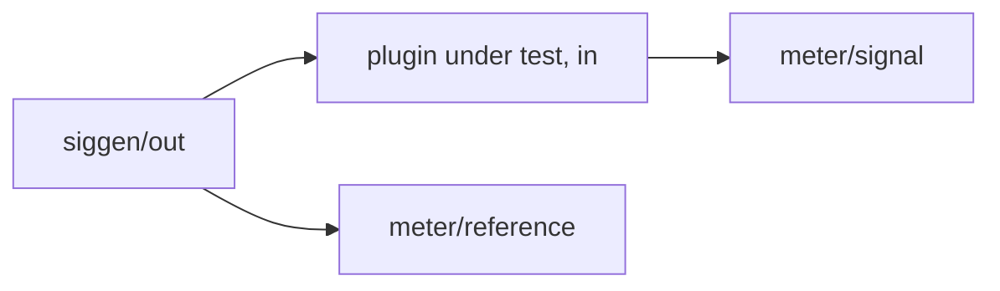

# Test plugins and device measurements

Three plugins let a script on the Mac test a plugin on the Dwarf without recording audio:
the script sets ports through the mod-ui websocket and reads results from control output
ports. The plugins measure in place on the device with the same
analysis code the Mac tests use (`dsp/Analysis/`).

| Plugin | Bundle | Role | Reference |
|---|---|---|---|
| probe | `jaypacks-probe.lv2` | Smallest plugin with control outputs: echo of an input, audio time, and counters of the MIDI messages it receives, passes them on to its MIDI output and sends every note on through the host's worker thread and back. Checks the readback path, the MIDI path and the worker | `docs/plugins/probe.md` |
| siggen | `jaypacks-siggen.lv2` | Deterministic test signals | `docs/plugins/siggen.md` |
| meter | `jaypacks-meter.lv2` | Measures a signal against a reference in windows | `docs/plugins/meter.md` |

## The readback path (measured on the device, 2026-10-15)

- A control output reaches the client only if the plugin's `modgui.ttl` lists it in
  `modgui:monitoredOutputs`; the generator lists every port of `ports-control-out`.
- mod-ui sends `output_set /graph/<instance> <symbol> <value>` over the websocket, the value
  as text with six decimals (`123.456789` arrives as `123.456787`, the float value). It only
  keeps sending while the client echoes every `data_ready <n>` message; `modui.WebSocket`
  does that.
- Updates come about every 12.5 ms (median of 480 intervals, 9 to 108 ms), and only for
  values that changed.
- From `param_set` on an input to the changed output arriving at the client: 23 ms median
  (19 to 36 ms over 10 tries).
- The script was the only websocket client during the measurement; whether a browser tab on
  the same board changes the rate was not checked.

`tools/device_tests/probe_readback.py` repeats these measurements (needs the probe
installed).

Consequences for the plugin design: levels are reported in dB (six decimals keep small levels
in dB but not in linear units), counters stay below 2^24 (exact in a float), and results are
held for a whole measurement window so that late or skipped updates do not matter.

## MIDI on the device (measured 2026-10-16)

The probe counts MIDI: `midiEvents` (all messages), `midiChannels` (bit n set for channel n + 1,
so MPE member channels 2 to 16 show as 0xFFFE) and the last message (`midiStatus`,
`midiData1`, `midiData2`). `tools/device_tests/midi_check.py` loads a fresh probe, connects
the board's MIDI input to it and plays messages the way a USB controller delivers them (the
path and its traps are in `docs/device.md`, "MIDI"): 16 note ons on 16 channels (16 of 16
counted, mask 0xFFFF), an MPE-style burst of note on, pitch bend, channel pressure and CC74 on
channels 2 to 16 (60 of 60, mask 0xFFFE, the last message intact), 500 messages one
millisecond apart (500 of 500), and a program change and a timing clock (both arrive). The
sender, `tools/device_tests/alsa_midi_send.py`, runs on the device, so a test only calls
`modui.midi_send([(milliseconds, [status, data1, data2]), ...])`; the timing is good to about
a millisecond, not sample accurate.

The probe also passes every message on to its MIDI output (`midiSent`, `midiDropped`) and sends every note on to the
host's worker thread (`workerJobs` counts the jobs worked, `workerAnswers` the answers back on the audio thread,
`workerNote` the note of the last answer). `midi_check.py` wires the board's MIDI input to a first probe and its MIDI
output to a second one: all 16 channels (16 of 16), a burst of 500 messages (500 of 500) and 200 note ons one
millisecond apart arrive in the second probe, and the first probe's worker works and answers every note on (16 of 16,
200 of 200). The worker figures of the host are in `docs/device.md`.

## Measurement protocol

The meter measures in windows of `window` seconds, back to back. A client measures like this:

1. Set the inputs of every plugin in the graph (`param_set`), e.g. the siggen waveform, the
   settings of the plugin under test, the meter's band frequencies.
2. Optionally wait a moment for the plugin under test to settle (filters, smoothing).
3. Send a new value on the meter's `measure` port (count up: 1, 2, 3, ...). The meter starts a
   new window at the next audio block.
4. Wait until `resultId` shows that value. All results now come from a window that started
   after step 3; read them after a short extra poll (0.3 s), because the result messages of one
   window arrive in the same or the next update batches.

Settings changed without a new `measure` value take effect at the next window; a window that is
already running keeps its settings. siggen's `restart` works the same way: any new value
restarts its waveform.

## Wiring

A device test builds the graph with `modui.reset()`, `modui.add_plugin()` and
`modui.connect()`:



Nothing needs to go to the audio outputs (`playback_*`): mod-host runs every plugin of the
graph in each cycle, connected or not. The reference input lets the meter compare the
processed signal with the source (`diffPeak`, band gains and coherence).

## Writing a device test

`tools/device_tests/devicetest.py` holds the shared parts (`Check` for pass/fail lines,
`Graph` with `set`, `bypass` and `measure`, CPU and xruns from the stats messages, the jack2
journal after a cursor). `tools/device_tests/test_plugins_check.py` is the short example,
`tools/device_tests/test_shipahoy.py` the full device test of a plugin, run with
`tools/jp.py test-device shipahoy`; `test_eigenghost.py` measures a stereo plugin with a
second meter instance (`meterR`, its right output against its left); `test_midiscript.py` tests a MIDI processor: it
cables the board's MIDI input through the plugin to the probe, plays MIDI from the ALSA sequencer while reading the
probe's counters over the websocket (so each message carries the time the host reported it), and checks timing, tempo,
transport, reload and panic. The bare protocol looks like this:

```python
import modui
modui.reset()
modui.add_plugin("siggen", URI_BASE + "siggen")
modui.add_plugin("meter", URI_BASE + "meter", x=500)
modui.connect("siggen/out", "meter/signal")
modui.connect("siggen/out", "meter/reference")
ws = modui.WebSocket()
reader = modui.OutputReader(ws)
ws.param_set("siggen", "waveform", 1)          # sine
ws.param_set("meter", "measure", 1)
reader.wait_for("meter", "resultId", lambda v: v == 1, timeout=6.0)
reader.poll(0.3)
print(reader.value("meter", "rms"))
```

The author lets the scripts use the device freely and leave the test graph loaded for
watching it in the web UI; `--restore` reloads the board that was loaded before.

On the Mac, `tests/host/TestPlugins_test.cpp` wires the same plugins through their built
binaries and uses the same protocol, so a device test can be developed against the Mac
first.

## Results of the first device run (2026-10-15)

`test_plugins_check.py` with siggen -> meter (signal and reference): sine 1 kHz at -20 dBFS
measured as peak -20.002 dB, RMS -23.0103 dB, frequency 1000.0 Hz, tone level -20.0 dB,
tone residual -153.6 dB, no difference between signal and reference, no non-finite or
denormal samples; white noise at -6 dBFS RMS -10.768 dB (expected -10.771), every band 0 dB
with coherence 1; no xruns. The mod-ui CPU figure was 10 to 13 % with siggen and meter
(with the probe alone it was 16 %), so the meter's cost does not stand out from the
variation between runs.
