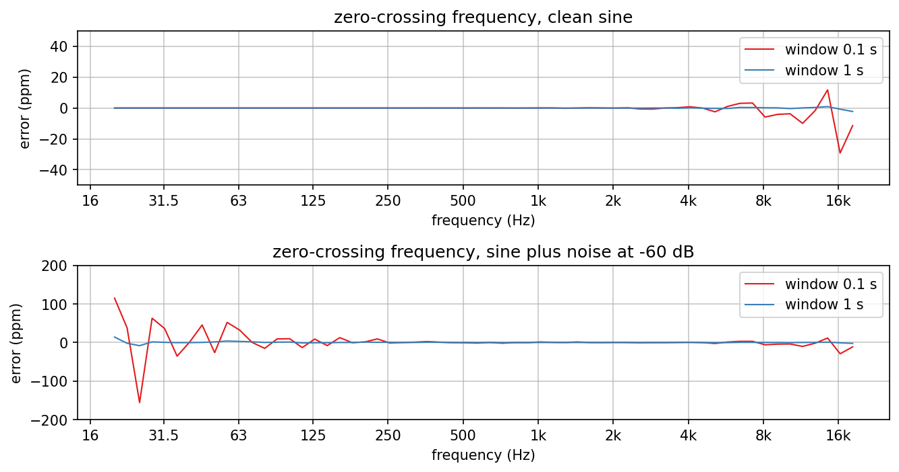
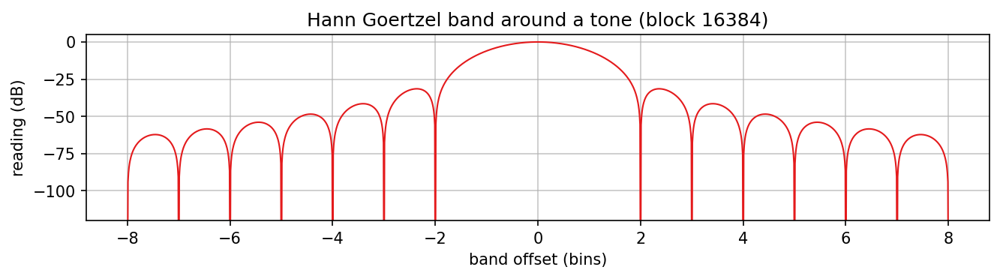
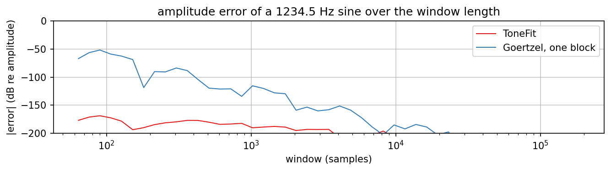
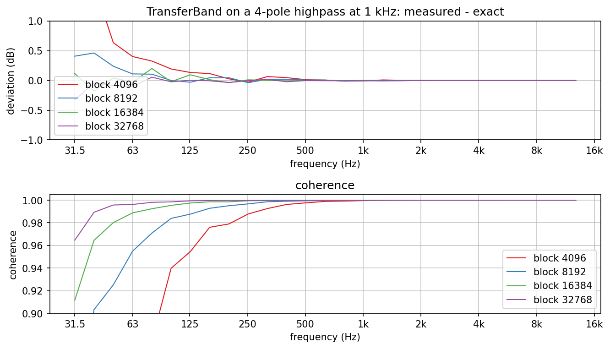

# Analysis blocks

Accuracy of the measurement blocks in `dsp/Analysis/`, which the Mac
integration tests and the meter plugin on the device both use (`docs/plugins/meter.md`).
All signals are float at 48 kHz, as the plugins see them.

Regenerate with `dev-scripts/dev-docs-plots.sh Analysis` (program `AnalysisExplore.cpp`, data
and `summary.txt` in `generated/`, rendering in `plots.sh`).

## Frequency from zero crossings

`ZeroCrossingFrequency` interpolates each upward crossing between two samples and divides the
number of periods by the time from the first to the last crossing. For a clean sine the error
stays within 2.2 ppm over 1 s and 29 ppm over 0.1 s from 20 Hz to 20 kHz; it grows towards
high frequencies, where linear interpolation between samples far apart in phase misplaces
the crossing a little. With white noise 60 dB below the sine (hysteresis 0.01) the crossings
jitter: 14 ppm over 1 s, 156 ppm over 0.1 s. The error falls with the window length because
the jitter of only the first and the last crossing enters the estimate.

## Hann Goertzel band around a tone

`GoertzelBand` reads the windowed spectrum at one frequency. For a sine of amplitude 1 on a
bin centre the reading is exact (0 dB); a band half a bin away reads 1.42 dB low (the scallop
loss of the Hann window), the main lobe ends at +-2 bins and the side lobes start at -31.5 dB
and fall by 18 dB per octave. With blocks of 16384 samples a bin is 2.9 Hz wide.

## ToneFit against one Goertzel block

For a sine at a frequency that does not fit the window (1234.5 Hz), `ToneFit` solves for DC,
cosine and sine and is exact to float precision at every window length (error below
-169 dB). A single Hann Goertzel block of the same length reads the windowed spectrum, which
is off by -50 dB for a window of 100 samples and stays above -160 dB up to about 5000. This
is why the meter's `toneLevel` and `toneResidual` (the zipper check) come from `ToneFit`.

## TransferBand block length

Four one-pole highpass stages at 1 kHz (24 dB per octave below it) measured from 16 s of
white noise against their exact response. The gain stays within 0.07 dB wherever the response
is above -60 dB for every block length, but the coherence on the steep slope drops with short
blocks: 0.979 with 4096 samples, 0.9986 with 16384, 0.99976 with 32768. Leakage from the
neighbouring, much louder frequencies adds output power that the input at the band frequency
does not explain. This is the step 8 finding behind the meter's 16384-sample bands: a test that
requires coherence above 0.98 on a steep flank needs at least 16384 samples.
