# eigenghost

Charts of `jp::EigenghostPedal` (`plugins/eigenghost/EigenghostPedal.h`), the diffused FDN
reverb with two pitch-shifting lines, and of its tank `jp::FdnTank`
(`dsp/Reverbs/FdnTank.h`). Everything is measured on the running classes at 48 kHz, with the
plugin defaults unless a chart says otherwise, dry muted and wet at 0 dB, left output.

Regenerate with `dev-scripts/dev-docs-plots.sh Eigenghost` (program `EigenghostExplore.cpp`,
data in `generated/`, rendering in `plots.sh`).

## Signal flow

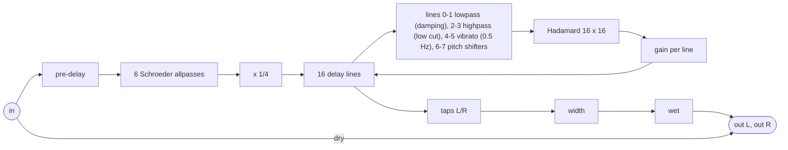

## Diffusion: impulse response and echo density

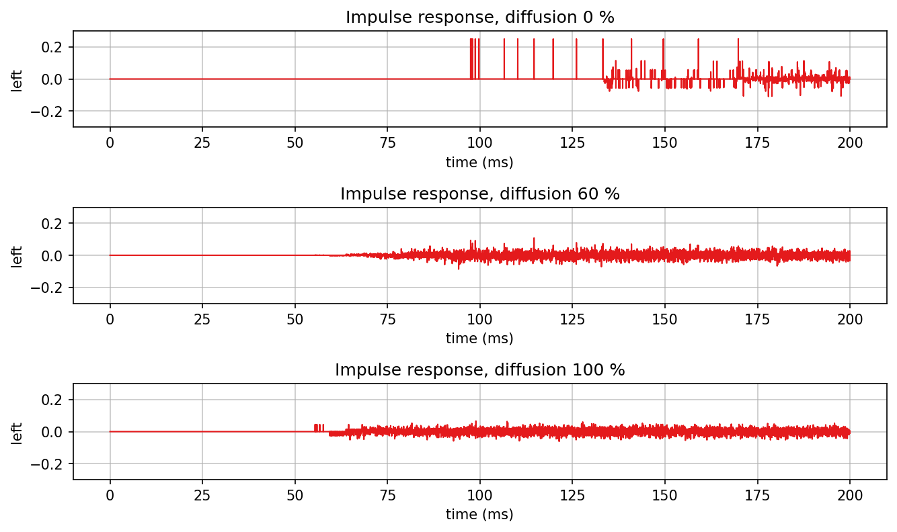

At diffusion 0 the response starts with single echoes, one per line: the first at 97.5 ms,
which is the pre-delay (20 ms), the diffuser (42 ms) and the shortest line (36 ms), less the
0.7 ms that the feedback path supplies. An allpass at gain 0 is a pure delay, so the six
diffuser stages (191, 211, 263, 347, 443 and 563 samples at the default 1.3 m, spread 3,
bulge 0.4) add their sum to the pre-delay. The bulge of 0.6 crowds the lines towards the
short end, so the single echoes come close together and the second passes start already at
about 133 ms. With diffusion the impulse is smeared before it enters the tank: the response
starts at 55 ms (pre-delay and shortest line) and is noise-like from the start.

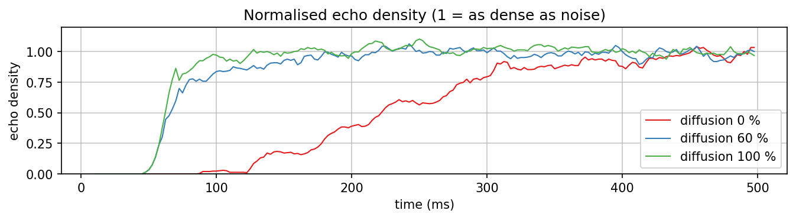

The normalised echo density (Abel and Huang) is the share of samples beyond one standard
deviation in a 20 ms window, divided by the share for Gaussian noise: 1 means the tail is
as dense as noise. It reaches 0.9 at 308 ms without diffusion, at 140 ms at the default
60 % and at 88 ms at 100 % (all including the 20 ms pre-delay). The diffuser is what makes
the onset dense; the tank alone needs several passes.

## Decay

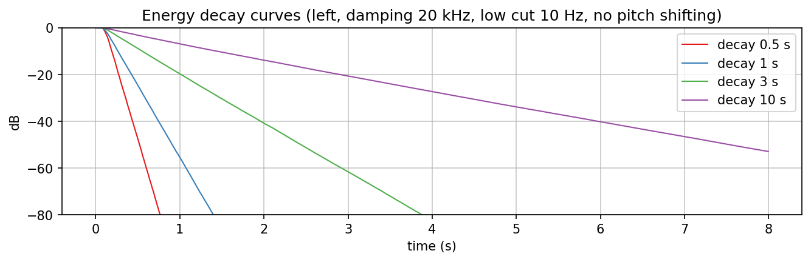

Energy decay curves (Schroeder backward integration) are straight lines: the per-line gain
0.001^(length / (fs T60)) makes every line lose 60 dB in the set time, whatever its
length. Fitted between -5 and -35 dB: 0.491, 0.969, 2.79 and 8.90 s for 0.5, 1, 3 and 10 s.
The damping lowpass at the default 3 kHz takes treble on every pass through lines 0 and 1,
so the broadband decay falls below the setting as the decay gets longer (with damping at
20 kHz the octave bands up to 2 kHz stay within 4.5 % of 3 s, next chart). The tank without
filters measures 0.515, 2.02 and 5.02 s for 0.5, 2 and 5 s
(`tests/unit/Reverbs/FdnTank_test.cpp`); the two modulated lines change that by under 1 %
(next but one section).

## Damping in two lines

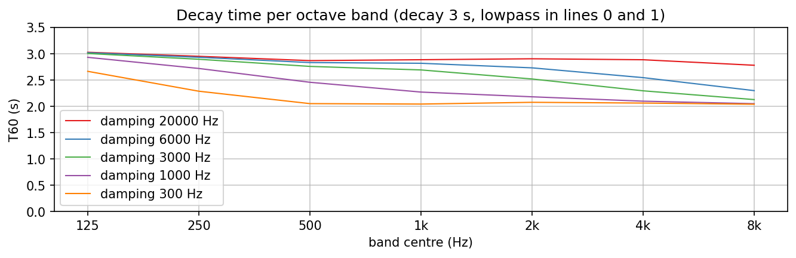

The damping lowpass sits in 2 of the 16 lines. On every pass the Hadamard matrix sends an
eighth of the energy through them, so the treble loses at most that share per pass: about
10 log10(16 / 14) = 0.6 dB per pass, which with the default lines (mean length 59 ms at
bulge 0.6, 17 passes per second) adds about 10 dB per second to the decay. At decay 3 s the
high bands therefore bottom out near 2.0 s however low the cutoff goes (300 Hz: 2.04 s at
8 kHz), and the cutoff decides from which band on: 6 kHz shortens mainly 4 and 8 kHz (2.55,
2.30 s), 1 kHz everything above 250 Hz. At longer decays the same extra loss is a larger
share (decay 10 s: about 4 s in the damped bands, estimated from the same rate, not
measured); with a shorter size or a higher bulge there are more passes per second and the
damping is stronger (bulge -0.4, the default before: 81 ms, 12 passes, 7 dB per second).

| Damping | 125 | 250 | 500 | 1k | 2k | 4k | 8k Hz |
|---|---|---|---|---|---|---|---|
| 20 kHz | 3.03 | 2.95 | 2.87 | 2.89 | 2.90 | 2.89 | 2.78 s |
| 6 kHz | 3.02 | 2.93 | 2.83 | 2.82 | 2.73 | 2.55 | 2.30 s |
| 3 kHz (default) | 3.01 | 2.90 | 2.76 | 2.69 | 2.52 | 2.30 | 2.13 s |
| 1 kHz | 2.93 | 2.72 | 2.46 | 2.27 | 2.18 | 2.10 | 2.05 s |
| 300 Hz | 2.67 | 2.29 | 2.05 | 2.04 | 2.08 | 2.06 | 2.04 s |

## Shimmer

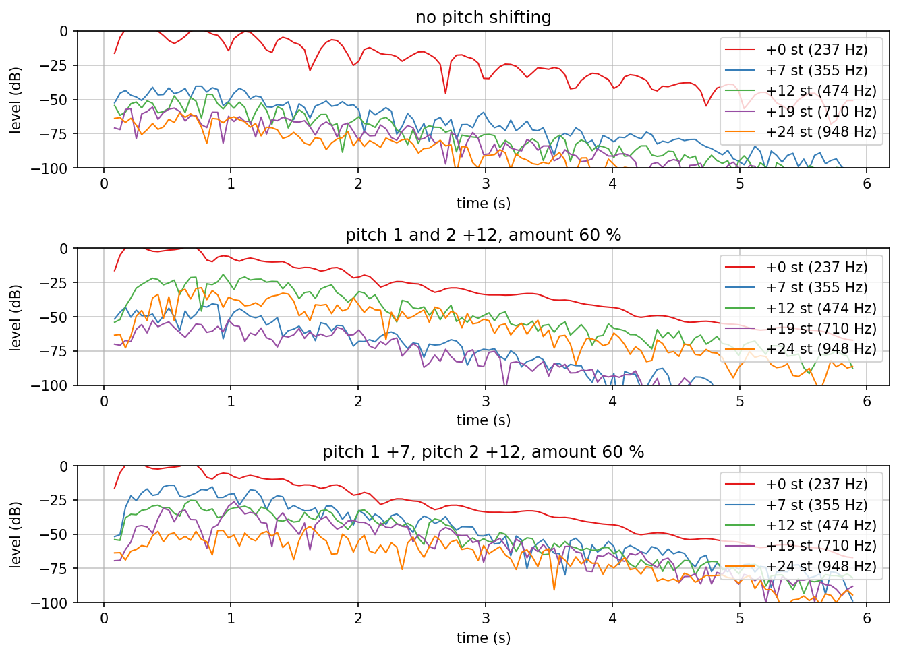

A 237 Hz tone for 0.5 s, decay 6 s, damping 8 kHz; the level of the tone and of four
intervals above it, in 170 ms windows. Without pitch shifting only the tone itself rings
(the other curves are the window's leakage). With both pitch lines an octave up at 60 %
the octave (474 Hz) rises to about -20 dB while the tone plays and the double octave
(948 Hz) follows about 15 dB lower: every pass through a pitch line shifts again. With pitch 1 a fifth
and pitch 2 an octave up the tail fills with +7, +12, +19 and +24 at similar levels. Levels
2 s after the tone ends, in dB: no shifting +0: -19, +12: -70; octaves +0: -32, +12: -45,
+24: -47; fifth and octave +7: -42, +12: -39, +19: -56, +24: -53.

## Size changes

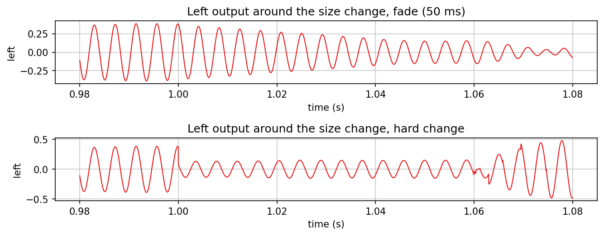

The tank alone with a 237 Hz sine, size 12 m changed to 20 m at 1.0 s (default bulge). A
hard change jumps in one sample, and the discontinuities it writes into the lines come back
with the shortest lines (from 1.06 s); the fade (50 ms) glides from the old to the new
lengths.

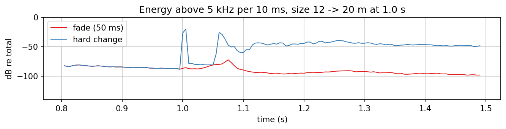

The energy above 5 kHz shows the difference: -86 dB in the 10 ms after the change with the
fade, -20 dB with the hard change, which comes back at -26 dB near 1.06 s and stays at -40
to -50 dB for the rest of the second. The fade peaks at -72 dB near 1.075 s, as the old
heads fade out.

## Line lengths

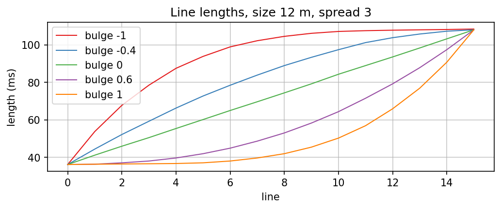

Size 12 m and spread 3 put the lines between 36 and 108 ms; the bulge decides how they are
spread in between. Negative values crowd the lines towards the long end (bulge -1: median
line 105 ms), positive ones towards the short end (bulge 1: median 42 ms); the default 0.6
puts the median at 53 ms (mean 59 ms), so early reflections come first and densely (-0.4,
the default before, put it at 89 ms). Every length is a distinct prime number of samples.

## Modulation

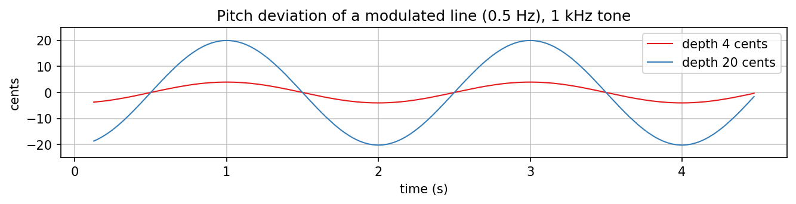

Lines 4 and 5 run through a vibrato: a delay swinging sinusoidally at 0.5 Hz around a
nominal delay that the tank takes off the line, so the loop keeps its length. The chart
shows a 1 kHz tone through one such vibrato alone, frequency per 50 ms window: +-4 cents at
the default depth, +-20 cents at the maximum (measured within 1 %, unit test). The two lines
run 90 degrees apart. The fractional delay is a first-order allpass (magnitude 1), so the
lines lose nothing per pass; a lossless tank loses 0.18 dB (4 cents) and 0.41 dB (20 cents)
over 10 s. Hermite interpolation, tried first, took a 10 s decay to 8.2 s in the highs.

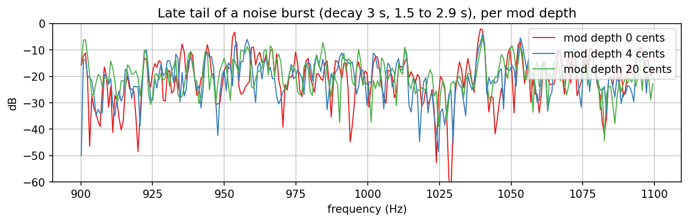

The usual reason for such a modulation is to keep the tail from ringing on fixed modes. The
spectrum of a late tail (a 0.2 s noise burst, decay 3 s, 1.5 to 2.9 s) shows it only in
places: the strongest peaks of the unmodulated tail (953 and 1040 Hz) sit 3 to 5 dB lower
at 4 cents, but over 500 Hz to 4 kHz the strongest bin stays as far above the mean (18.3 dB
at 0, 18.1 dB at 4 and 20.1 dB at 20 cents). With 2 of 16 lines and +-2.3 Hz at 1 kHz the
modulation is too slight to flatten the modes that a 1.4 s spectrum resolves; whether it
helps the ear is the listening test's question. That the depth reaches the tail shows in
the tail of a single 1 kHz tone: the share of its energy outside 1 kHz +-3 Hz is 36 % at
depth 0 (the reverb's own modes), 47 % at 4 cents and 98 % at 20 cents
(`tests/host/Eigenghost_test.cpp`).
