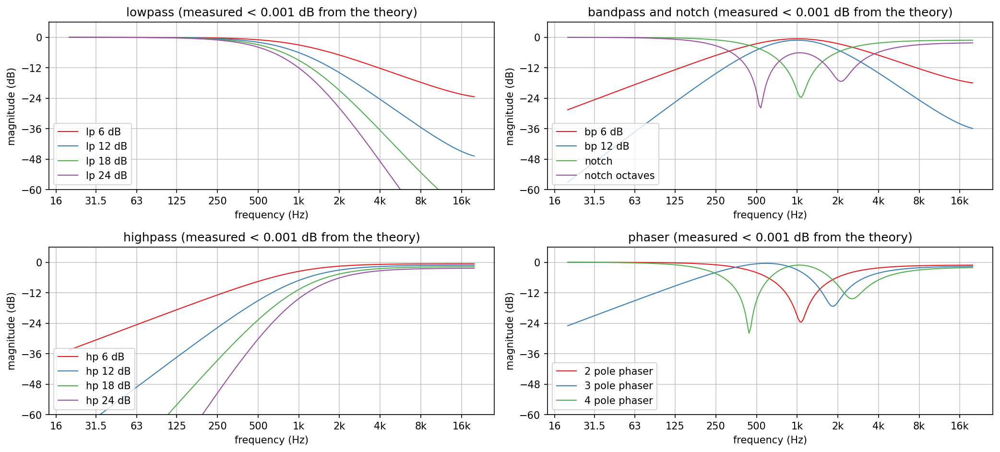
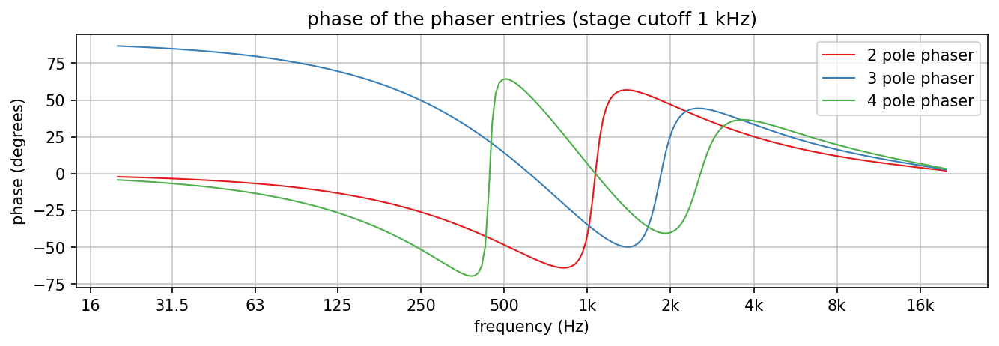
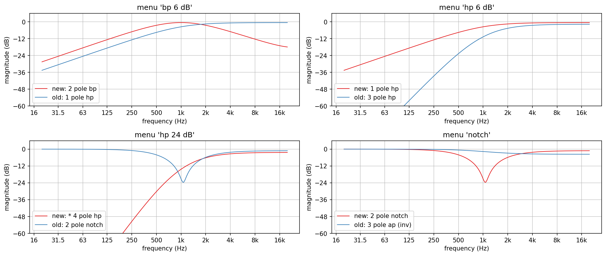
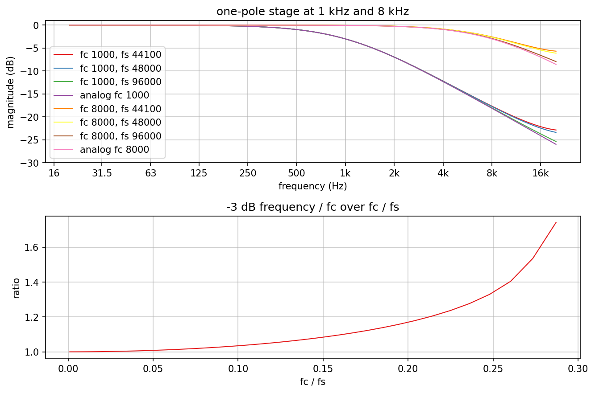
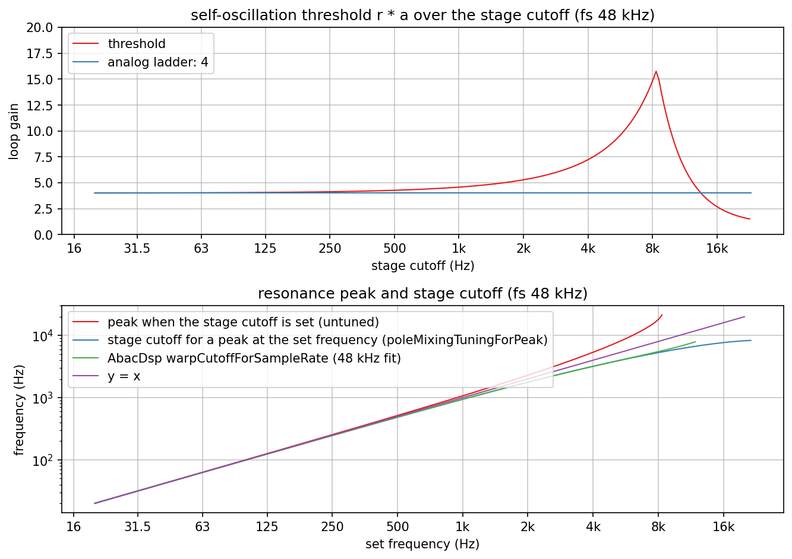
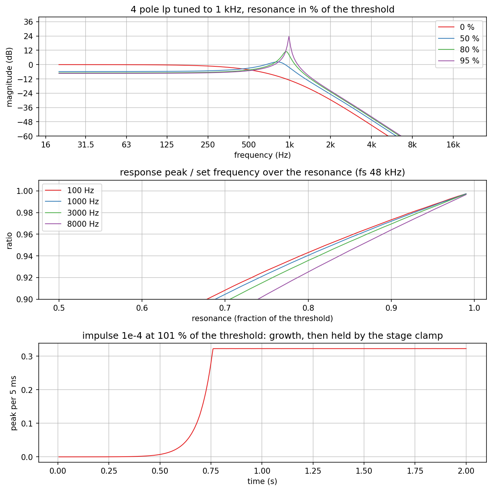
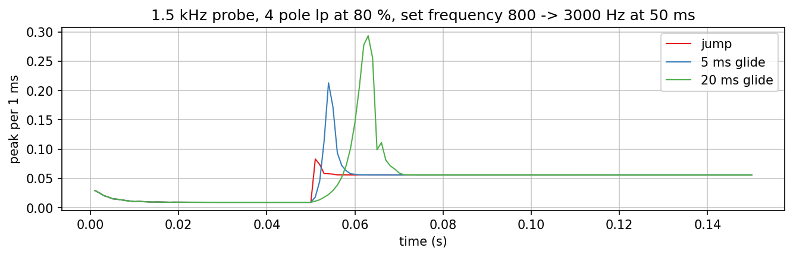
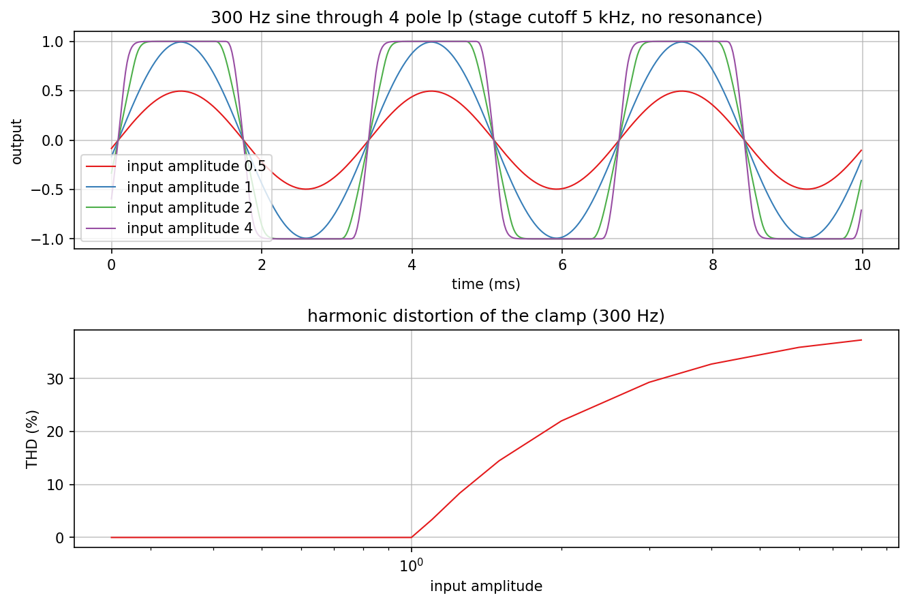

# Pole-mixing filter

Charts of `jp::PoleMixingFilter` and its one-pole stage (`dsp/Filters/PoleMixingFilter.h`,
`dsp/Filters/OnePoleLowpass.h`): the 15 filter types of the shipahoy menu, the menu mapping fix,
the stage across sample rates, the self-oscillation threshold and the resonance peak
tuning, resonance up to self-oscillation, frequency jumps and glides, and the stage clamp.
The method follows AbacDsp `documentation/Filters/PoleMixing/` (measure the running
filter, compare with theory); the program is new, because the filter here is a
different table and topology than AbacDsp's `PoleMixingFilter`. AbacDsp's correction fit
and generated header are not taken; the resonance peak is tuned in closed form instead.

Regenerate with `dev-scripts/dev-docs-plots.sh Filters/PoleMixing` (program
`PoleMixingExplore.cpp`, data in `generated/`, rendering in `plots.sh`). All charts at
fs = 48 kHz unless the title says otherwise.

## The 15 menu entries

Linear magnitude from `poleMixingResponse()` with the stage cutoff at 1 kHz and no
resonance. The running filter, measured with a steady-state sine probe on a third-octave
grid, stays within 0.0002 dB of these curves wherever they are above -60 dB (the subplot
titles give the deviation per group; the unit tests check the same within 0.05 dB for all
35 table entries).

What the curves show beyond their labels:

- "2 pole phaser" (`* 2 pole phaser`) has exactly the weights and resonance shaping of
  "notch" (`2 pole notch`): the red phaser curve is the green notch curve. The old menu
  also had "1 pole phaser", the 1-pole highpass under another name; it was removed from
  the menu and the table.
- The "phaser" entries are notch mixes, not allpasses: one or two notches whose position
  moves with the frequency, which is what a phaser sounds like after mixing with the dry
  signal.
- The highpass passbands end low: -0.6, -1.2, -1.8 and -2.4 dB for 6 to 24 dB at 16 kHz,
  about 0.6 dB per order, because the digital one-pole does not reach zero gain at
  Nyquist (stage cutoff 1 kHz).

## The menu mapping fix

The old plugin mapped menu index i to table row i. 12 of its 16 entries then played
another filter than their label, for example "bp 6 dB" played a 1-pole highpass, "hp 24
dB" a notch and "notch" an approximate allpass. The menu is now mapped by name.

## One-pole stage

`p = e^(-2 pi fc / fs)` matches the analog one-pole well below fs/8 and at any of the
three sample rates; near Nyquist the digital stage keeps more level. Its -3 dB point lies
above fc by 1.3 % at fs/16, 5.6 % at fs/8 and 34 % at fs/4 (lower chart).

## Self-oscillation threshold and peak tuning

The loop gain r * a at which the filter starts to oscillate is 4 at low cutoffs (the
analog ladder value) and rises with the cutoff, because the one-sample feedback delay
adds phase lag: 4.58 at 1 kHz, 10.2 at 6 kHz, 16 where the loop changes over to
oscillating at Nyquist (fs ln(3) / (2 pi), 8.4 kHz), and falling after that.

For the same reason the resonance peak lies above the stage cutoff (red curve: a 6 kHz
stage cutoff peaks at 9.8 kHz). `poleMixingTuningForPeak()` inverts this in closed form
(blue): the stage cutoff for a peak at 1, 3, 6, 8 and 12 kHz is 939, 2517, 4342, 5295 and
6733 Hz. AbacDsp measured the same correction for this feedback topology
(`FourStageFilter::warpCutoffForSampleRate`, green, a cubic fit at 48 kHz): 941, 2519,
4384, 5492 and 8001 Hz, within 0.2 % up to 4 kHz; above that the fit overshoots, as its
own README notes.

## Resonance up to self-oscillation

Top: 4 pole lp tuned to 1 kHz at 0, 50, 80 and 95 % of the threshold. More resonance
lowers the passband (negative feedback at DC) and raises the peak.

Middle: the tuning is exact at the threshold; below it the response peak sits lower. From
100 Hz to fs/6 at 44.1, 48 and 96 kHz it is 1.3 to 1.7 % low at 95 % and 4.1 to 5.3 %
low at 85 %.

Bottom: at 101 % a 1e-4 impulse grows for about 0.75 s and is then held by the stage
clamp at a constant amplitude: the filter oscillates without blowing up.

## Jumps and glides

A 1.5 kHz probe through 4 pole lp at 80 %, while the set frequency moves from 800 Hz to
3 kHz at 50 ms. The jump changes the level within about a millisecond with a small
overshoot. The glides rise higher: on its way the resonance peak passes the probe
frequency, and while it does the probe gets the full peak gain (+11 dB at 80 %). This is
the sound of a glide through a resonance, not an artefact; shipahoy's glide setting
controls how long it lasts.

## The stage clamp

Every stage clamps its state to [-1, 1]. Up to an input amplitude of 1 nothing happens
(THD below 1e-5 %); above it the first stage clips hard: 3.4 % THD at 1.1, 22 % at 2,
37 % at 8. With resonance the feedback adds to the input, so the clamp also bounds
self-oscillation (previous section).
