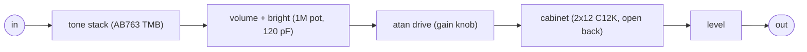
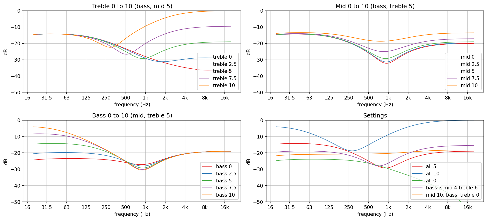
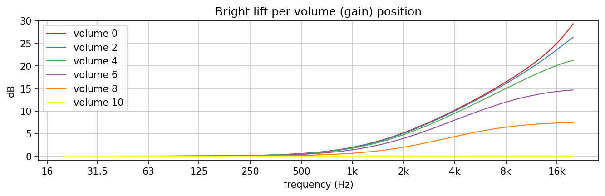
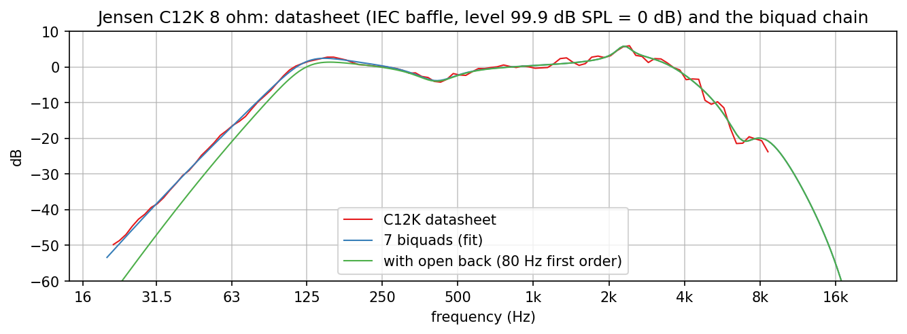
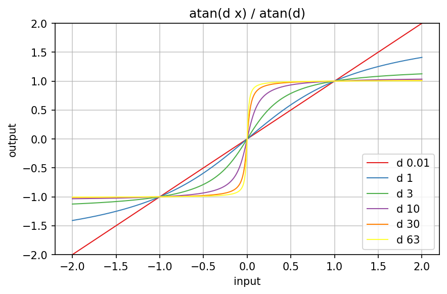
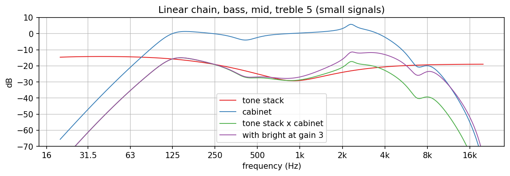

# JaysTwin

Charts of the DSP blocks of the Jays Twin plugin, a simple Fender Twin Reverb (AB763) from
biquads: the tone stack `jp::FenderToneStack` (`dsp/Filters/FenderToneStack.h`), the bright
cap `jp::VolumeBright` (`dsp/Filters/VolumeBright.h`), the cabinet
(`dsp/Filters/TwinCabinet.h` on `dsp/Filters/BiquadCascade.h`) and the drive
`jp::AtanDrive` (`dsp/NonLinear/AtanDrive.h`). The curves are the responses of the designed
digital sections at 48 kHz; the unit tests check them against the running filters, the
circuit and the datasheet.

Regenerate with `dev-scripts/dev-docs-plots.sh JaysTwin` (program `JaysTwinExplore.cpp`,
data in `generated/`, rendering in `plots.sh`). The cabinet table comes from
`fit_cabinet.py`, its target `c12k_8ohm.csv` from `trace_chart.py` (both below).

## Signal flow of the plugin

The order is the amp's: on the AB763 the tone stack follows the first triode and the volume
pot (with the bright cap) follows the tone stack. The gain knob stands for the volume pot
(it steers the bright cap) and drives the atan.

## Tone stack

The passive treble/mid/bass network with the AB763 Twin values (treble 250k and 250 pF, bass
250k and 0.1 uF, mid 10k and 0.047 uF, slope 100k; all log pots, modelled as an audio taper
with 10 % at mid travel). The coefficients are Yeh and Smith's closed form, checked against
a nodal analysis of the circuit (`tests/unit/Filters/FenderToneStack_test.cpp`, 1.6e-12 dB).
The digital filter is a first-order section and a biquad; at the warped frequency
fs / pi tan(pi f / fs) it equals the analog stack within 6e-4 dB at 48 kHz, and the warp
itself stays below 0.28 dB up to 5 kHz.

What the charts show is the Fender character: the controls interact, nothing is flat, and the
middle always sits lowest. With all three at 5 the response is -14.7 dB at 80 Hz, -25.0 dB at
500 Hz and -20.6 dB at 4 kHz; the dip moves from about 300 Hz (treble 10) to about 2 kHz
(treble 2.5) with the treble knob, because the treble pot is also part of the path for the
middle. Bass 0 to 10 lifts 80 Hz by 14.5 dB, treble 0 to 10 lifts 3 kHz by 31 dB, mid 0 to 10
fills 500 Hz by 7.7 dB. The stack loses 15 to 30 dB; the pedal compensates the level.

## Bright

The 120 pF cap across the upper part of the 1M volume pot, driven by the tone stack's output
impedance (about 25k with the knobs at 5, taken as fixed): a first-order shelf with its zero
at 1 / (2 pi Ru C), 1.3 kHz at low volume, and a high-frequency limit of
(Rs + R) / (Rs + Rl). Up to volume 4 the curves nearly coincide below 4 kHz (lift 7.4 to
7.9 dB at 3 kHz), then the lift shrinks: 6.2 dB at volume 6, 3.3 dB at 8, none at 10. This is why the
bright switch of a Fender is loud and harsh at low volume and does nothing when the amp is
turned up. The digital shelf follows the circuit within 0.18 dB up to 4 kHz (the pole lies
near or above Nyquist, where the bilinear warp is largest).

## Cabinet

Target: the Jensen C12K 8 ohm curve of the Jensen specification sheet (IEC baffle, 1 W, 1 m;
the speaker of the Twin reissue), traced by `trace_chart.py` into `c12k_8ohm.csv`. The sheet
image is not in the repository: download it from the C12K page
(https://www.jensentone.com/vintage-ceramic/c12k, `c12k_spec_sheet.png`) and run
`trace_chart.py <png> c12k_8ohm.csv --check check.png` to redo the trace. The tracer
calibrates the axes on the chart grid (1 kHz at x = 607, 316.5 pixels per decade; 4.75
pixels per dB), follows the blue curve from 1 kHz outwards column by column and skips the
columns where the red or green curve covers it; reading accuracy about +-0.5 dB.

Fit: `fit_cabinet.py` fits seven cookbook sections to the curve by least squares in dB
(30 Hz to 8 kHz, points above 6 kHz weighted 0.3): two highpasses (resonance at 125 Hz and
the steeper fall of the finite baffle below it), a cut at 410 Hz, the narrow presence peak at
2.3 kHz, a cut at 6.8 kHz and two lowpasses. Result: 0.68 dB rms, at most 2.4 dB off up to
6 kHz, level 99.9 dB SPL. Each section is bounded to its role, and above the data the chain
must stay 25 dB down: unbounded, the optimiser traded a +40 dB peak against the level and put
a Q 12 lowpass resonance at 8.8 kHz, a better number (0.83 dB with six sections) and a worse
filter. The fit curve lies under the open-back curve above 125 Hz.

The open back is an assumption: a first-order highpass at 80 Hz (-5.3 dB at 100 Hz for the
whole cabinet). A baffle has no rear wave; an open-back cabinet loses low end where the rear
wave reaches the front in antiphase. A measurement of a Twin (or of a modeller) can replace
the target curve and this stage later, with only the CSV and the table changing. The curve is
the speaker on axis, not a miked cabinet: no room, no microphone colour.

## Drive

y = atan(d x) / atan(d): every curve passes through (+-1, +-1), small signals get the gain
d / atan(d) (1.27 at d = 1, 40 at d = 63), and the output stays below pi / (2 atan(d)). The
curve compresses towards its limit, so the clipping sets in gradually and produces odd
harmonics only (unit test: the third harmonic of a sine at half scale rises from -35 dB at
d = 1 to -12 dB at d = 16, the second stays at the -240 dB floor). It aliases: there is no
oversampling.

## The linear chain

For small signals (below the drive's knee) the plugin is tone stack x bright x cabinet. With
the knobs at 5 the result has the Fender shape: a low-mid hump at 140 Hz, the scoop around
1 kHz, the presence peak at 2.3 kHz, and a fall of about 18 dB from 4 to 7 kHz. The bright cap
at gain 3 lifts from 2 dB at 1 kHz to about 10 dB at 4 kHz, where the cabinet still passes it.
