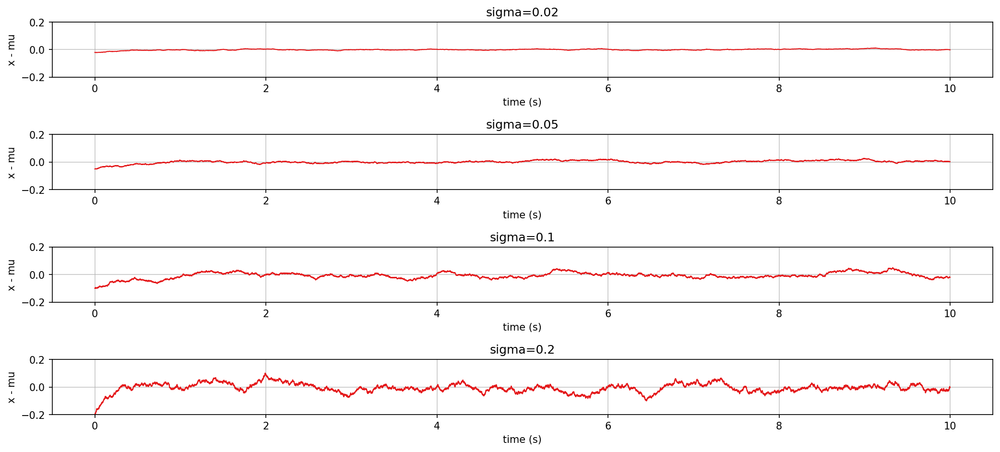
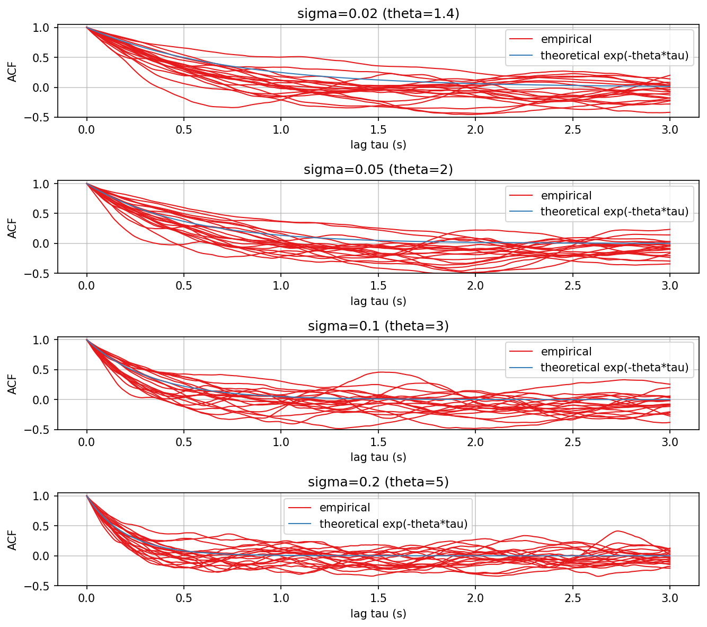
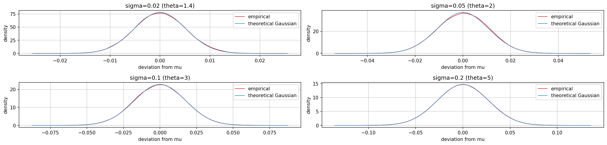
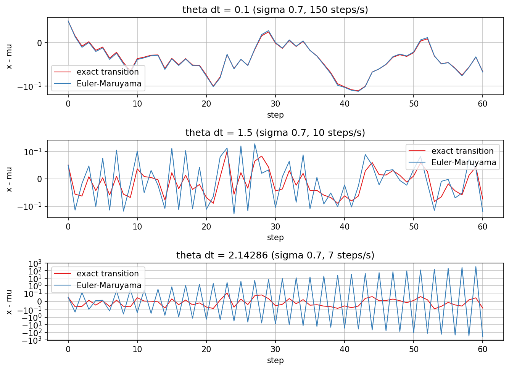
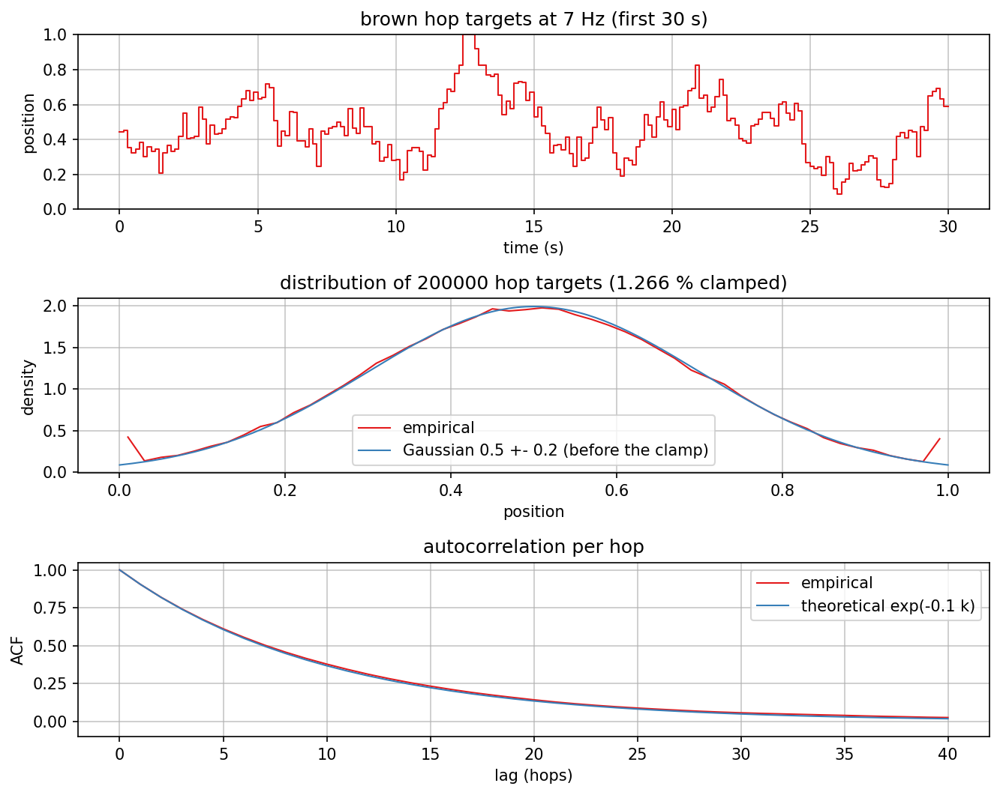

# Ornstein-Uhlenbeck random walk

Charts of `jp::OrnsteinUhlenbeck` (`dsp/Generators/OrnsteinUhlenbeck.h`), the mean-reverting random
walk behind shipahoy's "brown" random type. Transformed from AbacDsp
`documentation/OrnsteinUhlenbeck/` (see `docs/references.md`): same three views of the
process, plus two that only matter here, the step method at slow step rates and the
shipahoy hop walk.

Regenerate with `dev-scripts/dev-docs-plots.sh OrnsteinUhlenbeck` (program
`OrnsteinUhlenbeckExplore.cpp`, data in `generated/`, rendering in `plots.sh`).

## Differences from the AbacDsp version

- Noise comes from `jp::Random` (xoshiro256** and our own Box-Muller), not from
  `std::mt19937` and `std::normal_distribution`, so the sequences differ from AbacDsp's
  for the same seed; the statistics are the same.
- Each step uses the exact transition of the process instead of an Euler-Maruyama step.
At the 2000 steps per second used for the first three charts the two
  are indistinguishable; `ou_step_methods.png` shows where they part.
- 20 autocorrelation runs per speed instead of 100, to keep the PNG small.

## Timelines, autocorrelation, distribution

`setSigma()` derives the reversion rate `theta = 20 sigma + 1` and the mean `mu = sigma`
from one control, so a larger sigma reverts faster and is also wider. Every timeline is
drawn relative to its own mu, on one shared y-axis, so the widths are comparable.

The autocorrelation of each run decays like `exp(-theta tau)`: this is the check that the
reversion rate is right independent of the amplitude. Each run is 10 s, so single runs
scatter around the theory, more so at long lags.

The stationary distribution is Gaussian with standard deviation
`sigma / 2.33 / sqrt(2 theta)` (the driving noise is scaled by 1 / 2.33, see the class
brief). A 10 million step run matches it for all four speeds.

## Exact transition against Euler-Maruyama

Both methods are driven by the same Gaussian sequence, sigma 0.7 (theta 15), at three
step rates. At theta dt = 0.1 they agree. At theta dt = 1.5 the Euler step overshoots the
mean on every step (the sign alternates). At theta dt = 2.14, which is sigma 0.7 stepped
once per hop at 7 Hz, the Euler step diverges geometrically (factor |1 - theta dt| = 1.14
per step; the y-axis is symmetric-log). The exact transition stays bounded at every rate,
which is why the port uses it.

## shipahoy "brown"

shipahoy steps the walk once per hop with sigma 0.1 (theta 3) and dt 1/30, so consecutive
hops correlate with `e^(-0.1) = 0.905` at any speed, and scales it to a standard deviation
of 0.2 around the centre of the range, clamped to [0, 1]. Measured over
200000 hops: mean 0.498, deviation 0.199, lag-one correlation 0.905, 1.27 % of the hops
clamped (the spikes at both edges of the histogram; a Gaussian puts 1.24 % beyond 2.5
deviations).
