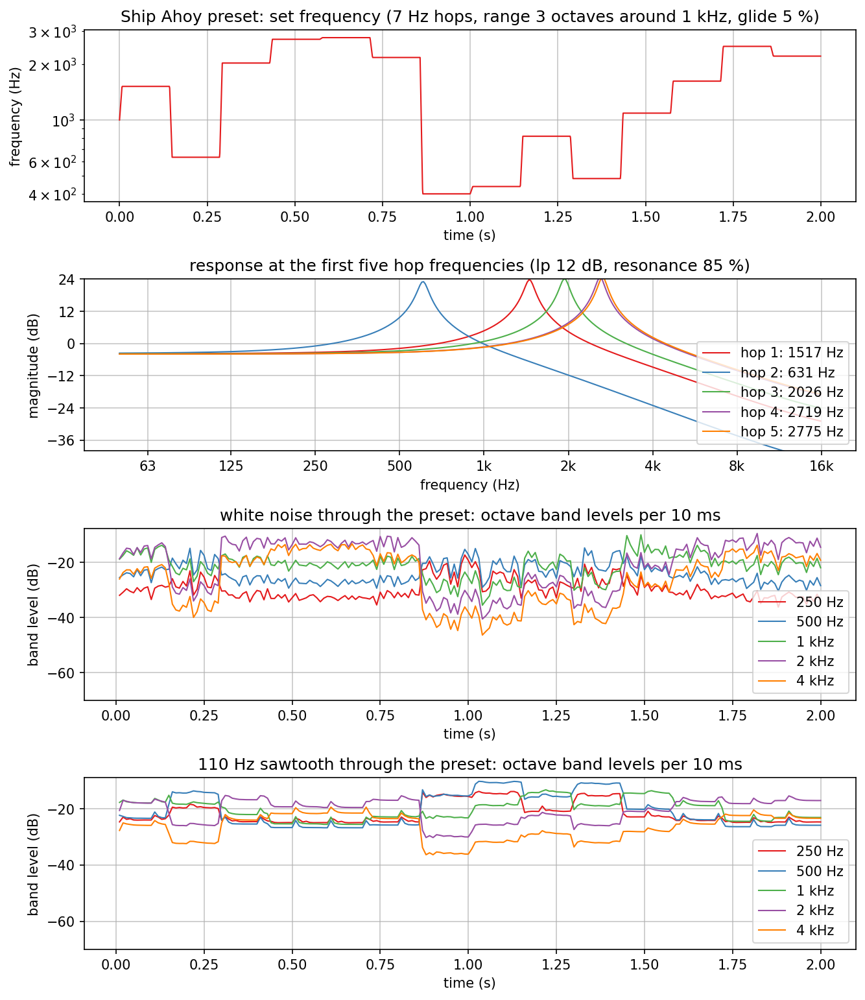
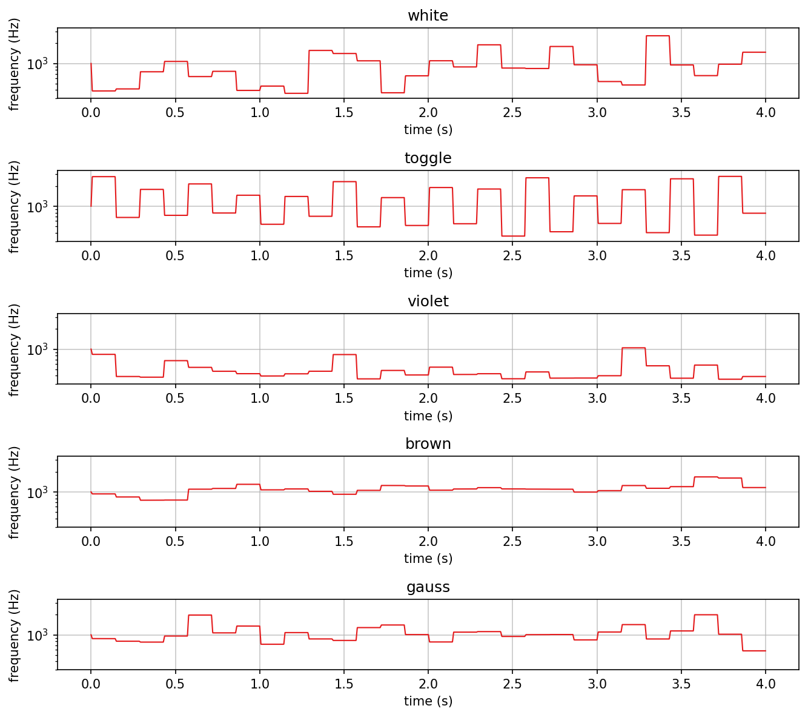
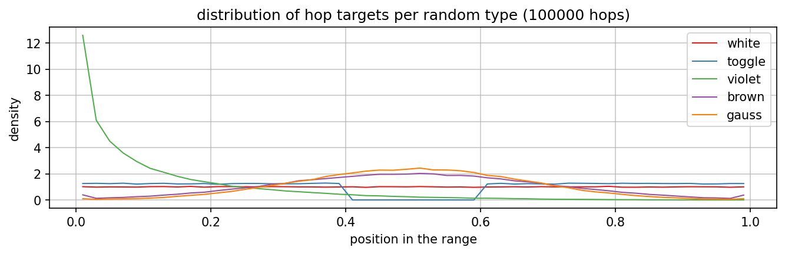
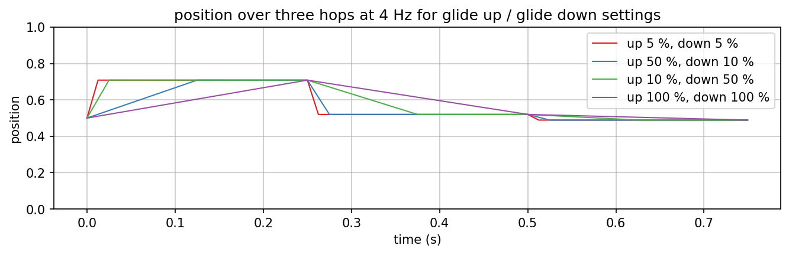
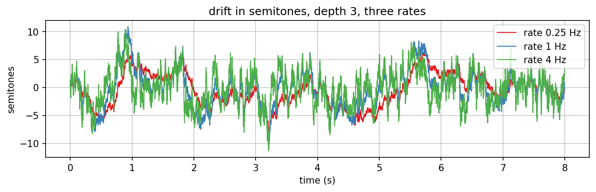
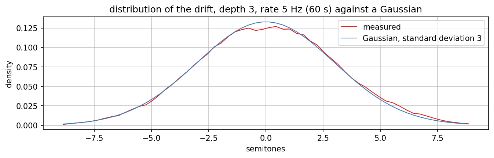
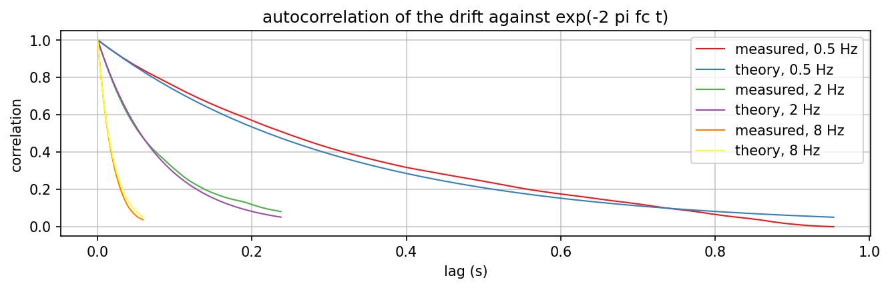
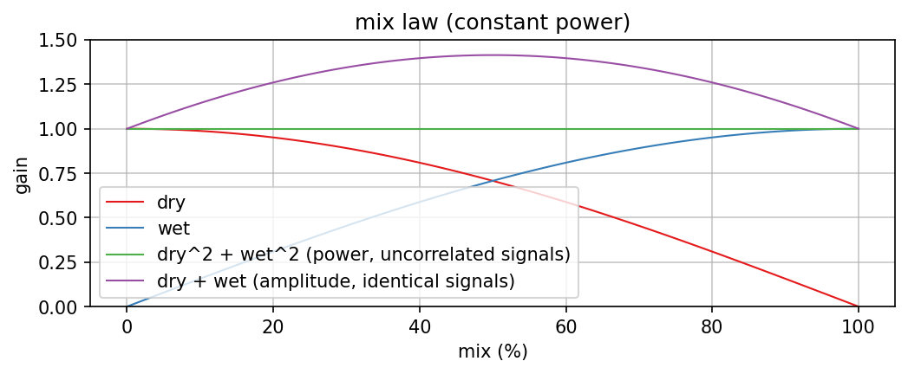

# shipahoy

Charts of `jp::ShipAhoyEngine` (`plugins/shipahoy/ShipAhoyEngine.h`), the pole-mixing filter
of the plugin, and of the hop algorithms of its factory scripts. The musical and technical description of the
plugin is `docs/plugins/shipahoy.md`; this page shows what the engine does, measured on the running class.

The plugin used to hop the filter in C++ (position in a range, random types, two glide times). Since the
scripts took over, that logic lives in Lua (`hop.lua` is white, `toggle-trill.lua` toggle, `slow-drift.lua` brown, a
range and a centre fixed in each) and the engine only follows notes. The charts still come from the reference
hopper in `tests/unit/ShipAhoyClockedEngine.h`, which drives the engine through its `cutoff()` with the original
formulas. When the hopper moved out of the engine, 20 hops of the old engine path and of `cutoff()` with the same
targets followed the same frequencies within 0.2 % (a one-off check at the move; the numbers below are unchanged by it).
Violet and gauss are not shipped as scripts; they stay here as the reference of what such a script would do.

Regenerate with `dev-scripts/dev-docs-plots.sh ShipAhoy` (program `ShipAhoyExplore.cpp`,
data in `generated/`, rendering in `plots.sh`).

## Background

The plugin is named after Frank Zappa's "Ship Ahoy". Its guitar sound is a
voltage-controlled filter in sample-and-hold mode: a clock samples a random voltage about
seven times per second and holds it, so the filter frequency jumps to a new random value
on every tick, and the filter's resonance is turned up high, so every jump is heard as a
new vowel-like peak in the guitar sound.

shipahoy does the same digitally. The default script (Hop) with its defaults X = 5 % and Y = 85 %, which is also the first preset, hops 7 times per second (105 BPM at 1/16; the charts drive the engine with a plain 7 Hz clock) to a random frequency within 3 octaves around
1 kHz, glides there in 5 % of the hop period, and runs a 2-pole lowpass at 85 % of the
self-oscillation threshold.

## The preset at work

From the top:

1. The set frequency over 2 s: 14 hops, each glide 5 % of the 143 ms period (7 ms).
2. The filter response at the first five hop frequencies: a peak of about +23 dB that
   moves with each hop (the frequency knob sets where this peak is).
3. White noise through the preset, in octave bands per 10 ms: the band nearest the
   current hop rises, the others fall, and the pattern changes at every hop.
4. A 110 Hz sawtooth (a stand-in for a guitar note) through the preset: the same, but the
   bands are steadier because the input spectrum is.

## Random types (the hop algorithms)

Positions in the range are 0 (bottom) to 1 (top) and map exponentially onto the octave
range. Per type, over 100000 hops:

- **white**: uniform; every position equally likely.
- **toggle**: alternates between the lowest and the highest 40 % of the range, a trill
  between low and high.
- **violet**: the product of three uniform values: mostly low, with occasional jumps up
  (mean 1/8 of the range).
- **brown**: a mean-reverting random walk, one step per hop: small moves around the
  centre, the next hop close to the last one (lag-one correlation 0.905). 1.15 % of the
  hops are clamped at an edge. See `documentation/OrnsteinUhlenbeck/`.
- **gauss**: independent values around the centre, standard deviation 1/6 of the range;
  0.27 % clamped.

## Glide

Each hop glides linearly in position (`jp::CutoffTrajectory`) (so exponentially in frequency) from where the
frequency is to the new target. Glide up applies to hops that go up, glide down to hops
that go down, both in percent of the hop period. At 100 % the frequency arrives just as
the next hop starts; a hop that comes before a glide has ended continues from where the
frequency is.

## Drift

Drift depth and rate add a slow random movement to the frequency, in semitones, on top of the hops or of a script
(`jp::ShipAhoyEngine`, `jp::OrnsteinUhlenbeck`). It is an Ornstein-Uhlenbeck process with a fixed sigma (theta 3) and a
time scale: stepped on a grid of 16 samples with dt = rate / 0.477 / 3000 (0.477 Hz = theta / 2 pi is the corner at time
scale 1), linearly interpolated between grid points, normalised to unit standard deviation and multiplied by the depth.

Depth is the standard deviation: depth 3 at rate 5 Hz over 60 s measures mean 0.09 and standard deviation 3.08 semitones,
and the histogram follows the Gaussian of standard deviation 3.

Rate is the corner frequency: the autocorrelation of an OU process is exp(-2 pi fc t), and at the lag 1 / (2 pi fc) the
measurement gives 0.400, 0.384 and 0.351 for 0.5, 2 and 8 Hz (theory 0.368; 120 s each, the scatter is the finite
record). The linear interpolation between the grid points rounds the fastest rate slightly. The "brown" random type is
a different thing: a walk of hop targets with one step per hop.

## Mix

Mix uses the constant-power law: dry = cos, wet = sin of pi/4 (m + 1) with m = mix / 50 - 1 (mix 0 to 100 %). For unrelated
signals the power stays constant across the range; for identical signals the amplitude
rises by up to 3 dB at the centre. With a resonant filter the wet signal is neither, so
the level in the middle of the range depends on the filter type.
