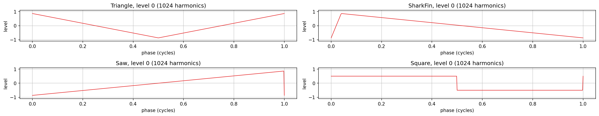
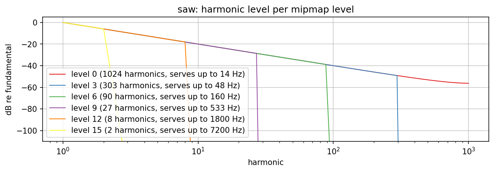
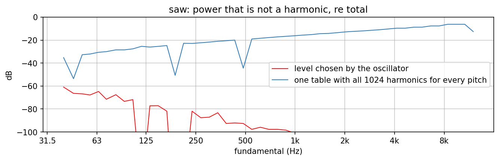
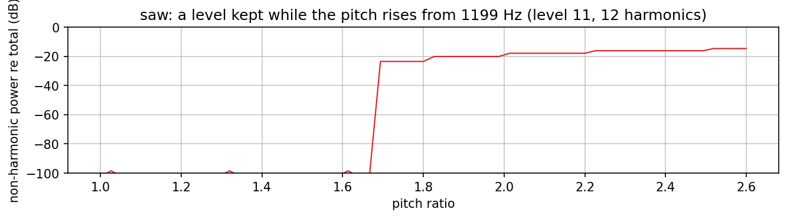
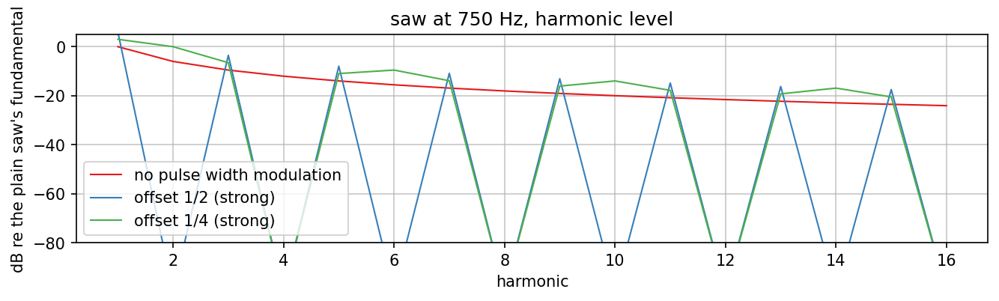

# Wavetable oscillator

Charts of `jp::WaveTableBank` and `jp::WaveTableOscillator` (`dsp/Wavetables/`): band-limited
mipmap tables, the level an oscillator reads for its pitch, the headroom for pitch bend and
pulse-width modulation by phase distortion. The ideas follow AbacDsp `documentation/Wavetables/`
(see `docs/references.md`); the program and the numbers are new.

Regenerate with `dev-scripts/dev-docs-plots.sh Wavetables` (program `WavetablesExplore.cpp`, data
in `generated/`, rendering in `plots.sh`).

## Differences from the AbacDsp version

- The oscillator reads one waveform, not a morph over three; the tables are shared and read-only
  (AbacDsp copies three sets of 131 kB into every oscillator).
- The phase is a double; the pulse-width ramp is per sample and takes 10 ms (in AbacDsp the ramp
  was advanced once per block, so it took 480 blocks).
- The tables keep the direction of the shapes (AbacDsp ran two forward FFTs, which reverses a
  shape in time, a rising ramp comes out falling, checked with numpy; the magnitude spectrum is the same).

## The shapes

The first level of each waveform: 1024 harmonics, scaled to an RMS of 0.5, DC removed (so
the square lies at +-0.5 and the saw's peaks at +-0.87).

## Harmonics per level

A saw's harmonics fall as 1/k (-6 dB for the second, -20 dB for the tenth); level 0 keeps them
all, every other level the same harmonics up to its own count and nothing above (a drop of more
than 100 dB). The legend gives the highest pitch a level serves: increments below
0.6 / (2 harmonics), 14 Hz at 48 kHz for level 0, 7.2 kHz for the last. The curve of level 0 lies
above 1/k towards the highest harmonics (-56.3 dB at 1000 instead of -60): the shape is the
ramp sampled at 2048 points, whose spectrum is 1 / sin(pi k / N) instead of 1 / k (+3.7 dB at k = 1000);
numpy gives the same -56.28 dB.

## Aliasing

What is left of a saw's power once its harmonics (3 bins each, the pitch on a bin centre) are
taken out is aliasing and interpolation images. With the level chosen by the oscillator the
worst case from 40 Hz to 12 kHz is -60.9 dB (at the lowest pitch, where the 2048-point table is
read with 2.3 table samples per output sample and the jump of the saw is interpolated linearly);
most of the range lies below -80 dB, and from 1 kHz up below -100 dB (the curve leaves the chart).
With one table of 1024 harmonics for every pitch the figure rises from -35 dB at 40 Hz to -6 dB at 8 kHz:
that is what the mipmap levels remove. The dips of the blue curve are chance coincidences of
aliased harmonics with true ones.

## Pitch-bend headroom

The oscillator picks a level with twice its phase increment, so the highest harmonic of the level
lies at 0.3 of the sample rate (14.4 kHz) at most, and the pitch may rise by 0.5 / 0.3 = 1.67 before
that harmonic reaches Nyquist. The chart keeps the 12-harmonic level (the highest pitch it serves,
1199 Hz) and raises the pitch: clean until 1.67, then the harmonic that passes Nyquist folds
back and the non-harmonic power jumps to -24 dB. Measured: -60 dB is crossed at 1.69
(the grid step of the chart is 0.027). A pitch change of more than that within one note needs
the level to be chosen again, which `setFrequency()` does on every call.

## Pulse-width modulation

`out = w(p) - w(p + o)` multiplies harmonic k by `1 - exp(-2 pi i k o)`: at `o = 1/2` the even
harmonics vanish (the chart shows them below -80 dB) and the odd ones double, so a saw turns into
a square (odd harmonics at 1/k, +6 dB on the fundamental; the chart's axis ends at +5 dB); at
`o = 1/4` every fourth harmonic is missing (+3 dB on the fundamental). Other offsets give other
pulse widths.

## Numbers

From `generated/summary.txt` (48 kHz):

| Quantity | Value |
|---|---|
| Memory | 8200 bytes per level, 16 levels, 131200 bytes per waveform (4 waveforms: 524800) |
| Pitch error of the oscillator | below 1e-4 cent, 20 Hz to 12 kHz (unit test) |
| Non-harmonic power, saw, level chosen, 40 Hz to 12 kHz | at most -60.9 dB re total |
| The same with the first level only | -35 dB at 40 Hz rising to -6.2 dB at 8 kHz |
| Bend headroom of a level | -60 dB crossed at pitch ratio 1.69 (design 1.67) |
| RMS at 100 Hz | 0.5 for sine and triangle, 0.499 for saw and square |
