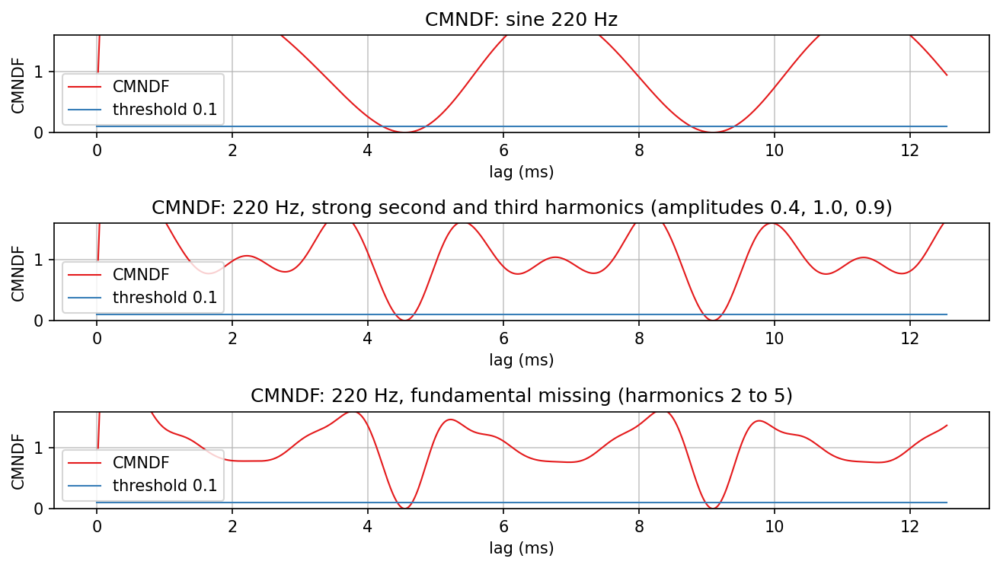
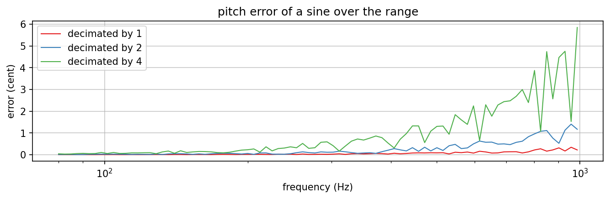
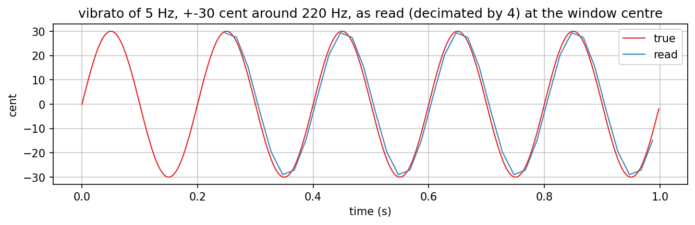
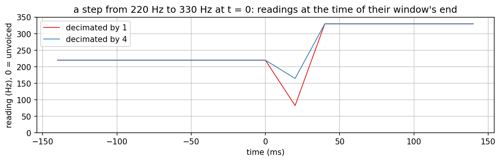
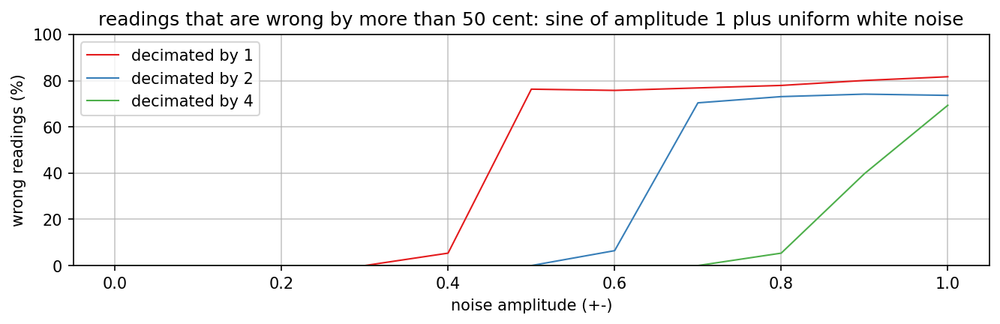
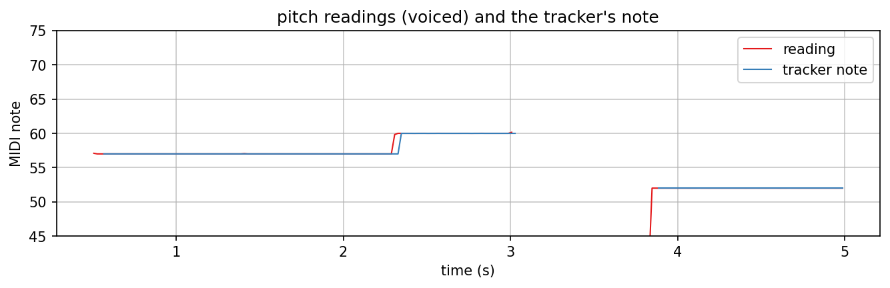
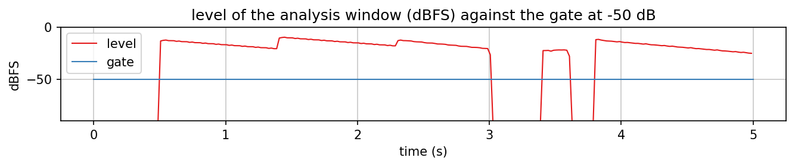

# yinpitch

Checks of `jp::YinPitchDetector` and `jp::PitchNoteTracker` (`dsp/Analysis/`) against the YIN paper
(de Cheveigne and Kawahara, JASA 111(4), 2002, https://doi.org/10.1121/1.1458024; `docs/references.md`
section 2), and the cost on the Dwarf. The detector reads the pitch of one monophonic voice once per hop; the
tracker turns the readings into note events. Nothing of this runs in a plugin yet.

Regenerate with `dev-scripts/dev-docs-plots.sh YinPitch` (program `YinPitchExplore.cpp`, data in `generated/`,
rendering in `plots.sh`). The numbers below are the program's `summary.txt` and the unit tests'
output; the device figures are `benchmark_dwarf.txt`, made by `YinDeviceBenchmark.cpp`.

## The algorithm in the code

The difference function d(t) of the newest window is divided by its own running mean (the cumulative mean
normalised difference function, CMNDF); the first dip below 0.1 is the period, and a dip is only taken once its
upper neighbour has been computed, so the search stops there (all lags are computed only when no dip qualifies).
The three tones above (a sine, a tone whose second and third harmonics are the strongest, a tone without its
fundamental) all show their first dip at 4.55 ms and later dips that are no deeper; the detector reads 220.002,
220.003 and 220.003 Hz with confidence 0.99998, 0.99992 and 0.99987. The tests run a sweep of fundamentals from
82 to 330 Hz through four such tones, at full rate and decimated, and every reading is within 15 cent of the
fundamental (no octave error).

Confidence is 1 - CMNDF at the chosen lag: a measure of periodicity, not a probability.

The window is the newest 2 x maxLag samples (1204 at 48 kHz, 25.1 ms); the difference function integrates over the
first maxLag of them and looks up to maxLag further. The reading is stamped with the end of that window
(`getLastWindowEnd()`), its centre is `getLatencySamples()` earlier (12.5 ms).

## Accuracy

Largest error of a sine over 80 Hz to 1 kHz in 3 % steps, after the first window: full rate 0.34 cent (at 958 Hz),
decimated by 2 1.40 cent (958 Hz), decimated by 4 5.85 cent (987 Hz). The error grows toward 1 kHz where the period
is 12 samples at the decimated rate and the parabola through the CMNDF is a coarse model of the dip. The budget of
the plan was 5 cent; decimated by 4 stays below 3 cent up to 760 Hz, reads 4.5 to 4.8 cent at 850 to 930 Hz and exceeds the
budget only at 987 Hz (5.85 cent). A pitch is
mapped to the nearest note (tolerance 50 cent in the tracker), so the figure only matters to a user of the
unquantised pitch.

A vibrato of 5 Hz and +-30 cent around 220 Hz is read, decimated by 4 and plotted at the centre of the window, as
-29.0 to +29.4 cent: the 25 ms window averages a little of it.

## A step of pitch

A window that contains both tones has no period: its readings are unvoiced (0 Hz) or wrong, and the tracker's
confidence gate drops them. The first reading whose window lies fully after the step comes 40 ms after the step
(window 25 ms, readings every 20 ms), full rate and decimated alike. The tracker needs three such readings
(`stableHops`), so a new note is announced 80 ms after a step of pitch (at the end of the window of its third
reading; the event is stamped with that window's centre, 12.5 ms earlier). In the phrase below the notes came 80 ms
(A3), 60 ms (C4) and 100 ms (E3, after a pick click) after their onsets and the re-pluck of A3 40 ms after: the
numbers a script has to expect from `OnNewPitch`.

## Noise

A sine of amplitude 1 plus uniform white noise: the dip of the CMNDF rises with the noise power, and once it
stays above the threshold the global minimum is taken, which lies at a multiple of the period about as often as at
the period. Readings that are wrong by more than 50 cent (6 seeds of 0.75 s each): full rate 5 % at a noise
amplitude of +-0.4 and 76 % at +-0.5, decimated by 2 6 % at +-0.6 and 70 % at +-0.7, decimated by 4 0 % up to
+-0.7, 5 % at +-0.8 and 40 % at +-0.9. The decimating lowpass (4th order, 0.4 of the decimated rate) removes
the noise above it before the difference function sees it, so decimation is also the more robust variant for a
signal with a noise floor. At +-0.5 the signal to noise ratio is about 8 dB. This is the failure mode of the
threshold rule; the paper's step 6 and the usual remedies (several thresholds, a smoothing over readings) are not
part of this detector, the tracker's confidence minimum (0.85) and its stability rule take the rest.

Level matters too: AbacDsp's version added the convention d(0) = 1 to the cumulative sum, which for input far
below full scale dominates it and lowers the CMNDF everywhere, so quiet noise looks periodic. The sum starts at
lag 1 here; the test runs sines and noise at amplitudes 1e-2, 1e-3 and 1e-4 and finds the sine and no pitch in the
noise.

## The note tracker

The phrase: a noise floor of about -84 dBFS (uniform, amplitude 1e-4), A3 plucked at 0.5 s and again at 1.4 s (decay of 0.9 s), C4 at 2.3 s
(A3 cut), silence from 3.0 s, a noise burst of 0.2 s at 3.4 s, E3 at 3.8 s with a 1.9 kHz pick click at its start.
The tracker reports (time of the window centre): note 57 (A3) at 0.57 s, note 57 again at 1.43 s (the re-pluck, a
level rise of 6 dB over the lowest level since the onset), note 60 (C4) at 2.35 s, release at 3.05 s, note 52 (E3)
at 3.89 s. The noise burst gives no event: the highest confidence of a reading in it is 0.25 (the minimum is 0.85). The rules and their
starting values (`PitchNoteTrackerSettings`): level above -50 dBFS, confidence above 0.85, three readings within 50
cent make a note, a reading within 0.65 semitone of the playing note belongs to it, three unvoiced readings end it,
a rise of 6 dB over the lowest level since the onset strikes it again. The unit tests have one case per rule and
were checked by mutation (stability count, hysteresis band, release count, tolerance, retrigger).

The detector is monophonic: two notes at once give a window with no single period (the first phrase tried here
overlapped A3 and C4 and the tracker released A3 early).

## Cost on the Dwarf

Built and run as described in `docs/working-with-claude-code.md` ("Timing DSP on the device"): cross-compiled in the
container, `scp -O` to `/tmp` on the Dwarf, run over ssh, removed.

`benchmark_dwarf.txt`: microseconds per block of 128 frames (period 2667 us) on the Cortex-A35, GCC 9.4 with the
toolchain's flags at -O3, 8 s of input, the first 400 blocks left out. Selected rows at a hop rate of 50 Hz
(the default); the file has 20 Hz as well and all three inputs.

| Input | Variant | mean | p99 | share of the period (mean / p99) |
|---|---|---|---|---|
| tone 82 Hz | AbacDsp detector as published | 1812 us | 14132 us | 68 % / 530 % |
| tone 82 Hz | full rate (linear indexing, early exit) | 144 us | 1273 us | 5.4 % / 48 % |
| tone 82 Hz | decimated by 2 | 45 us | 516 us | 1.7 % / 19 % |
| tone 82 Hz | decimated by 4 | 19 us | 136 us | 0.7 % / 5.1 % |
| noise | decimated by 4 | 19 us | 140 us | 0.7 % / 5.2 % |
| tone 1 kHz | decimated by 4 | 9 us | 27 us | 0.3 % / 1.0 % |

The detector as published costs more than five block periods in the block that holds a reading, which the audio
thread cannot afford; the noise and the 82 Hz tone are the worst cases (no early exit, longest lags). Decimated by 4
the worst block with a reading costs 5 % of the period and the mean 0.7 % (derived from the block times, about 0.7
points of mod-ui's DSP load, not measured through mod-ui); at a hop rate of 20 Hz the mean is 11 to 12 us and the
p99 74 to 82 us. The maximum column shows the scheduler's noise (the 1 kHz tone, where almost nothing is computed,
has maxima of 150 to 500 us).

**Decision D2 of the plan: the detector runs on the audio thread, decimated by 4, hop 50 Hz** (criteria: worst block
at most 10 % of the period, mean at most 1 point at 50 Hz, accuracy within 5 cent: the first two hold with margin,
the third up to about 950 Hz). Decimated by 2 fails the mean (1.7 %) and the worst block (19 %). Time slicing (the lags of a reading
spread over the next hop) was built and measured in an earlier revision of the program: decimated by 4 it lowered
the 99th percentile on a tone from 106 us to 35 us and raised the mean by 1 us, at full rate it lowered the
spike from 1.4 ms to 0.57 ms and raised nothing, but cost 150 us per block on average. As decimation by 4 alone
meets the criteria it was removed again.

Not measured: the detector inside a plugin next to the other work of the block (Ship Ahoy costs 1.8 points on its own);
`tools/jp.py perf` does that in step 5.
